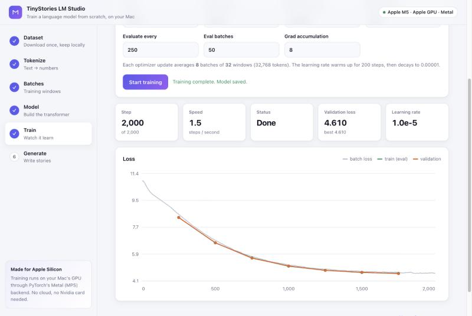
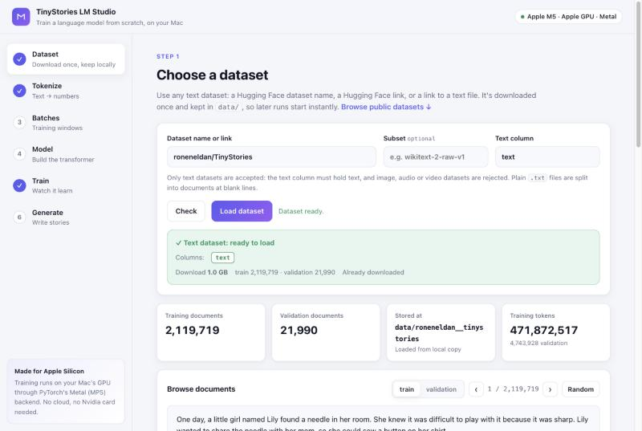
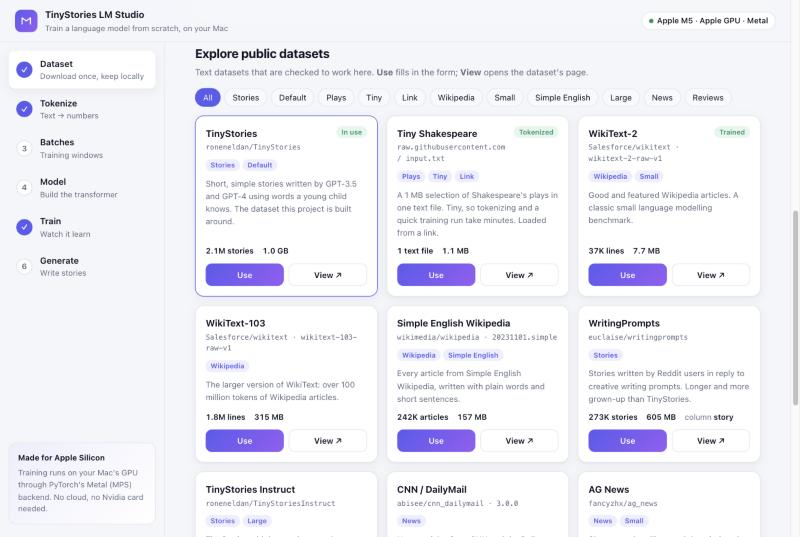
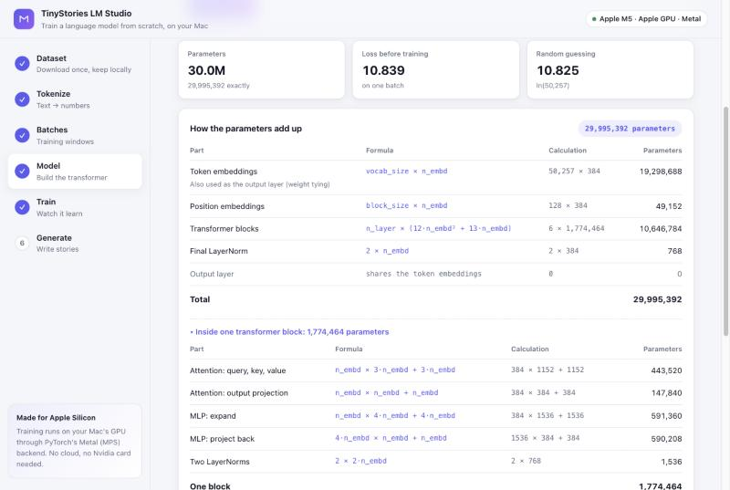
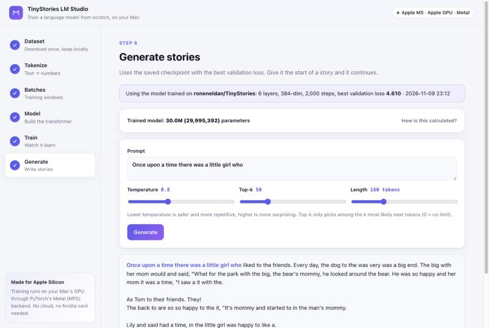
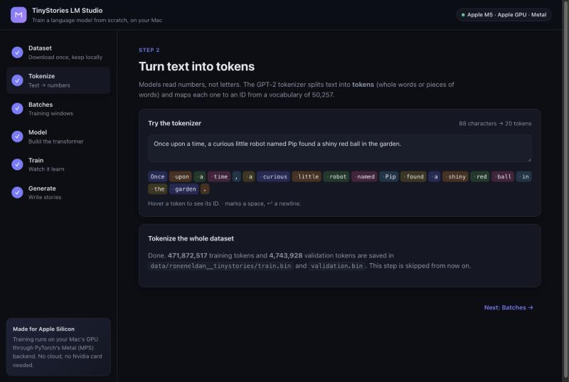

# TinyStories ARM: train a language model on your Apple Silicon Mac


-ee4c2c?logo=pytorch&logoColor=white)

[](https://colab.research.google.com/github/a-ramakrishnan/tinystories-ARM-model/blob/main/train_step_by_step.ipynb)

**Built for Apple Silicon.** Build a small GPT-style language model (~30M parameters) from scratch in PyTorch
and train it on your Mac's own GPU, step by step, in a local web app. No cloud, no Nvidia card.



## About

**TinyStories ARM** is an open-source, beginner-friendly project for **training a small language model (SLM)
from scratch on a Mac with Apple Silicon** (M1, M2, M3, M4 and M5). It implements a **GPT-style decoder-only
transformer** in **PyTorch**, trains it on the Mac's GPU through **Metal Performance Shaders (MPS)**, and
shows every stage of the **LLM training pipeline** in a local web app:

1. **Data**: download a text dataset from **Hugging Face** (or any text file link) and keep it locally.
2. **Tokenization**: convert text to token IDs with the **GPT-2 BPE tokenizer** (`tiktoken`).
3. **Batching**: cut the token stream into fixed-length context windows for **next-token prediction**.
4. **Model**: a **transformer** with **causal self-attention**, MLP blocks, LayerNorm and weight tying, with a
   line-by-line **parameter count**.
5. **Pre-training**: **AdamW**, linear warmup and **cosine learning-rate decay**, gradient accumulation and
   gradient clipping, with live **training and validation loss curves**.
6. **Inference**: **text generation** with temperature and top-k sampling.

The default dataset is [TinyStories](https://huggingface.co/datasets/roneneldan/TinyStories), 2.1 million
short stories in simple English. The research behind it showed that even very small models can learn to
write coherent English when trained on simple text, which makes it ideal for **on-device AI training**
on a laptop. The code is adapted from Andrej Karpathy's **nanoGPT** and kept small and readable, so it
doubles as a hands-on **machine learning tutorial**: learn how **large language models (LLMs)** work by
building and training one yourself, locally and privately on your own **MacBook, Mac mini, iMac or
Mac Studio**.

**Keywords:** small language model · train LLM from scratch · GPT from scratch · PyTorch MPS · Apple Silicon
machine learning · M1/M2/M3/M4/M5 GPU training · local LLM training on Mac · transformer tutorial ·
TinyStories · nanoGPT · tokenization · Hugging Face datasets · deep learning on macOS

## Three ways to use it

| | What it is | Best for |
|---|---|---|
| **Web app** · `python3 app/server.py` | A local, step-by-step studio in your browser with live training charts | Learning how it works, experimenting |
| **Command line** · `python3 full-model.py` | Runs the whole pipeline in one go | Long training runs |
| **Colab notebook** · badge above | The same steps as a notebook on Colab's free GPU | Trying it without a Mac |

## Made for Apple Silicon

- **Trains on the Mac GPU.** The device is picked automatically, and on M-series Macs that's the GPU through
  PyTorch's Metal backend (MPS). The app and the script both show it at startup:
  `Training on device: mps (float32)`.
- **No extra setup.** The standard `pip install torch` already includes Metal support on macOS.
- **Full precision on MPS.** Training uses float32 on the Mac. Mixed precision is only switched on for CUDA,
  where it's well supported.
- **Unified memory.** The default model and batch size train comfortably on a 16 GB Mac.
- **Measured speed.** On an M5 with 16 GB, the default model trains at about **2 steps per second**
  (32 × 128 tokens per step). The *Quick* preset (2,000 steps) takes roughly 20 minutes and brings the
  validation loss from 10.8 down to about 4.6. The full run (20,000 steps) takes several hours.

It also runs on an Nvidia GPU (CUDA, with mixed precision) or the CPU, but the Mac is what it's built and
tested on.

Check that PyTorch can see your Mac's GPU:

```bash
python3 -c "import torch; print('MPS available:', torch.backends.mps.is_available())"
```

## Quick start (Mac)

Requires an Apple Silicon Mac (M1 or later) and Python 3.9+.

```bash
git clone https://github.com/a-ramakrishnan/tinystories-ARM-model.git
cd tinystories-ARM-model
pip install -r requirements.txt
```

### Web app (recommended)

```bash
python3 app/server.py
```

It opens http://127.0.0.1:8000 in your browser. The sidebar walks through six steps:

1. **Dataset**: type a Hugging Face dataset name, paste a link, or pick one from the gallery of public
   datasets. **Check** validates it before anything is downloaded. Then browse its documents.
2. **Tokenize**: type text and see it split into tokens live, then tokenize the whole dataset with a
   progress bar.
3. **Batches**: sample a batch and see how each target is the input shifted by one token.
4. **Model**: choose layers, heads and embedding size; see the parameter count with the formula behind
   every part, the architecture, and the untrained model's gibberish.
5. **Train**: pick *Quick*, *Full* or custom settings and watch loss, speed, time left and learning rate
   update live. You can stop at any time and keep what's been learned.
6. **Generate**: write a prompt and tune temperature, top-k and length.

Options: `--port 8080` to use another port, `--no-browser` to skip opening a browser tab. A step can be
opened directly with a link such as http://127.0.0.1:8000/#train.

### Command line

```bash
python3 full-model.py
```

Training takes hours, so keep the Mac awake and save a log:

```bash
caffeinate -i python3 full-model.py 2>&1 | tee train.log
```

The loss plot window **pauses the script** until you close it; generation runs after that.

## Screenshots

| Choose and validate a dataset | Explore public datasets |
|---|---|
|  |  |
| **See how 29,995,392 parameters add up** | **Generate a story after a 20-minute Quick run** |
|  |  |
| **Live tokenizer (dark mode)** | **Live training chart** |
|  |  |

## Choosing a dataset

TinyStories is the default, but any text dataset works. A dataset can be given as:

| Form | Example |
|---|---|
| Hugging Face name | `Salesforce/wikitext` (plus subset `wikitext-2-raw-v1`) |
| Hugging Face link | `https://huggingface.co/datasets/roneneldan/TinyStories` |
| Link to a text file | `https://raw.githubusercontent.com/karpathy/char-rnn/master/data/tinyshakespeare/input.txt` |

File links can point to `.txt`, `.jsonl`, `.json`, `.csv` or `.parquet` files. GitHub
page links are converted to the raw file automatically. Plain `.txt` files are split into documents at
blank lines.

From the command line:

```bash
python3 full-model.py --dataset Salesforce/wikitext --dataset-config wikitext-2-raw-v1
python3 full-model.py --dataset https://raw.githubusercontent.com/karpathy/char-rnn/master/data/tinyshakespeare/input.txt
python3 full-model.py --list-datasets
```

| Option | Meaning | Default |
|---|---|---|
| `--dataset` | Hugging Face name or link, or a link to a text file | `roneneldan/TinyStories` |
| `--dataset-config` | Subset name, for datasets that have them | none |
| `--text-column` | Column holding the text | `text` |
| `--list-datasets` | Print the public datasets below with ready-to-run commands | |

In the web app, enter the same values in step 1. In the notebook, they're the form fields in Step 1.

### Text-only validation

Datasets are checked before anything is downloaded, using the dataset's metadata:

- Datasets with **image, audio or video** columns are rejected.
- The chosen column must exist and hold **text** (not numbers or labels). If it doesn't, the message lists
  the text columns that do exist.
- Datasets with several **subsets** list them so you can pick one (in the web app, as clickable buttons).
- **Links** must be reachable and point to a data file, not a web page.
- After downloading, the first rows are checked to make sure they hold **readable text**.

### Public datasets that work out of the box

Each of these was checked with the validation above. The web app shows them as a gallery with **Use** and
**View** buttons.

| Dataset | What it is | Size | Use with |
|---|---|---|---|
| [TinyStories](https://huggingface.co/datasets/roneneldan/TinyStories) | Simple short stories (the default) | 2.1M stories · 1.0 GB | `--dataset roneneldan/TinyStories` |
| [Tiny Shakespeare](https://github.com/karpathy/char-rnn/tree/master/data/tinyshakespeare) | A 1 MB selection of Shakespeare's plays | 1 text file · 1.1 MB | `--dataset https://raw.githubusercontent.com/karpathy/char-rnn/master/data/tinyshakespeare/input.txt` |
| [WikiText-2](https://huggingface.co/datasets/Salesforce/wikitext) | Good and featured Wikipedia articles | 37K lines · 7.7 MB | `--dataset Salesforce/wikitext --dataset-config wikitext-2-raw-v1` |
| [WikiText-103](https://huggingface.co/datasets/Salesforce/wikitext) | Over 100M tokens of Wikipedia | 1.8M lines · 315 MB | `--dataset Salesforce/wikitext --dataset-config wikitext-103-raw-v1` |
| [Simple English Wikipedia](https://huggingface.co/datasets/wikimedia/wikipedia) | Every Simple English Wikipedia article | 242K articles · 157 MB | `--dataset wikimedia/wikipedia --dataset-config 20231101.simple` |
| [WritingPrompts](https://huggingface.co/datasets/euclaise/writingprompts) | Stories written for Reddit writing prompts | 273K stories · 605 MB | `--dataset euclaise/writingprompts --text-column story` |
| [TinyStories Instruct](https://huggingface.co/datasets/roneneldan/TinyStoriesInstruct) | TinyStories with instructions | 21.8M lines · 2.7 GB | `--dataset roneneldan/TinyStoriesInstruct` |
| [CNN / DailyMail](https://huggingface.co/datasets/abisee/cnn_dailymail) | News articles | 287K articles · 837 MB | `--dataset abisee/cnn_dailymail --dataset-config 3.0.0 --text-column article` |
| [AG News](https://huggingface.co/datasets/fancyzhx/ag_news) | News headlines and descriptions | 120K articles · 20 MB | `--dataset fancyzhx/ag_news` |
| [IMDB Reviews](https://huggingface.co/datasets/stanfordnlp/imdb) | Movie reviews | 25K reviews · 83 MB | `--dataset stanfordnlp/imdb` |
| [Rotten Tomatoes](https://huggingface.co/datasets/cornell-movie-review-data/rotten_tomatoes) | One-sentence review snippets | 8.5K sentences · 0.5 MB | `--dataset cornell-movie-review-data/rotten_tomatoes` |

Sizes are download sizes reported by Hugging Face. Find more on the
[Hugging Face datasets hub](https://huggingface.co/datasets?modality=modality:text&sort=trending).

### Where datasets are stored

Each dataset is downloaded once and kept in its own folder, with its own tokens and trained model, so
switching back and forth doesn't redo any work. A `validation`, `valid`, `val` or `test` split is used for
validation; if there isn't one, a small slice of `train` is held out.

```
data/
└── roneneldan__tinystories/
    ├── dataset/               local copy of the downloaded dataset (~1.8 GB for TinyStories)
    ├── train.bin              token IDs for training (~900 MB for TinyStories)
    ├── validation.bin         token IDs for validation
    ├── best_model_params.pt   best weights from training
    └── model_config.json      model settings and training summary for those weights
```

`data/` is git-ignored, so none of this is committed.

## How many parameters?

The default model has **29,995,392** parameters. The web app shows this table for whatever size you build:

| Part | Formula | Default model |
|---|---|---|
| Token embeddings | `vocab_size × n_embd` | 50,257 × 384 = 19,298,688 |
| Position embeddings | `block_size × n_embd` | 128 × 384 = 49,152 |
| Transformer blocks | `n_layer × (12·n_embd² + 13·n_embd)` | 6 × 1,774,464 = 10,646,784 |
| Final LayerNorm | `2 × n_embd` | 768 |
| Output layer | shares the token embeddings (weight tying) | 0 |
| **Total** | | **29,995,392** |

Inside each block: query/key/value projection `n_embd × 3·n_embd + 3·n_embd`, attention output
`n_embd² + n_embd`, MLP expand `n_embd × 4·n_embd + 4·n_embd`, MLP project back `4·n_embd × n_embd + n_embd`,
and two LayerNorms `2 × 2·n_embd`. These add up to `12·n_embd² + 13·n_embd`. The calculation is in
`param_breakdown()` in [model.py](model.py), and it matches PyTorch's own count.

Almost two thirds of the parameters are the token embeddings: with a 50,257-word vocabulary, a small model
spends most of its size on knowing words.

## What happens on each run

| Step | Module | First run | Later runs |
|---|---|---|---|
| 1. Get the dataset | `data.py` | Validates, downloads and saves a local copy | Loads the local copy |
| 2. Tokenize | `tokenization.py` | Converts every document to GPT-2 token IDs | Skipped |
| 3. Batches | `data.py` | Samples random 128-token windows | Same (fresh batches every run) |
| 4. Train | `pretrain.py` | Trains and saves the best weights | Same |
| 5. Plot | `plots.py` | Training and validation loss | Same |
| 6. Generate | `inference.py` | Writes text from the prompts | Same |

## Project structure

```
full-model.py              Command-line entry point: model config, --dataset options, runs every step
app/
  server.py                Web app backend (FastAPI): runs the steps and reports live progress
  static/                  Web app front end (HTML, CSS, JavaScript; no build step)
data.py                    Dataset sources (names, links, files), text-only validation, local caching, BatchLoader
catalog.py                 Public text datasets shown in the gallery and by --list-datasets
tokenization.py            GPT-2 tokenizer and writing train.bin / validation.bin
model.py                   GPT architecture, param_breakdown() and estimate_loss()
train_config.py            TrainConfig hyperparameters and setup_device() (MPS / CUDA / CPU)
pretrain.py                Training loop: AdamW, warmup + cosine LR schedule, gradient accumulation
plots.py                   Loss curves
inference.py               Load a checkpoint and generate text
train_step_by_step.ipynb   Notebook version for Google Colab
docs/screenshots/          Screenshots used in this README
```

## Configuration

### Model size: `full-model.py`

```python
config = GPTConfig(
    vocab_size=50257,   # GPT-2 tokenizer
    block_size=128,     # context window (tokens)
    n_layer=6,          # transformer blocks
    n_head=6,           # attention heads per block
    n_embd=384,         # embedding size
    dropout=0.1,
    bias=True
)
```

### Training: `train_config.py`

| Setting | Default | Meaning |
|---|---|---|
| `max_iters` | 20000 | Training steps |
| `learning_rate` | 1e-4 | Peak learning rate |
| `min_lr` | 1e-5 | Learning rate at the end of the cosine decay |
| `warmup_steps` | 1000 | Steps of linear warmup |
| `batch_size` | 32 | Sequences per batch |
| `gradient_accumulation_steps` | 32 | Batches averaged per optimizer update |
| `eval_interval` | 500 | Evaluate every N steps |
| `eval_iters` | 500 | Batches per evaluation |
| `weight_decay` | 0.1 | AdamW weight decay |
| `grad_clip` | 0.5 | Gradient norm clipping |

The web app's *Quick* preset uses 2,000 steps, 200 warmup, evaluation every 250 steps over 50 batches, and
gradient accumulation of 8. *Full* uses the defaults above.

## Generating text from a trained model

The web app's Generate step does this for you. From Python:

```python
from data import dataset_paths
from inference import generate_text, load_model, load_model_config
from tokenization import get_tokenizer
from train_config import setup_device

paths = dataset_paths("roneneldan/TinyStories")          # same name (and subset) you trained on
config, info = load_model_config(paths.model_config)
dev = setup_device()
model = load_model(config, paths.checkpoint, dev.device)

print(generate_text(model, get_tokenizer(), "Once upon a time there was a dragon who",
                    dev.device, max_new_tokens=200, temperature=0.8, top_k=50))
```

- `temperature`: lower is more predictable, higher is more varied.
- `top_k`: only sample from the `k` most likely next tokens (`None` for no limit).

## No Mac? Use Colab

Click the **Open in Colab** badge, choose *Runtime → Change runtime type → T4 GPU*, and run the cells from
top to bottom. The notebook clones this repository, installs the dependencies, and walks through the same
steps as the web app, with form fields for the settings and the dataset.

## Credits

- Data loading and the model are adapted from Andrej Karpathy's [nanoGPT](https://github.com/karpathy/nanoGPT).
- Default dataset: [TinyStories](https://huggingface.co/datasets/roneneldan/TinyStories) by Ronen Eldan and
  Yuanzhi Li.
- Thanks to Claude for all the help in refactoring, UI and writing readme etc.

## License

[MIT](LICENSE)
