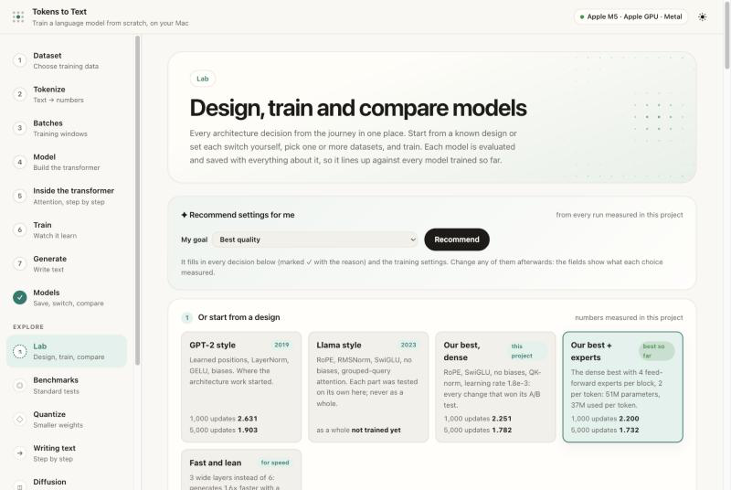

# TinyStories ARM: train a language model on your Apple Silicon Mac


-ee4c2c?logo=pytorch&logoColor=white)

[](https://colab.research.google.com/github/a-ramakrishnan/tinystories-ARM-model/blob/main/train_step_by_step.ipynb)

**▶ Live site: [a-ramakrishnan.github.io/tinystories-ARM-model](https://a-ramakrishnan.github.io/tinystories-ARM-model/)**:
[chat with the model in your browser](https://a-ramakrishnan.github.io/tinystories-ARM-model/try.html), no install.

**Built for Apple Silicon.** Build a small GPT-style language model from scratch in PyTorch and train it on
your Mac's own GPU, step by step, in a local web app. See inside the transformer as it works: watch one
token flow through a block, step by step, with your model's real attention weights, feed-forward layer and
next-token probabilities. No cloud, no Nvidia card.



> **Website:** [a-ramakrishnan.github.io/tinystories-ARM-model](https://a-ramakrishnan.github.io/tinystories-ARM-model/)
> has the docs, the Journey timeline, a side-by-side replay of the GPT and the diffusion model,
> [**AR vs diffusion**](https://a-ramakrishnan.github.io/tinystories-ARM-model/compare.html) (the two 124M models
> compared), and **Try it**: the 124M chat model running in your browser.
>
> **Run the models anywhere:** the 124M base and chat models are on Hugging Face in standard formats
> ([base](https://huggingface.co/aramkris/fineweb-edu-124m-base-qwen3),
> [chat](https://huggingface.co/aramkris/fineweb-edu-124m-chat-dpo-qwen3)), so `transformers`, llama.cpp, Ollama and
> LM Studio run them: `ollama run hf.co/aramkris/fineweb-edu-124m-chat-dpo-qwen3:Q8_0`.
>
> **New here?** [From a training script to a working language model](docs/journey.md) tells the story of this
> project: where it started, every change made to the model and the inference, why each one worked, and what
> it measured. It's the best place to learn from. In the app, the **Journey** page shows the same story as a
> timeline, and the **Lab** page lets you design, train and compare models with every architecture switch.

## About

Live site: **[a-ramakrishnan.github.io/tinystories-ARM-model](https://a-ramakrishnan.github.io/tinystories-ARM-model/)**
(the docs, the Journey, the Explorer and [Try it](https://a-ramakrishnan.github.io/tinystories-ARM-model/try.html), the
model running in your browser).

**TinyStories ARM** is an open-source, beginner-friendly project for **training a small language model (SLM)
from scratch on a Mac with Apple Silicon** (M1, M2, M3, M4 and M5). It implements a **GPT-style decoder-only
transformer** in **PyTorch**, trains it on the Mac's GPU through **Metal Performance Shaders (MPS)**, and
explains every stage of the **LLM training pipeline** in a local web app: data, tokenization, batching, the
model, attention, pre-training, inference and evaluation (see
[Understanding the components](docs/components.md#the-pipeline-at-a-glance)).

The default dataset is [Mini FineWeb-Edu](https://huggingface.co/datasets/BaoMinhTran/mini-fineweb-edu)
(its `small` subset, ~500M tokens), educational web pages filtered from Common Crawl for teaching value: the
same kind of data modern small language models are pre-trained on. The project started with
[TinyStories](https://huggingface.co/datasets/roneneldan/TinyStories), 2.1 million short stories in simple
English, which is still one click away. The research behind it showed that even very small models can learn
to write coherent English when trained on simple text, which makes it ideal for **on-device AI training** on
a laptop. The code is adapted from Andrej Karpathy's **nanoGPT** and kept small and readable, so it
doubles as a hands-on **machine learning tutorial**: learn how **large language models (LLMs)** work by
building and training one yourself, locally and privately on your own **MacBook, Mac mini, iMac or
Mac Studio**.

It also has a second kind of model: a **masked diffusion language model** ([`diffusion_models/`](diffusion_models/README.md)),
which writes by denoising instead of left to right: the text starts as all `[MASK]` and a bidirectional transformer
fills in a few positions per step. It's trained on Colab with
[its own notebook](https://colab.research.google.com/github/a-ramakrishnan/tinystories-ARM-model/blob/main/diffusion_models/diffusion_colab.ipynb),
on the same data and tokenizer as the autoregressive models, and the app's **Diffusion** page replays its denoising
step by step.

## At a glance

| | Result |
|---|---|
| Fixing the training set-up (story separators, enough updates, learning rate, context) | validation loss 4.527 → **2.214** with a model half the size |
| Better decoding (the Balanced default) | repeated 4-token runs 73% → **0%** |
| Modern architecture changes, one at a time (RoPE, SwiGLU, no biases, QK-norm, learning rate, experts) | 2.631 → **2.200** (Small model, 1,000 updates) |
| All of them over a longer run, on TinyStories / on Mini FineWeb-Edu | 1.903 → **1.732** / 4.495 → **4.143** (5,000 updates) |
| Winning back generation speed (no hidden waits for the GPU, batched experts) | **1.8–3.5×** faster generation, identical output |
| Adding more kinds of data (Cosmopedia stories, how-to, textbooks) and a 512-token context | held-out web text 3.691 → **3.549**, greedy repetition 75% → **25%** |
| Standard benchmarks vs OpenAI's GPT-2 small (zero-shot) | ARC-Easy **44.0%** vs 43.8%, PIQA **62.6%** vs 62.9%, HellaSwag **29.7%** vs 31.1%, LAMBADA **15.7%** vs 32.6% ([details](docs/analysis.md#standard-benchmarks)) |
| A masked diffusion model (51M, 164M tokens of TinyStories), against the autoregressive model of the same size | likelihood bound **2.525** vs loss 1.583; coherent stories once the sampler keeps revealed tokens |
| Diffusion text without loops: a repetition penalty while denoising | repeated 4-token runs on FineWeb-Edu 43% → **4%** (real text 0%) |
| The FineWeb-Edu diffusion model trained 3× longer (492M tokens, 145 min on an L4) | likelihood bound 5.269 → **4.729**; more fluent text (judge loss 3.62 → 3.01) |
| Benchmarks for diffusion models (each choice scored by its likelihood bound) | TinyStories: at chance like the autoregressive model of the same size, but LAMBADA 1.8% vs 8.7%; FineWeb-Edu: ARC-Easy **31.2%** |
| A diffusion model the size of the base, on the stage 2 data (124M, 1B tokens, 2 h 8 min on an A100) | likelihood bound 4.729 → **3.923** (stage 2 AR model's loss on the same text: 2.963); LAMBADA 2.2% → **11.8%**, benchmark average 32.4 → 34.8 (AR: 42.3) |
| The same diffusion model extended to 2.5B tokens, the base model's own budget | likelihood bound 3.923 → **3.830**; LAMBADA 11.8% → **14.4%**, average 34.8 → **35.4** |
| Autoregressive vs diffusion, like for like (124M, same data, tokens and tokenizer; [F4](docs/journey.md#38-two-ways-to-write-compared-f4)) | on the same held-out web text, loss **3.296** vs bound 4.148 (gap 0.85, as at 51M); at equal speed GPT-2 judges the AR text far better (2.98 vs 4.48) |
| Instruction tuning on 409K smol-smoltalk conversations (90 min on an L4): a Chat mode | loss on held-out answers 2.437 → **1.548**; it answers instead of writing blog posts, at a cost of 3 benchmark points |
| DPO against repetition: the reference answer preferred to the chat model's own greedy one, 2,000 pairs (21 min on the Mac) | greedy repetition on held-out questions 20.0% → **11.2%**, answers that end 59% → **84%**; held-out answer loss 1.548 → 1.617 |
| Instruction tuning redone on the stage 2 base (20 min on an A100) | held-out answer loss **1.390** (was 1.548); greedy repetition on held-out questions **12.4%** (was 20.0%), with no DPO yet |
| DPO redone on the stage 2 chat model (19 min on the Mac) | greedy repetition on held-out questions 12.4% → **6.5%**, answers that end 70% → **86%**; benchmarks unchanged |
| Instruction tuning without forgetting: a gentler learning rate and a fifth of each batch from the pre-training data (25 min on an A100) | closed-book facts 44.0% → **50.0%** (base 57.5%), benchmark average 37.7 → **40.3** (base 41.5); answer loss 1.390 → 1.448; with DPO on top: greedy repetition **8.5%**, answers that end **87%**, benchmark average **40.5** (old chat model 37.7) |
| A reward model as the judge: DPO on pairs of the chat model's own answers, the best and worst of seven by Skywork-Reward-V2-Qwen3-0.6B (17 min on the Mac) | greedy repetition 8.5% → **2.3%**, answers that end 87% → **99%**, facts and benchmark average unchanged (40.5); the served chat model |
| A yardstick: OpenAI's GPT-2 small (124M) on held-out web text | **3.401**, against **3.549** for our same-size model (500M tokens of training) |
| Stage 2: five times the data (2.5B tokens of FineWeb-Edu full + Cosmopedia, continued from the base; the last 74K steps on an A100, 5× an L4) | held-out web text 3.549 → **3.296** (GPT-2 small 3.401); benchmark average 40.4 → **42.3** (GPT-2 44.4): HellaSwag **32.3%**, ARC-Easy **46.8%**, LAMBADA 20.3% |

Details in [Analysis](docs/analysis.md) and [the journey](docs/journey.md).

## Quick start (Mac)

Requires an Apple Silicon Mac (M1 or later) and Python 3.9+.

```bash
git clone https://github.com/a-ramakrishnan/tinystories-ARM-model.git
cd tinystories-ARM-model
pip install -r requirements.txt
python3 app/server.py
```

It opens the web app at http://127.0.0.1:8000. For the command line, the Colab and Kaggle notebooks, datasets,
saved models and every option, see [How to use it](docs/usage.md).

## Documentation

| Page | What's in it |
|---|---|
| [How to use it](docs/usage.md) | The web app, the command line, datasets, the Lab, saved models and evaluation, generating text, resuming runs, configuration, Google Colab and Kaggle |
| [Understanding the components](docs/components.md) | The pipeline, inside the transformer, parameter counts, training, inference metrics, sampling and the KV cache, project structure |
| [Analysis](docs/analysis.md) | Measured results: getting better stories, every improvement step with its result, the roadmap, the Colab measurements |
| [Results](docs/results.md) | Every model's latest numbers (benchmarks, held-out loss, chat, diffusion), generated from the results store |
| [The journey](docs/journey.md) | The whole story, from the first commit to today, with the lessons learned |
| [The plan](docs/plan.md) | The roadmap: what's done, what's next, and who does it |
| [Diffusion models](diffusion_models/README.md) | The masked diffusion language model: its modules, the Colab runs, the sampler and its fixes |

**Keywords:** small language model · masked diffusion language model · train LLM from scratch · GPT from scratch · transformer attention
visualization · PyTorch MPS · Apple Silicon machine learning · M1/M2/M3/M4/M5 GPU training · local LLM training
on Mac · TinyStories · nanoGPT · tokenization · Hugging Face datasets · deep learning on macOS

## Credits

- Data loading and the model are adapted from Andrej Karpathy's [nanoGPT](https://github.com/karpathy/nanoGPT).
- Default dataset: [TinyStories](https://huggingface.co/datasets/roneneldan/TinyStories) by Ronen Eldan and
  Yuanzhi Li.
- Thanks to Claude for all the help in refactoring, UI and writing readme etc.

## License

[MIT](LICENSE)
