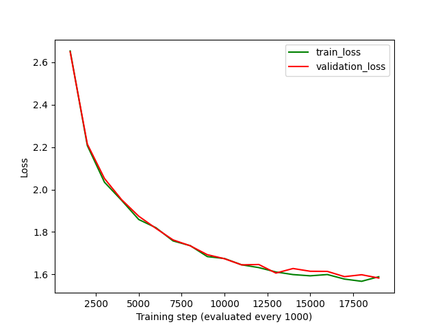
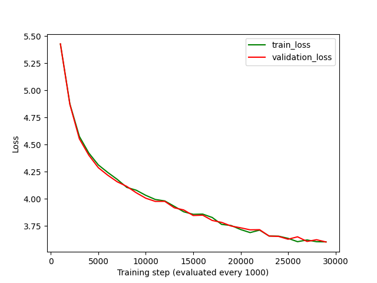
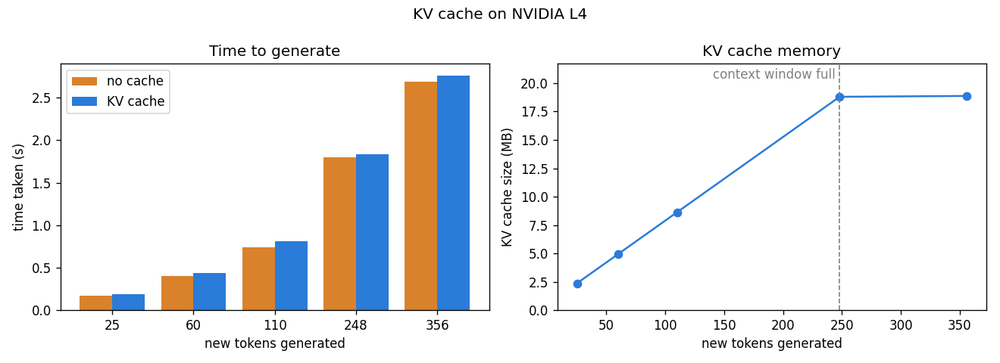
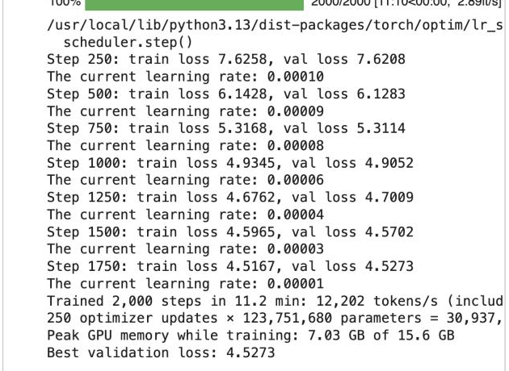
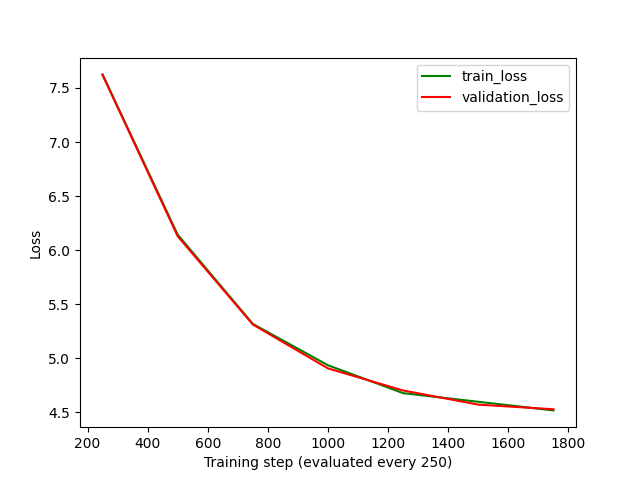

# Analysis: what was measured

The results behind the project: how the stories got better, every step taken to improve the model with its
measured result, and the plan from here. Every number was measured in this project, on an Apple M5 Mac or a
Colab GPU. For the story of how each decision was made, read [the journey](journey.md); in the web app, the
**Journey** page shows it as a timeline and the **Lab** page compares any of the models.

## Getting better stories

The first versions of this project produced stories like *"She was a big house. She wanted to go to a big
her mommy"*: grammatical fragments that never hold together. The model wasn't broken; it was badly
undertrained, and a few settings made every step count for much less than it should. These changes fixed it:

| Change | Before | Now | Why it matters |
|---|---|---|---|
| Separator between stories | none | `<|endoftext|>` after every story | Without it, stories ran straight into each other, so the model never learned where one ends and training windows spliced unrelated stories together. |
| Learning rate | `1e-4` → `1e-5` | `6e-4` → `6e-5` | `1e-4` is too low for small GPTs; nanoGPT uses `6e-4` for the 124M GPT-2. |
| Gradient accumulation | 8 (Quick), 32 (Full) | 1 | With accumulation, 2,000 steps gave only 250 weight updates (625 for 20,000). Now every step is an update. |
| Context window | 128 tokens | 256 tokens | Many stories are longer than 128 tokens, so the model couldn't see the beginning of the story it was writing. |
| Dropout | 0.1 | 0.0 | Train and validation loss were equal: the model was underfitting, not memorizing, so dropout only slowed it down. |
| Gradient clipping | 0.5 | 1.0 | The usual setting; 0.5 clipped normal updates. |
| Generation | ran to the length limit | stops at `<|endoftext|>` | A finished story ends instead of starting a new one mid-sentence. |

Token files made before the separator was added are detected (they have no `tokens.json`) and re-tokenized
automatically the next time a dataset is used.

### Measured: before and after

Both runs used TinyStories on a Colab **Tesla T4** (float16).

| | Old settings | New settings |
|---|---|---|
| Model | Large (124M) | Medium (51M) |
| Steps / optimizer updates | 2,000 / 250 | 20,000 / 20,000 |
| Validation loss at step 1,000 | 4.905 | **2.649** |
| Validation loss at step 2,000 | 4.527 | **2.214** |
| Best validation loss | 4.527 | **1.583** (step 19,000) |
| Training time | 11.2 min | 101.2 min (26,991 tokens/s, 8.56 GB peak GPU memory) |

The new settings beat the old ones at the same step even with a model less than half the size. Training
and validation loss stayed equal the whole way, so the model is still learning rather than memorizing, and
a longer run or a larger model would go lower still.



A story from the new model, generated on the Mac (MPS) from the prompt *"Once upon a time"*. It stopped by
itself at `<|endoftext|>`:

> Once upon a time, there was a little boy named Timmy. Timmy loved to play with his toys all day long. One
> day, he accidentally broke his favorite toy car. He was very sad and didn't know what to do.
>
> Timmy's mom saw him crying and asked him what was wrong. Timmy told his mom that he broke his toy car and
> he couldn't fix it. [...] But then, Timmy's mom made a present for him. She gave him a toy car to play
> with instead. Timmy was happy again and played with his new toy car all day long.

The stories now hold one plot and one set of characters from start to finish. Small slips remain, such as a
character changing name mid-story or a sentence that doesn't follow.

### Measured: Mini FineWeb-Edu, the new default

The **Large** model (123,849,984 parameters) trained on Mini FineWeb-Edu's `small` subset for **30,000
steps** on a Colab **NVIDIA L4** (bfloat16): 245.8 million tokens in **161.7 minutes** at 25,330 tokens/s,
with 11.1 GB of the L4's 23.7 GB at the peak.

| Step | 1,000 | 2,000 | 5,000 | 10,000 | 15,000 | 20,000 | 25,000 | 29,000 |
|---|---|---|---|---|---|---|---|---|
| Validation loss | 5.428 | 4.870 | 4.287 | 4.006 | 3.847 | 3.734 | 3.628 | **3.603** |

The best validation loss is **3.603** (perplexity about 37). That's much higher than TinyStories' 1.58, as
expected: educational web pages use a far bigger vocabulary and range of topics than children's stories.
Training and validation loss stayed equal throughout, and the loss was still falling at the end, so more
data, more steps or a bigger model would all help.



**Generated text, and why sampling settings matter.** The same model on the Mac (MPS), with the same seed:

> **Greedy** (69% of 4-token runs repeat earlier ones): *Photosynthesis is the process by which plants convert
> sunlight into energy. It is the process by which plants convert sunlight into energy. The process of
> photosynthesis is a process by which plants convert sunlight into energy. This process is called
> photosynthesis. The process of photosynthesis is called photosynthesis. The process of photosynthesis is
> called photosynthesis. …*

> **Balanced** (temperature 0.8, top-p 0.9, repetition penalty 1.15; 0% repeated): *Photosynthesis is the
> process of converting sunlight into energy. This process uses a variety of substances to produce a wide
> range of goods and services, from cars to cars to industrial plants. The process is responsible for
> producing more energy than you might think. It's important to note that not all energy-intensive
> chemicals are toxic and should be treated to ensure safety and efficacy. …*

> **Greedy** (74% repeated): *The French Revolution began in 1776 when the French Revolution was finally
> broken. The French Revolution was a major turning point in the French Revolution. The French Revolution
> was a major turning point in the French Revolution. …*

> **Balanced** (0% repeated): *The French Revolution began in the 17th century when France signed the French
> Crown. It was first issued a military service at its present time, and the French capital of Paris became
> the property of France. In 1775, King Charles I of France moved to France for a military service …*

Greedy decoding gets the first sentence right and then loops. With a small amount of randomness and a
repetition penalty, the model writes fluent, varied, encyclopedia-style English, but the facts are invented:
a 124M model trained on 246M tokens has learned how educational text *sounds*, not what is true.

**The KV cache on the L4** (Step 9 of the notebook, the same text both ways): here the cache was slightly
*slower*, 0.92× for short generations and 0.98× when filling the window. A data-center GPU runs this model's
small matrix multiplications so fast that each step is mostly fixed launch overhead, and the cache adds a
little bookkeeping. On the Apple M5 the same comparison saved 37% (see [The KV cache](components.md#the-kv-cache)). The
cache grows to 18.9 MB (73.7 KB per token in float32) when the 256-token window is full.



## Improving the model, step by step

The full story, with the reasoning and lessons behind each step, is in
[docs/journey.md](journey.md).

The steps taken so far to improve the model, and the ones planned next, in order. The rule from step 6 on:
**change one thing at a time**, train it the same way as the baseline, and compare with the
[evaluation suite](usage.md#the-evaluation-suite) before keeping it.

### Done

| # | Step | What changed | Result |
|---|---|---|---|
| 1 | **Fix undertraining** | `<\|endoftext\|>` between documents, learning rate 6e-4, no gradient accumulation, 256-token context, no dropout, clipping 1.0, stop at the end of a story ([details](#getting-better-stories)) | TinyStories validation loss after 2,000 steps: 4.527 → **2.214**, with a smaller model |
| 2 | **Train longer on a cloud GPU** | 20,000 steps of the Medium model on a Colab T4 | Loss **1.583**: coherent short stories ([before and after](#measured-before-and-after)) |
| 3 | **Harder, more realistic data** | Mini FineWeb-Edu as the default; the Large model for 30,000 steps on a Colab L4 | Loss **3.603** on educational web text ([results](#measured-mini-fineweb-edu-the-new-default)) |
| 4 | **Better decoding** | Top-p, min-p, repetition / frequency / presence penalties, greedy; **Balanced** (temperature 0.8, top-p 0.9, repetition penalty 1.15) as the default ([sampling](components.md#sampling-how-the-next-token-is-picked)) | The FineWeb model's repetition: **73% → 0%** of 4-token runs |
| 5 | **Keep every model, measure every model the same way** | A model library and a fixed evaluation suite ([saved models](usage.md#saved-models-and-evaluation)) | A baseline to beat: **3.603** on FineWeb, 5.257 on WikiText-2, 73% greedy repetition |
| 6 | **Resume training** | The full training state is saved at every evaluation; runs can be finished after an interruption or extended, in the app, on the command line and on Colab (with Google Drive) ([details](usage.md#resuming-and-extending-a-run)) | Tested on the Mac: a run stopped at step 25 resumed there and finished; a 60-step run extended to 90 kept its loss history and best checkpoint |
| 7 | **RoPE + a sliding KV cache** (A1, I1) | Rotary position embeddings instead of a learned position table (**Positions** in the Model step, `--rope`); with RoPE the KV cache is a ring buffer that slides past the window instead of being rebuilt ([the A/B](journey.md#11-architecture-step-one-rotary-positions-rope)) | Small model, 1,000 steps on TinyStories: validation loss 2.631 → **2.475**, lower on WikiText-2 and Shakespeare too, with 98k fewer parameters; past the window the cache is never rebuilt (1.14× → **1.47×** faster than no cache); past the window it approximates a full recompute rather than matching it exactly ([why](journey.md#11-architecture-step-one-rotary-positions-rope)) |
| 8 | **RMSNorm** (A2) | Scale-only normalization instead of LayerNorm (**Normalization** in the Model step, `--rmsnorm`) ([the A/B](journey.md#12-architecture-step-two-rmsnorm)) | **A tie**, on top of RoPE: validation loss 2.475 → 2.483, held-out WikiText-2 9.461 → 9.454; 5k fewer parameters and a ~17% faster training step on the Mac. Kept as an option |
| 9 | **SwiGLU feed-forward** (A3) | A gated feed-forward layer, `silu(xW) · xV`, 8/3 × wide instead of 4 × so the parameter count stays the same (**Feed-forward** in the Model step, `--swiglu`) ([the A/B](journey.md#13-architecture-step-three-a-gated-feed-forward-layer-swiglu)) | **A win**, on top of RoPE: validation loss 2.475 → **2.366**, held-out TinyStories 2.440 → **2.338**, the baseline's loss reached ~30% sooner; unseen datasets about the same; greedy repetition up (9% → 28%), Balanced 0% |
| 10 | **No biases** (A4) | No bias terms in linear layers or LayerNorms (**Biases** in the Model step, `--no-bias`) ([the A/B](journey.md#14-architecture-step-four-no-biases)) | **A tie**, on top of RoPE + SwiGLU: validation loss 2.366 → 2.365 with 29k fewer parameters; greedy repetition back to 7.5%, so the jump in step 9 was noise. Kept as an option |
| 11 | **QK-norm** (A5), and A/B tests on a cloud GPU | RMS-normalize each head's queries and keys before attention (**QK-norm** in the Model step, `--qk-norm`); `ab_test.py` and the notebook's A/B section run comparisons on Colab ([the A/B](journey.md#15-architecture-step-five-qk-norm-and-moving-the-ab-tests-to-a-gpu)) | **A small win**: 2.369 → 2.336 at 6e-4, 2.266 → 2.251 at 1.8e-3, less greedy repetition; no loss spikes at either rate. **Tripling the learning rate helped more** (2.369 → 2.266): 6e-4 is too low for these short runs. Each variant took 2½ min on an L4 vs ~25 on the Mac |
| 12 | **A learning-rate sweep** | 5 learning rates × QK-norm off/on, on a Colab L4 ([details](journey.md#16-a-learning-rate-sweep-and-what-qk-norm-is-really-for)) | **Best at 1.8e-3** (2.251 with QK-norm). Without QK-norm, loss rises to 3.33 at 1.2e-2; with it, only 2.55. The new baseline for A/B tests: RoPE + SwiGLU, no biases, QK-norm, lr 1.8e-3 |
| 13 | **Grouped-query attention** (A6) | Query heads share key/value heads (**Key/value heads** in the Model step, `--kv-heads N`); the KV cache stores only the shared heads ([the A/B](journey.md#17-architecture-step-six-grouped-query-attention)) | 3 KV heads: **cache 2× smaller for free** (2.251 → 2.252); 2: 3× smaller, +0.013; 1 (multi-query): 6× smaller, +0.033. No generation speedup at this size: the cache is tiny and the shared heads are copied out |
| 14 | **Depth vs width** (A7) | Four shapes at ~29.9M parameters: 3×448, 6×384, 11×320, 22×256 (`ab_test.py` `layers=`/`embd=`/`heads=`) ([the A/B](journey.md#18-architecture-step-seven-deep-and-thin-or-wide-and-shallow)) | **6×384 is best** at 1,000 updates (2.251); 3 and 11 layers 2.27; 22 layers 2.40 (slow start, still closing). The 3-layer model generates **5× faster** than the 22-layer one, with a 4× smaller KV cache |
| 15 | **Layer sharing** (A8) | Each block applied 2–3× in a row with the same weights (**Repeat each block** in the Model step, `--block-repeat N`) ([the A/B](journey.md#19-architecture-step-eight-layer-sharing)) | **Worse at this budget**: 2× sharing 2.251 → 2.346, 3× → 2.518; the wide model 2.271 → 2.345; and slower. Likely because shared weights get 2–3× the gradient (an effectively higher learning rate) and depth needs longer runs. Kept as an option |
| 16 | **Multi-token prediction** (A9) | Extra heads also predict 2–4 tokens ahead during training (**Tokens predicted** in the Model step, `--mtp N`) ([the A/B](journey.md#20-architecture-step-nine-predicting-several-tokens-at-once)) | **Worse at this size**: 2.251 → 2.336 (2 tokens), 2.490 (3), 2.536 (4), and slower to train, as Meta found for small models. The 2-ahead head agrees with the main head **51%** of the time: a candidate drafter for speculative decoding (I5) |
| 17 | **Mixture of experts** (A10) | Several feed-forward experts per block and a router that picks 1 or 2 per token (**Experts** / **Experts per token** in the Model step, `--experts N --experts-per-token K`) ([the A/B](journey.md#21-architecture-step-ten-a-mixture-of-experts)) | **4 experts, 2 per token: best so far, 2.251 → 2.200** (51M parameters, 37M active per token). 1 per token was worse (2.391 with 4 experts, 2.464 with 8): each expert sees too little data in 1,000 updates. Slower in this simple implementation (generation 132 → 66 tokens/s) |
| 18 | **All the wins together, over a longer run** | GPT-2 style vs the best dense and mixture-of-experts models, 5,000 updates each on a Colab L4 ([details](journey.md#22-putting-it-together-the-original-model-vs-all-the-wins)) | **1.903 → 1.782 (dense) → 1.732 (experts)**: learning rate 0.05, architecture 0.07, experts 0.05; the same quality in roughly 25–38% fewer updates. The cost: generation 232 → 132 tokens/s in this unfused implementation, the next thing to fix |
| 19 | **The same designs on Mini FineWeb-Edu** | GPT-2 style vs best dense vs best with experts, 5,000 updates on a Colab L4, launched from the Lab with `lab_run.ipynb` ([details](journey.md#23-the-same-designs-on-harder-data-mini-fineweb-edu)) | **4.495 → 4.206 → 4.143**: the gains double on web text (0.35 vs 0.17 on TinyStories); the dense best matches GPT-2 style's final loss in about 40% fewer updates |
| 20 | **OpenAI's GPT-2 as a yardstick** | `reference_gpt2.py` loads OpenAI's GPT-2 small (124M) weights into this project's GPT class and evaluates it on the same held-out windows; **Against GPT-2** in the Lab ([details](journey.md#24-a-yardstick-openais-gpt-2)) | Held-out Mini FineWeb-Edu: **GPT-2 3.401** vs our 124M GPT-2-style model 3.735 (246M tokens of training) and our best Small model 4.245. The gap is data: GPT-2 read billions of tokens |
| 21 | **Win back generation speed** (I0, I2, I8) | Cached RoPE tables, PyTorch's fused RMSNorm, all experts in two batched matrix products instead of a Python loop over experts; and no hidden waits for the GPU in the generation loop (a list index copied to the GPU, the token history grown on the GPU, several reads per token) ([details](journey.md#25-winning-back-generation-speed)) | Generation **1.8–3.5× faster, identical output** (M5, KV cache, greedy): experts 43 → **150** tokens/s, best dense 127 → **232**, GPT-2 style 123–165 → **292–309**. Half precision (I2): no faster at this size, and bfloat16 changes the greedy output after 11–38 tokens. A compiled one-token step (I8): +25–35% for the new designs, none for GPT-2 style; not adopted yet |
| 22 | **Speculative decoding** (I5) | `speculative_generate` in inference.py: a small model drafts k tokens, the large one checks them in one pass (a KV cache that takes several tokens and rolls back the rejected ones); greedy, or sampled with the rejection rule that keeps the target's distribution ([details](journey.md#25-winning-back-generation-speed)) | **Identical output** in every test; 50–90% of drafted tokens accepted, up to 3.7 tokens per pass of the large model. **But barely faster here**: 0.8–1.07× for Medium (51M) with a 4-layer drafter, 0.8–1.0× for our Large, at best 1.33× for OpenAI's GPT-2. On the Mac a pass of these models costs mostly fixed overhead, so a drafter half or a third as deep still costs a third to half of what it saves |
| 23 | **Better decoding algorithms** (I4) | **DRY** (a penalty only for continuing a sequence already in the text) and **typical sampling** as settings in the Generate step, with a **Greedy + DRY** preset, and DRY 0.8 instead of the repetition penalty in the **Balanced** default; **contrastive search**, **beam search** and batched samples in the Generate step's **Other ways to generate**. Compared on the suite's prompts (100 tokens, 2 seeds for sampling): repetition, distinct pairs, and how likely a bigger model finds the text (judge perplexity: Medium for TinyStories, our Large for FineWeb) ([details](journey.md#26-better-decoding-algorithms)) | **Greedy + DRY**: TinyStories repetition 27.5% → **1.2%**, judge perplexity unchanged (2.70 → 2.67); on web text only 76% → 12%. **T 0.8, top-p 0.9 + DRY** vs Balanced: as little repetition (0.9–1.4% vs 0.3–1.2%), more fluent to the judge (4.2 vs 5.7; 18.8 vs 23.4). **Contrastive search** on web text: 0.7% repetition at judge perplexity **8.0**, the most coherent text. Plain beam search loops (65% on web text); with no repeated 3-grams it doesn't, but circles the same idea. Typical sampling: word salad at this size (judge perplexity ~90) |
| 24 | **8-bit and 4-bit weights** (I3) | `quantize.py`: every weight matrix as small integers and scales (8 bits: one scale per row; 4 bits: one per 64 weights), turned back into floats when a layer runs; the shared embedding / output layer stays at 8 bits ([details](journey.md#27-8-bit-and-4-bit-weights)) | Our Large 124M: 495 MB → **125 MB** at 8 bits (held-out loss +0.001), → **88 MB** at 4 bits (+0.015); Small models +0.0001 / +0.003–0.009. OpenAI's GPT-2: +0.059 / +0.16, and **3.40 → 7.03** with a 4-bit embedding (a few large values per row). The cost: **1.3–3.5× slower** on the Mac (no fast integer matrix multiply). The 8-bit KV cache wasn't worth it: at 256 tokens the cache is 19 MB next to 495 MB of weights |
| 25 | **Batched generation** (I6) and **prefix caching** (I7) | `generate_batch` in inference.py: one prompt, n samples at once (the prompt's KV cache copied to n rows, every step one batched pass, sampling on the GPU) ([details](journey.md#28-batched-generation-and-prefix-caching)) | **28–31× the throughput** of one stream with 64 samples (Small: 2,864 tokens/s; Large 124M: 1,682), each sample at about half the single-stream speed; greedy rows identical to `generate_stream`. Prefix caching not built: reading even a 250-token prompt takes 17–25 ms, so it could save at most ~16 ms. Sampling (Balanced) costs 10–25% of the single-stream speed against greedy, measured side by side |
| 26 | **The best design at 124M** | Large (12 × 768) with RoPE, SwiGLU, no biases, QK-norm, learning rate 1.2e-3 (picked from 6e-4 / 1.2e-3 / 1.8e-3 at 1,000 updates: 5.125 / 5.103 / 5.105), 30,000 steps on Mini FineWeb-Edu small, Colab L4, 3 h 38 min ([details](journey.md#30-the-best-design-at-gpt-2-size)) | Validation **3.603 → 3.563**; held-out FineWeb-Edu **3.735 → 3.691**, Tiny Shakespeare 5.823 → 5.753, TinyStories 3.872 → 3.856, WikiText-2 5.582 → 5.605 (slightly worse). The gap to OpenAI's GPT-2 (3.401) shrinks from 0.333 to 0.290. A much smaller gain than on the Small model (0.29–0.35 at 5,000 updates): the design mostly buys speed of learning, and 30,000 updates at 124M leave less to buy. Data is the remaining gap |
| 27 | **Faster training** (L1) | `torch.compile` on Nvidia GPUs (TrainConfig.compile, on by default in the notebook), fused AdamW, TF32; `speedtest.py` / `speed_test.ipynb` time real steps of the 124M best design ([details](journey.md#31-faster-training)) | On a Colab L4: **20,869 → 35,344 tokens/s (1.69×)** at 256 tokens of context, 20,182 → 34,381 (1.70×) at 512, and 7.5 GB of memory instead of 11.2. Fused AdamW + TF32 alone: 1.06×. Bigger batches gave nothing (the compiled L4 is already compute-bound; batch 128 ran out of memory). Same maths: identical losses on the Mac, compiled gradients within 4e-8. No A100 was available to compare |

### Next: the architecture

The focus now is the model itself rather than the training data: each idea is added as a switch, trained
for a short run on the Mac (the Small model, 1,000 updates on TinyStories, the same data and seed; since step 12, at learning rate 1.8e-3) and kept only if the
evaluation suite says it helps.

`ab_test.py` runs these comparisons: name the variants, and it trains each the same way, evaluates it and writes a
comparison table and loss chart. The notebook's **A/B test** section does the same on a cloud GPU, and
`import_run.py` brings its zip home into the model library:

```bash
python3 ab_test.py --title "A5 QK-norm" --variant "baseline: rope swiglu no-bias" --variant "qk: rope swiglu no-bias qk-norm"
```

| # | Idea | What it is | Why it should help | How it's measured |
|---|---|---|---|---|
| ~~A1~~ | ~~**RoPE**~~ | Done: step 7 above | | |
| ~~A2~~ | ~~**RMSNorm**~~ | Done: step 8 above | | |
| ~~A3~~ | ~~**SwiGLU feed-forward**~~ | Done: step 9 above | | |
| ~~A4~~ | ~~**No biases**~~ | Done: step 10 above | | |
| ~~A5~~ | ~~**QK-norm**~~ | Done: step 11 above | | |
| ~~A6~~ | ~~**Grouped-query attention**~~ | Done: step 13 above | | |
| ~~A7~~ | ~~**Deep and thin vs wide and shallow**~~ | Done: step 14 above | | |
| ~~A8~~ | ~~**Layer sharing**~~ | Done: step 15 above | | |
| ~~A9~~ | ~~**Multi-token prediction**~~ | Done: step 16 above | | |
| ~~A10~~ | ~~**Mixture of experts**~~ | Done: step 17 above | | |

### Next: inference

| # | Idea | What it is | Why it should help | How it's measured |
|---|---|---|---|---|
| ~~I0~~ | ~~**Remove the new design's overhead**~~ | Done: step 21 above | | |
| ~~I1~~ | ~~**Sliding KV cache**~~ | Done: step 7 above | | |
| ~~I2~~ | ~~**Half-precision inference**~~ | Measured in step 21: no gain at this size | | |
| ~~I6~~ | ~~**Batched generation**~~ | Done: step 25 above | | |
| ~~I7~~ | ~~**Prefix caching**~~ | Measured in step 25: at most ~16 ms to save at a 256-token context; not built | | |
| ~~I3~~ | ~~**Quantized weights and KV cache**~~ | Done: step 24 above (weights; the cache is too small to matter here) | | |
| ~~I4~~ | ~~**Better decoding algorithms**~~ | Done: step 23 above | | |
| ~~I5~~ | ~~**Speculative decoding**~~ | Built and measured in step 22: identical output, little gain at this size | | |
| I8 | **Compiled generation** | `torch.compile` and a fixed-size cache, CUDA graphs on Nvidia | Less per-token overhead, the main cost for small models. A prototype (step 21) gave +25–35% for the new designs on the Mac | tokens/s on the Mac and on Colab |

### Kept for later

| # | Idea | Why |
|---|---|---|
| ~~L1~~ | ~~**Faster training**~~ | Done: step 27 above (1.7× on an L4 with `torch.compile`) |
| L2 | **Tokenize large datasets in little memory** | Stream the tokenizer over the dataset in chunks, so Mini FineWeb-Edu fits on a 16 GB Mac and joins the held-out tests |
| L3 | **Longer context (512 tokens)** | Educational pages average ~800 tokens; at 256 the model never sees a whole page (easier with A1) |
| L4 | **Filter the data by quality** | Keep only Mini FineWeb-Edu pages with an educational score of 3 or more |
| L5 | **Mix in synthetic textbooks** | Cosmopedia: clean, explanatory text, the idea behind TinyStories applied to general knowledge |
| L6 | **One combined cloud run** | Everything that won above, with ~1 billion tokens (about 10× the current run) |
| L7 | **Instruction fine-tuning** | Question-and-answer pairs so the model answers questions; a Chat mode in Generate |
| L8 | **A masked diffusion language model** | Generate a whole block at once and refine it; reuses A1–A4 and the whole pipeline |

## Standard benchmarks

Zero-shot, scored the way EleutherAI's lm-evaluation-harness scores them (`benchmarks.py`, the
[Benchmarks page](usage.md#standard-benchmarks)). First, the check: OpenAI's GPT-2 small, loaded into this
project's code, against its published scores.

| GPT-2 small | HellaSwag acc / acc_norm | LAMBADA acc / perplexity | ARC-Easy acc / acc_norm | PIQA acc / acc_norm | Winogrande acc |
|---|---|---|---|---|---|
| Published (lm-evaluation-harness) | 28.92% / 31.14% | 32.56% / 40.06 | 43.81% / 39.52% | 62.89% / 62.51% | 51.62% |
| **Measured here** | **28.92% / 31.14%** | **32.56% / 40.06** | **43.81% / 39.48%** | **62.89% / 62.51%** | **51.62%** |

Identical to the published numbers except ARC-Easy's length-normalized accuracy (0.04 points), so the scoring is
the standard one and other models' numbers can be compared with published results. Chance is 25% for HellaSwag
and ARC-Easy, 50% for PIQA and Winogrande. All five took 9.3 minutes for GPT-2 on an M5 (HellaSwag 7.2).

Then our Large 124M model with the best design (30,000 steps, 246M tokens of Mini FineWeb-Edu):

| ★ metric (the one usually quoted) | Chance | Our 124M, best design | OpenAI GPT-2 small |
|---|---|---|---|
| HellaSwag (acc_norm) | 25% | 27.9% ± 0.4 | **31.1%** |
| LAMBADA (acc; perplexity of the right word) | ≈0% | 9.6% (7,309) | **32.6%** (40) |
| ARC-Easy (acc) | ~25% | 42.1% ± 1.0 | **43.8%** |
| PIQA (acc) | 50% | 58.4% ± 1.2 | **62.9%** |
| Winogrande (acc) | 50% | 50.6% ± 1.4 | 51.6% |
| Average | 30% | 37.7% | **44.4%** |

The gaps follow the data. **ARC-Easy** (school science) is within 1.7 points of GPT-2: that's what educational
web pages teach. **HellaSwag** and **PIQA** (everyday situations and how-to common sense) trail by 3–5 points: above
chance, but those situations are rare in educational pages. **LAMBADA** is the big gap: its passages are from
novels, and FineWeb-Edu filters fiction out, so the model has hardly read narrative prose (perplexity 7,309 on
the right word, against GPT-2's 40). **Winogrande** is at chance for both: too hard at this size. GPT-2 read about
40× more text, and of every kind. Measured in 18.5 minutes on an M5 (with a 256-token context).

## Measured on a Colab T4

A real run of this notebook on Colab's free-tier **Tesla T4** (15.6 GB): TinyStories, the **Large** model
(123,751,680 parameters) and the *Quick* preset (2,000 steps).

| Stage | Time |
|---|---|
| Clone, install and download TinyStories | about 2 minutes |
| Tokenize 2.1 million stories (2 CPU processes) | about 5 minutes |
| Write `train.bin` and `validation.bin` | seconds (it took 16 minutes before the write was rewritten to use Arrow chunks) |
| Train 2,000 steps | **11.2 minutes** |

| Result | Value |
|---|---|
| Training speed | 3.9 steps/s, **12,202 tokens/s** (including evaluations) |
| Optimizer updates × parameters | 250 × 123,751,680 = **30.9 billion parameter updates** |
| Peak GPU memory | **7.03 GB** of 15.6 GB |
| Best validation loss | **4.527** (the Small model on an M5 reaches 4.61 after the same 2,000 steps) |
| Training tokens | 471,872,517 (identical to the Mac's `train.bin`) |
| Results zip | 495 MB (almost all of it the weights) |

| Training output | Loss curves (from the results zip) |
|---|---|
|  |  |

**Inference on the T4** (Step 9, the same text generated with and without the KV cache):

| Tokens | Without cache | With KV cache | Ratio | Cache rebuilds |
|---|---|---|---|---|
| 25 | 145 tok/s | 149 tok/s | 1.02× | 0 |
| 60 | 145 tok/s | 147 tok/s | 1.01× | 0 |
| 110 | 123 tok/s | 111 tok/s | 0.90× | 0 |
| 250 | 108 tok/s | 114 tok/s | 1.06× | 131 |

On the T4 the cache made no real difference for this model: the GPU is fast enough that each step is
dominated by Python and kernel-launch overhead rather than by the attention arithmetic the cache saves. Both
ways produced exactly the same text.

**Back on the Mac.** The zip was imported with `import_run.py`, and the web app now uses the Large model.
Its training history shows the T4 run, and it generates on the M5 at about 58 tokens per second with an
average confidence of 19% (the 30M Small model from the Mac scores about 14%). That run used the original
settings; a later 20,000-step Medium run with the new ones reached a validation loss of 1.583 and replaced
it (see [Measured: before and after](#measured-before-and-after)). Using the built-in browser
of the Claude desktop app, the download landed in the project folder rather than `~/Downloads`; result
zips are git-ignored wherever they land.
