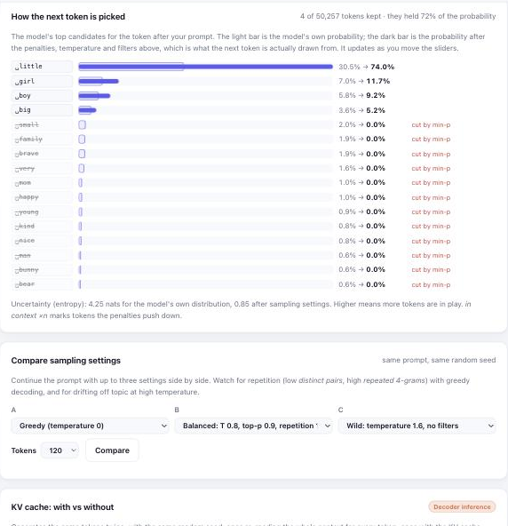
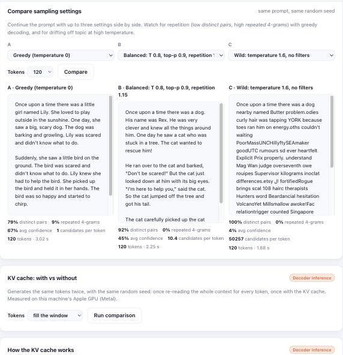
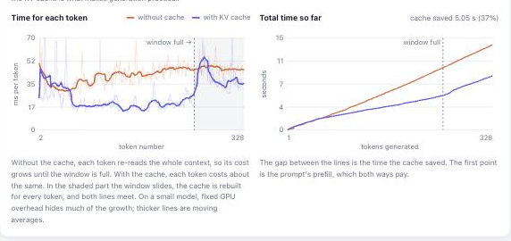
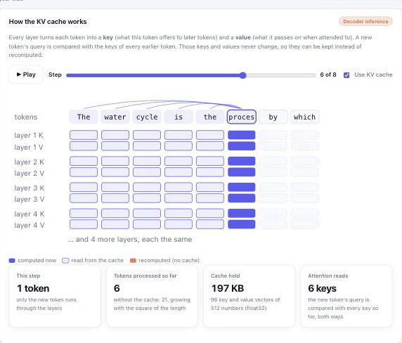
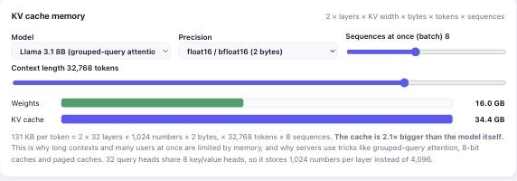

# Understanding the components

How each part of the project works: the pipeline, the transformer inside, how parameters add up, what training
updates, and how generation picks tokens and uses the KV cache. To run it, see [How to use it](usage.md).

## The pipeline at a glance

The project explains every stage of the **LLM training pipeline** in a local web app:

1. **Data**: pick one or more text datasets from **Hugging Face** (or any text file link) and keep them locally.
2. **Tokenization**: convert text to token IDs with the **GPT-2 BPE tokenizer** (`tiktoken`), with examples.
3. **Batching**: cut the token stream into context windows for **next-token prediction**, with a worked example.
4. **Model**: a **transformer** with **multi-head causal self-attention**, feed-forward (MLP) blocks, LayerNorm
   and weight tying, from 16M to 124M parameters, with an architecture diagram and a line-by-line
   **parameter count**.
5. **Inside the transformer**: a 13-stage **transformer visualization** with **Q, K and V matrices**:
   **LayerNorm**, attention scores, the causal mask, softmax, **context vectors**, the output projection,
   **dropout**, **residual connections**, the **feed-forward network** (GELU), and the final **logits and
   softmax** that pick the next token. Each stage is labelled **encoder & decoder** or **decoder only**, and
   heatmaps show the trained model's real attention. The **Explorer** draws the whole model at once with
   real numbers, as a **Flow** of ribbons or a **Diagram**, with a **logit lens**, a per-token trace through
   every block, and **▶ Play the data flow**, which follows one token through a block step by step.
6. **Pre-training**: **AdamW**, warmup and **cosine learning-rate decay**, gradient accumulation and clipping,
   with live **loss curves**, optimizer updates, parameter updates and tokens processed.
7. **Inference**: streamed **text generation** with **temperature, top-k, top-p, min-p, greedy and
   repetition / frequency / presence penalties**, a next-token explorer, side-by-side comparison of sampling
   settings, and a **KV cache**, showing
   tokens used, **time to first token**, decode speed, KV cache size, GPU memory and the model's confidence in
   every token, plus a with/without **KV cache benchmark** with per-token timing charts, an interactive
   **KV cache diagram** and a **KV cache memory calculator**.
8. **Models & evaluation**: every trained or imported model kept in a **model library**, switchable for
   generation, and compared on a fixed **evaluation suite** (held-out loss and perplexity per dataset,
   repetition, variety, speed and size) with side-by-side samples.

## Inside the transformer

The web app's fifth step follows a short prompt through a whole transformer block, and out the other end as
a prediction, in 13 stages. It uses **small made-up numbers** (4 dimensions instead of 384) so every value
can be checked by hand, and every number on screen is actually computed from the ones before it. Each stage
is labelled **Encoder & decoder** (an encoder like BERT does the same) or **Decoder only**:

| # | Stage | Shown | |
|---|---|---|---|
| 1 | Tokens become IDs | the real token IDs | Encoder & decoder |
| 2 | Embeddings | token vector + position vector = `x`, where dropout applies | Encoder & decoder |
| 3 | **LayerNorm** | mean, standard deviation and the normalized vector (pre-norm, as in GPT-2) | Encoder & decoder |
| 4 | Queries, keys, values | `Q = LN(x)·W_Q`, `K = LN(x)·W_K`, `V = LN(x)·W_V` | Encoder & decoder |
| 5 | Attention scores | `Q·Kᵀ / √d_k`, one worked out term by term | Encoder & decoder |
| 6 | Causal mask | future positions set to `−∞` | **Decoder only** |
| 7 | Softmax | attention weights per token, where attention dropout applies | Encoder & decoder |
| 8 | Context vector | each token's weighted sum of value vectors, term by term | Encoder & decoder |
| 9 | Output projection, **dropout**, residual | `context·W_O`, a dropout example (zero + rescale by 1/(1−p)), `h = x + …` | Encoder & decoder |
| 10 | LayerNorm and the **feed-forward network** | `LN(h)` → widen to 16 → GELU → narrow to 4 → dropout → `+ h` | Encoder & decoder |
| 11 | Many heads, many layers | how heads are concatenated and blocks repeat, with your model's sizes | Encoder & decoder |
| 12 | Final LayerNorm, **logits**, softmax | the last token's vector · each candidate's embedding (weight tying) → probabilities | **Decoder only** |
| 13 | Your model's real prediction | top 10 next tokens from the **trained model**; click one to append it and continue | **Decoder only** |

Above the walkthrough, a card compares **encoder-only** (BERT: unmasked attention, for understanding text),
**decoder-only** (GPT and this model: masked attention, for generating text) and **encoder–decoder**
(original Transformer, T5: adds **cross-attention**, for translation). This model has no encoder and no
cross-attention. The Model step's architecture diagram marks the same decoder-only parts, plus every
LayerNorm and dropout.

Below the walkthrough, a heatmap shows your trained model's **real attention weights** for the same
prompt, for any layer and head (or averaged over heads).

### The Explorer

The **Explorer** (a switch at the top of the step) draws one prompt (up to 16 tokens) flowing through the
whole model at once, with the model you've chosen's real numbers, from `/api/explain` (`explain.py`, which
replays the forward pass block by block and records each stage; its final logits match the model's own):

- **Embedding**: each token's vector (48 of its 384 or 768 numbers, orange positive, blue negative), with the
  position vector added (GPT-2 style) or a note that RoPE rotates queries and keys inside attention instead.
- **Q · K · V**: one head's query, key and value for every token.
- **Attention**: that head's matrix in three stages: raw scores (`q·k / √d`), the causal mask (`−∞`) and
  softmax. Click a cell to see its calculation with the real numbers.
- **Out + residual** and the **feed-forward** layer's hidden activations (GELU or SwiGLU, with the share
  strongly active), or, in a model with experts, the router's probabilities and the experts it picked.
- **Blocks**: step through every block and head with ← → and the head buttons.
- **Next token**: the probabilities with their own temperature, top-k and top-p sliders.
- **Logit lens**: the final norm and output layer applied after every block, as if the model stopped there:
  the top guess for each position, block by block. For OpenAI's GPT-2 and "…the capital of Germany is", the
  guess is "not" for seven blocks, "Paris" after block 8 (the earlier answer in the prompt) and "Berlin"
  (80%) from block 9.

It has two looks, switched in its toolbar. **Flow** (the default) draws the prompt as ribbons: every token
fans into every head's Q, K and V tabs; the chosen head's card (the other heads stacked behind it, pick one with
a tab or ‹ ›) lists the keys, queries and values, with key lines dropping into the attention dots, query lines
running into their rows and the values flowing to Out; each token's ribbon then dips into the feed-forward
layer's wider hidden layer (2.7× for SwiGLU, 4× for GELU) and comes back up beside the residual connection,
passes the other blocks, and the last token fans out into the next-token probabilities. **Diagram** shows the
numbers themselves.

**▶ Play the data flow** (in the Flow view) follows one token (the one you clicked, or the last) through the
whole model, block by block, and the diagram moves to each block as the token reaches it. The embedding comes
first. Block 1 is shown in full detail: query, key and value; into the chosen head; the scores against every key;
the mask; softmax; the weighted values flowing to Out; the residual addition; the feed-forward layer (or the
experts' router). Every later block then takes two steps with that block's own numbers: **attention** (the
token's weights in the chosen head, the sharpest of all heads, the values it mixes in) and **feed-forward** (how
much of the hidden layer is active, and what the model would predict if it stopped after that block). The last
step is the next-token probabilities, or, for an earlier token, its own prediction against the real next token
(the probabilities column switches to that token, the real next token is marked ✓, and its probability, rank and
loss are given):
20 steps for a 6-block model, 32 for GPT-2's 12 blocks. Each step lights only the parts that work on the token,
sends particles along its ribbons and explains the step with real numbers (scores and weights, the values it
mixes, how much of the hidden layer is active, how its vector grows). It plays on its own (about 4 s a step);
pause, step with ← → or the step dots (grouped by block), jump to a block with the block arrows, or pick another
token to follow.

In the Diagram, the block is drawn as two bands, one per half of a transformer block: **1 · Attention** (tokens share
information: embedding → query, key, value → the attention matrix) and **2 · Feed-forward** (each token on its
own: out + residual → feed-forward or experts → the other blocks). The step widens to use the window, and
**Full screen** (Esc to leave) gives the diagram the whole screen, up to 1.35× larger.

Every part has an explanation that uses the model's own sizes; hovering a token highlights its path, and the
rows line up across the diagram so one token can be followed from embedding to prediction. **Click a token's
name** to follow it through every block in a table: what it attends to most (averaged over heads, and the head
that focuses hardest), how big its vector gets as the blocks add to it, and what the model would predict next
if it stopped after that block. The layout follows
the idea of [Transformer Explainer](https://poloclub.github.io/transformer-explainer/) (Georgia Tech's Polo
Club), with the app's own models and designs (RoPE, QK-norm, SwiGLU, experts) and the logit lens added.

## How many parameters?

The default (Small) model, with its 256-token context window, has **30,044,544** parameters. The web app
shows this table for whatever size you build:

| Part | Formula | Small model |
|---|---|---|
| Token embeddings | `vocab_size × n_embd` | 50,257 × 384 = 19,298,688 |
| Position embeddings | `block_size × n_embd` | 256 × 384 = 98,304 |
| Transformer blocks | `n_layer × (12·n_embd² + 13·n_embd)` | 6 × 1,774,464 = 10,646,784 |
| Final LayerNorm | `2 × n_embd` | 768 |
| Output layer | shares the token embeddings (weight tying) | 0 |
| **Total** | | **30,044,544** |

Inside each block: query/key/value projection `n_embd × 3·n_embd + 3·n_embd`, attention output
`n_embd² + n_embd`, feed-forward expand `n_embd × 4·n_embd + 4·n_embd`, feed-forward project back
`4·n_embd × n_embd + n_embd`, and two LayerNorms `2 × 2·n_embd`. The calculation is in `param_breakdown()`
in [model.py](../model.py), and it matches PyTorch's own count.

### Bigger models

Add layers or widen the embedding to get a bigger model. **Adding attention heads doesn't add
parameters**: the heads split the embedding into smaller pieces (`n_embd / n_head` each).

| Preset | Layers | Heads | Embedding | Parameters | Memory to train* |
|---|---|---|---|---|---|
| Tiny | 4 | 4 | 256 | 16,090,880 | 0.26 GB |
| Small (default) | 6 | 6 | 384 | 30,044,544 | 0.48 GB |
| Medium | 8 | 8 | 512 | 51,082,752 | 0.82 GB |
| Large (GPT-2 small size) | 12 | 12 | 768 | 123,849,984 | 1.98 GB |

Counts are for the default 256-token context window; the position table adds `block_size × n_embd`, so a
128-token window has slightly fewer (e.g. 29,995,392 for Small). \*Weights, gradients and AdamW state at
16 bytes per parameter, plus activations. Any combination up to 48
layers, 32 heads and an embedding size of 2,048 can be set by hand, as long as it fits in memory.

## Training: what gets updated

Each step runs a batch forward, measures the loss (the average of `−ln(p)`, where `p` is the probability
the model gave the correct next token), and computes gradients. Every `gradient_accumulation_steps` steps,
AdamW updates **every parameter**. The app shows, live and for every past run:

- **Optimizer updates**: `steps ÷ gradient_accumulation_steps` (the *Quick* preset: 2,000 ÷ 1 = 2,000).
- **Parameters updated**: `parameters × updates` (Small, *Quick*: 30,044,544 × 2,000 ≈ 60 billion).
- **Tokens processed**: `steps × batch_size × block_size` (*Quick*: 2,000 × 32 × 256 ≈ 16.4 million).

Every run is appended to `runs.jsonl` in the model's folder and listed in the Train step's history table.
The command line prints the same summary at the end of a run.

A run can also be resumed or extended later: see [Resuming and extending a run](usage.md#resuming-and-extending-a-run).

## Inference metrics

The Generate step streams tokens as they are produced and reports:

| Metric | What it means |
|---|---|
| Prompt tokens / generated tokens | Tokens in and out |
| Context used | How many tokens the model could see at the end (at most the context window, 256) |
| Time to first token | Reading the prompt (prefill) and picking the first token, with the prefill speed |
| Total time, decode speed | Speed of the decode loop: one forward pass per new token |
| KV cache | Size of the cache at the end, and per token (`2 × n_layer × n_embd × 4 bytes`, 18 KB for the default model) |
| Memory | Size of the weights, and GPU memory in use (plus the peak on CUDA) |
| Average confidence | The model's average probability for the tokens it picked |
| Per-token timing chart | Time for each token; the first one is the slowest |

Each generated token is colored by the model's probability for it, and hovering shows its top alternatives
and how many candidates it was drawn from.

### Sampling: how the next token is picked

The model gives a probability to every one of the 50,257 tokens; **sampling settings** decide which of them
can be picked. The Generate step has all the common ones, applied in this order:

| Setting | What it does | Off |
|---|---|---|
| Repetition penalty | Divides the score of every token already in the context by the penalty (CTRL-style) | 1 |
| Frequency / presence penalty | Subtracts penalty × times seen / a flat amount for tokens seen at all (OpenAI-style) | 0 |
| DRY | Lowers only tokens that would continue a sequence already in the text, by multiplier × 1.75^(length − 2) for a repeat of 2+ tokens; single words can come back freely | 0 |
| Temperature | Sharpens (below 1) or flattens (above 1) the probabilities. **0 = greedy**: always the most likely token | – |
| Top-k | Keeps the k most likely tokens | 0 |
| Top-p (nucleus) | Keeps the smallest set of tokens whose probabilities add up to p | 1 |
| Min-p | Drops tokens less likely than min-p × the top token's probability | 0 |
| Typical-p | Keeps the tokens whose surprise is closest to the average surprise (the entropy), up to p of the probability: drops the blandest choices as well as the unlikely ones | 1 |

Presets set them in one click: **Greedy**, **Greedy + DRY** (deterministic, without loops), **Balanced** (temperature 0.8, top-p 0.9, DRY 0.8), **Creative** (temperature 1.1, min-p 0.05) and **Old default** (temperature 0.8, top-k 50, no
penalty). **Balanced is the default**: with the old default, the FineWeb model often fell into loops,
repeating one sentence over and over (73% of 4-token runs repeated with greedy decoding, 0% with Balanced).
Balanced first used a repetition penalty of 1.15; it now uses DRY instead, which was as good at stopping repeats
and more fluent, because it doesn't push down every word already used ([the comparison](journey.md#26-better-decoding-algorithms)).
The evaluation suite keeps the original setting (repetition penalty 1.15), so every model is measured the same way.

**Other ways to generate**, a card below the sliders, offers three more:
- **Contrastive search** (`contrastive_search`): deterministic like greedy, but of the k most likely tokens it
  prefers the one whose hidden state is least like anything already written, so it doesn't loop. It's slow
  (~13 tokens/s for the Small model): each candidate reruns the context without the KV cache.
- **Beam search** (`beam_search`): keeps the most probable few continuations, optionally never repeating an
  n-gram.
- **Several samples at once** (`generate_batch`): n continuations in one batch with the temperature, top-k and
  top-p above (no penalties). 8 samples of 120 tokens take about as long as two single ones (567 tokens/s in
  total for the Small model).

How all of them compare is in [Analysis](analysis.md) (steps 23 and 25).

**How the next token is picked** shows the model's top candidates for the token after your prompt and updates
as you move the sliders: the model's own probability, the probability after the settings, which tokens a
filter cut (and which one), which tokens the penalties pushed down, how many tokens are left and how much of
the probability they hold.



**Compare sampling settings** continues the same prompt with three settings side by side, with the same
random seed, and measures each one: distinct word pairs, repeated 4-token runs, average confidence and
candidates per token. With the TinyStories model, greedy decoding repeated 9% of its 4-token runs, the
Balanced preset 0%, and temperature 1.6 without filters drew from all 50,257 tokens and fell apart into
word salad. The Generate step also reports repetition and candidates per token for every generation.



### The KV cache

With the **KV cache** on (the default), every layer keeps the keys and values it has already computed, so
each new token only runs itself through the model instead of re-reading the whole context. The cache is
allocated once for the whole context window and filled in place. It's exact: cached and uncached logits
match to within 2×10⁻⁶. The **KV cache: with vs without** card generates the same tokens both ways, with the
same seed, and compares them.

The gain grows with the number of tokens the model has to re-read. Measured on an Apple M5 with the 51M
Medium model (256-token window), generating 328 tokens from an 8-token prompt:

| | Without cache | With KV cache |
|---|---|---|
| Time per token | 42.1 ms | 26.7 ms |
| Decode speed | 23.7 tok/s | 37.4 tok/s |
| Total for 328 tokens | 13.8 s | **8.8 s (1.58× faster, 37% saved)** |
| KV cache | none | 8.4 MB (33 KB per token) |
| Same tokens generated | | ✓ |

GPU timings vary from run to run (another run measured 1.28×), so run it a few times. With a small model,
each step is dominated by the fixed cost of launching work on the GPU, so short generations gain little;
for large language models reading thousands of tokens, the cache is what makes generation practical. This
model's positions are learned per slot, so once the 256-token window is full the cache has to be rebuilt
every step (shown as "rebuilds"), and the advantage disappears.

**Per-token timing charts.** Pick *fill the window* or *past the window* as the length to see the whole
story. Without the cache, each token gets slower as the context grows. With the cache, the time stays flat
until the window is full, then jumps to meet the uncached line. The second chart shows the total time, and
the gap between its lines is the time saved.



**How the KV cache works.** An interactive diagram of the cache for your prompt. Step through generation, or
press Play, and see which keys and values each layer computes and which it reads back from the cache. Turn
the cache off to see every earlier token recomputed instead. The counters show the work: with the cache,
the number of tokens processed grows in a straight line; without it, with the square of the length.



**KV cache memory.** A calculator for `2 × layers × KV width × bytes × tokens × sequences`, for this model,
GPT-2 and Llama models, with the context length, batch size and precision as sliders. It compares the cache
with the size of the weights and shows when the cache becomes the bigger of the two: Llama 3.1 8B at 32K
tokens for 8 users needs 34 GB of cache for 16 GB of weights. It also explains grouped-query attention,
which shares one key/value head among several query heads to shrink the cache 4×.



The Colab and Kaggle notebook's Step 9 runs the same comparison on the cloud GPU and saves a chart of the
time taken and the cache size (`kv_cache.png`) in the results zip.

## What happens on each run

| Step | Module | First run | Later runs |
|---|---|---|---|
| 1. Get the data | `data.py` | Validates, downloads and saves a local copy of each dataset | Loads the local copies |
| 2. Tokenize | `tokenization.py` | Converts every document to GPT-2 token IDs | Skipped |
| 3. Batches | `data.py` | Samples random 256-token windows (from several datasets if mixed) | Same (fresh batches every run) |
| 4. Train | `pretrain.py` | Trains, saves the best weights and logs the run | Same |
| 5. Plot | `plots.py` | Training and validation loss | Same |
| 6. Generate | `inference.py` | Writes text from the prompts | Same |

## Project structure

```
full-model.py              Command-line entry point: model config, --dataset/--mix options, runs every step
app/
  server.py                Web app backend (FastAPI): runs the steps, streams generation, reports progress
  static/                  Web app front end (HTML, CSS, JavaScript; no build step)
data.py                    Dataset sources, text-only validation, local caching, multi-dataset BatchLoader
catalog.py                 Public text datasets shown in the gallery and by --list-datasets
tokenization.py            GPT-2 tokenizer and writing train.bin / validation.bin
model.py                   GPT architecture (with an optional KV cache), param_breakdown() and estimate_loss()
train_config.py            TrainConfig hyperparameters and setup_device() (MPS / CUDA / CPU)
pretrain.py                Training loop: AdamW, warmup + cosine LR schedule, gradient accumulation
plots.py                   Loss curves
inference.py               Checkpoints, streamed generation, speculative decoding, contrastive and beam search,
                           KV cache benchmark, GPU memory, attention maps
quantize.py                8-bit and 4-bit weights for inference
train_step_by_step.ipynb   Notebook for training on Google Colab or Kaggle
import_run.py              Brings a model trained on Colab or Kaggle into data/ (from the notebook's results zip)
registry.py                Model library: every trained or imported model saved under models/<id>/
evaluate.py                Evaluation suite: the same held-out loss and generation tests for every model
ab_test.py                 A/B tests: train named variants the same way, evaluate each, compare; runs Lab run specs
lab_run.ipynb              Notebook that runs a Lab run spec on Google Colab or Kaggle
reference_gpt2.py          Loads OpenAI's GPT-2 small into the model library as a reference
explain.py                 The model's internals for one prompt, for the Explorer in Inside the transformer
benchmarks.py              Standard zero-shot benchmarks: HellaSwag, LAMBADA, ARC-Easy, PIQA, Winogrande
docs/                      This documentation: usage.md, components.md, analysis.md, journey.md
docs/screenshots/          Screenshots used in the documentation
```
