# From a training script to a working language model: what changed and why

This page follows the project from its first commit to today, one change at a time. For each step: what was
wrong, what we changed, why it works, what it measured, and the lesson worth keeping. Every number here was
measured in this project, on an Apple M5 Mac or a Colab GPU.

If you're learning how language models are built, read it top to bottom: most of the gains came from things
that are easy to get wrong and rarely explained.

**Contents**

1. [Where we started](#1-where-we-started)
2. [Making it run well on a Mac](#2-making-it-run-well-on-a-mac)
3. [Making it understandable: the web app](#3-making-it-understandable-the-web-app)
4. [Training on a cloud GPU](#4-training-on-a-cloud-gpu)
5. [The big fix: the model was undertrained](#5-the-big-fix-the-model-was-undertrained)
6. [Training longer, then on harder data](#6-training-longer-then-on-harder-data)
7. [Inference: the KV cache, measured honestly](#7-inference-the-kv-cache-measured-honestly)
8. [Decoding: why the model repeated itself](#8-decoding-why-the-model-repeated-itself)
9. [Measuring progress: a model library and an evaluation suite](#9-measuring-progress-a-model-library-and-an-evaluation-suite)
10. [Never losing a run: resume training](#10-never-losing-a-run-resume-training)
11. [Architecture, step one: rotary positions (RoPE)](#11-architecture-step-one-rotary-positions-rope)
12. [Architecture, step two: RMSNorm](#12-architecture-step-two-rmsnorm)
13. [Architecture, step three: a gated feed-forward layer (SwiGLU)](#13-architecture-step-three-a-gated-feed-forward-layer-swiglu)
14. [Architecture, step four: no biases](#14-architecture-step-four-no-biases)
15. [Architecture, step five: QK-norm, and moving the A/B tests to a GPU](#15-architecture-step-five-qk-norm-and-moving-the-ab-tests-to-a-gpu)
16. [A learning-rate sweep, and what QK-norm is really for](#16-a-learning-rate-sweep-and-what-qk-norm-is-really-for)
17. [Architecture, step six: grouped-query attention](#17-architecture-step-six-grouped-query-attention)
18. [Architecture, step seven: deep and thin, or wide and shallow?](#18-architecture-step-seven-deep-and-thin-or-wide-and-shallow)
19. [Architecture, step eight: layer sharing](#19-architecture-step-eight-layer-sharing)
20. [Architecture, step nine: predicting several tokens at once](#20-architecture-step-nine-predicting-several-tokens-at-once)
21. [Architecture, step ten: a mixture of experts](#21-architecture-step-ten-a-mixture-of-experts)
22. [Putting it together: the original model vs all the wins](#22-putting-it-together-the-original-model-vs-all-the-wins)
23. [The same designs on harder data: Mini FineWeb-Edu](#23-the-same-designs-on-harder-data-mini-fineweb-edu)
24. [A yardstick: OpenAI's GPT-2](#24-a-yardstick-openais-gpt-2)
25. [Winning back generation speed](#25-winning-back-generation-speed)
26. [Better decoding algorithms](#26-better-decoding-algorithms)
27. [8-bit and 4-bit weights](#27-8-bit-and-4-bit-weights)
28. [Batched generation and prefix caching](#28-batched-generation-and-prefix-caching)
29. [Seeing the model work: the Explorer](#29-seeing-the-model-work-the-explorer)
30. [The best design at GPT-2 size](#30-the-best-design-at-gpt-2-size)
31. [Faster training](#31-faster-training)
32. [More kinds of data](#32-more-kinds-of-data)
33. [A second kind of model: masked diffusion](#33-a-second-kind-of-model-masked-diffusion)
34. [Lessons](#34-lessons)
35. [What's next](#35-whats-next)

---

## 1. Where we started

The first commit was a single 356-line script, adapted from nanoGPT: a GPT-2-style decoder-only transformer
(token and learned position embeddings, 6 blocks of causal self-attention and an MLP, LayerNorm, weight tying)
trained on [TinyStories](https://huggingface.co/datasets/roneneldan/TinyStories), short stories written with a
small child's vocabulary.

| Setting | First version |
|---|---|
| Model | 6 layers, 6 heads, 384-dim (~30M parameters) |
| Context window | 128 tokens |
| Learning rate | 1e-4, "decaying" to a minimum of **5e-4** |
| Gradient accumulation | 32 batches per weight update (8 in the later 2,000-step *Quick* preset) |
| Dropout | 0.1 |
| Gradient clipping | 0.5 |
| Documents | concatenated with nothing between them |
| Device | Nvidia GPU (`cuda`) or CPU; on a Mac, the CPU |

The architecture was fine. Almost everything around it held the model back, and the output showed it:
grammatical fragments that never held together, like *"She was a big house. She wanted to go to a big her
mommy"*.

---

## 2. Making it run well on a Mac

**The problem.** The script only knew `cuda` and `cpu`, so on a Mac it trained on the CPU. And the learning
rate's "minimum" (5e-4) was *higher* than its peak (1e-4), so the cosine schedule made the learning rate
**rise** during training instead of fall.

**What we changed.**
- Pick the Apple GPU through PyTorch's Metal backend (`mps`) when there's no Nvidia GPU. Train in float32 on
  the Mac, since mixed precision only pays off on CUDA.
- Fix the schedule so it decays from the peak down to a tenth of it.
- Split the script into modules: `data.py`, `tokenization.py`, `model.py`, `pretrain.py`, `inference.py`,
  and so on. One file per idea makes each one easier to read, test and change.

**Lesson.** Check that your hyperparameters say what you think they say. A minimum learning rate above the
maximum is easy to write and silently turns "decay" into "growth".

---

## 3. Making it understandable: the web app

A training script hides everything interesting. We built a local web app (`python3 app/server.py`) that walks
through the pipeline one step at a time, with real numbers from your own data and model:

- **Data**: any Hugging Face text dataset or text file, checked to make sure it really is text, stored
  locally, and mixable with others.
- **Tokenize** and **Batches**: the GPT-2 tokenizer on your own text, and how training windows and targets
  are cut from the token stream.
- **Model**: an architecture diagram and a line-by-line parameter count that matches PyTorch's exactly.
- **Inside the transformer**: 13 stages from token IDs to the next-token prediction, with the trained
  model's real attention weights (and, later, the Explorer: see [section 29](#29-seeing-the-model-work-the-explorer)).
- **Train**, **Generate** and later **Models**: live loss curves, streamed generation, and model comparison.

**Lesson.** You learn a model by looking inside it. Every number the app shows is computed, not illustrated.

---

## 4. Training on a cloud GPU

A Mac is great for learning and short runs; long runs need a bigger GPU. We wrote a notebook
(`train_step_by_step.ipynb`) that runs the same steps on Google Colab or Kaggle and packs the trained model
into a zip that `import_run.py` brings back to the Mac.

Two problems showed up on Colab's free T4 GPU:

| Problem | Cause | Fix | Result |
|---|---|---|---|
| 1.4 seconds per step | The T4 reports bfloat16 as "supported", but only emulates it | Use float16 (with a gradient scaler) unless the GPU is Ampere or newer | **3.86 steps/s**, about 5× faster |
| 16 minutes to write the token files | Writing 1,024 shards one by one | Write straight from the dataset's Arrow chunks | **seconds**, byte-identical output |

**Lesson.** "Supported" is not "fast". Measure the step time on the actual hardware before a long run.

---

## 5. The big fix: the model was undertrained

The first Colab run trained the 124M Large model for 2,000 steps: validation loss **4.527**, and the stories
were still word salad. A bigger GPU didn't help, because the problem wasn't the hardware. The training set-up
made every step count for far less than it should:

| Change | Before | After | Why it matters |
|---|---|---|---|
| Separator between documents | none | `<\|endoftext\|>` after every story | Without it, stories ran into each other: the model never learned where one ends, and training windows spliced unrelated stories together |
| Gradient accumulation | 8 (Quick) / 32 (Full) batches per update | 1 | 2,000 steps gave only **250** weight updates, and 20,000 steps only 625. Accumulation makes each update better informed, but a small model needs *many* updates |
| Learning rate | 1e-4 | 6e-4 → 6e-5 | 1e-4 is too timid for small GPTs; nanoGPT uses 6e-4 for the 124M GPT-2 |
| Context window | 128 tokens | 256 tokens | A typical story is ~230 tokens: at 128, the model never saw how its own story began |
| Dropout | 0.1 | 0 | Training and validation loss were equal, so the model was underfitting, not memorizing. Dropout only slowed it down |
| Gradient clipping | 0.5 | 1.0 | 0.5 clipped ordinary updates |
| Generation | ran to the length limit | stops at `<\|endoftext\|>` | A finished story ends instead of starting a new one mid-sentence |

Measured on the same T4:

| Validation loss | Step 1,000 | Step 2,000 |
|---|---|---|
| Before: Large model, 124M | 4.905 | 4.527 |
| After: Medium model, 51M | **2.649** | **2.214** |

A model less than half the size, with better settings, was far ahead at every step.

**Lessons.**
- **Count your optimizer updates**, not your steps.
- **If training loss ≈ validation loss, you're underfitting.** Remove regularization and train harder.
- **Tell the model where documents end.** One separator token fixed story structure.

---

## 6. Training longer, then on harder data

**TinyStories, 20,000 steps.** The Medium model (51M) for 20,000 steps on a T4 (101 minutes) reached
validation loss **1.583** and wrote coherent stories that end by themselves:

> Once upon a time, there was a little boy named Timmy. Timmy loved to play with his toys all day long. One
> day, he accidentally broke his favorite toy car. He was very sad and didn't know what to do. …

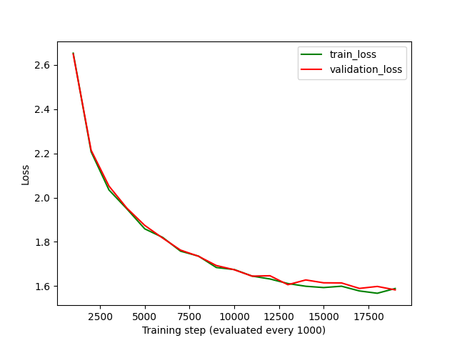

**Mini FineWeb-Edu, 30,000 steps.** Children's stories are easy. We switched the default dataset to
[Mini FineWeb-Edu](https://huggingface.co/datasets/BaoMinhTran/mini-fineweb-edu), educational web pages like
those modern small models are trained on, and trained the Large model (124M) for 30,000 steps on a Colab L4
(bfloat16, 162 minutes, 246M tokens). Validation loss: **3.603** (perplexity ~37).

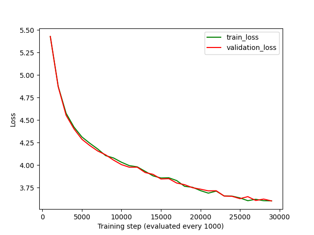

The model writes fluent, encyclopedia-style English, and invents its facts ("The French Revolution began in
1776…").

**Lessons.**
- Loss values only compare within the same data. 3.6 on web text is a much better model than 3.6 would be
  on children's stories.
- A small model learns how text *sounds* long before it learns what is *true*.

---

## 7. Inference: the KV cache, measured honestly

Generating text is one forward pass per new token. Without a cache, every pass re-reads the whole context.
The **KV cache** keeps every layer's keys and values for the tokens already seen, so each pass only processes
the new token.

We built it (preallocated once, filled in place, checked to give the same logits as no cache), then measured
it, with per-token timing charts, an interactive diagram and a memory calculator in the app:

| Hardware | Model | Result |
|---|---|---|
| Apple M5 | Medium 51M, 328 tokens | 13.8 s → **8.8 s**: 1.58× faster, 37% saved |
| Colab L4 | Large 124M | **0.92–0.98×**: slightly *slower* |

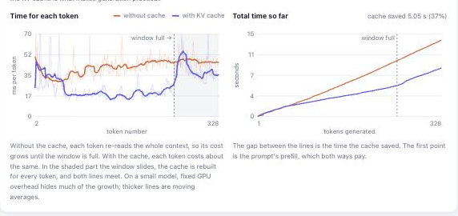

Why slower on the L4? A data-center GPU runs this model's small matrix multiplications so fast that each
step is dominated by fixed overhead (launching GPU work, Python), and the cache adds bookkeeping. The savings
grow with model size and context length; for LLMs reading thousands of tokens, the cache is what makes
generation practical.

There was a catch on both: with **learned positions**, a full context window means every position shifts, so
the cache had to be **rebuilt for every token** past the window, and the advantage disappeared. Section 11
fixes that.

**Lessons.**
- Measure optimizations on the hardware you'll use; the textbook answer can be wrong at your scale.
- The KV cache trades memory for speed: `2 × layers × width × bytes` per token. For Llama 3.1 8B at 32K
  tokens for 8 users, that's 34 GB of cache for 16 GB of weights.

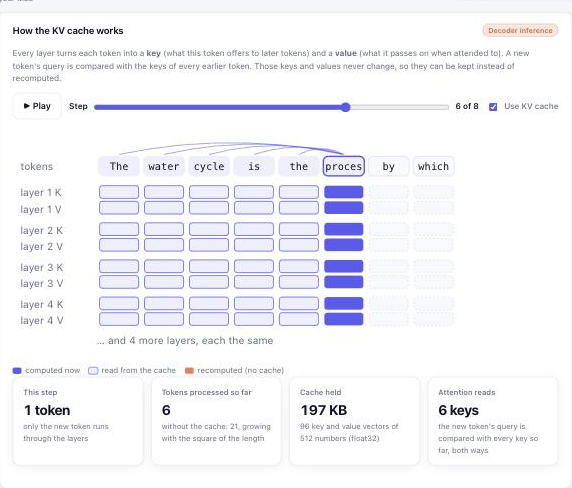

---

## 8. Decoding: why the model repeated itself

The FineWeb model kept producing loops like *"The process of photosynthesis is called photosynthesis. The
process of photosynthesis is called photosynthesis. …"*.

**Why.** Transformers learn to copy from their context (induction heads): once a sentence has appeared,
repeating it becomes the most likely continuation, and every repeat makes the next one more likely. Greedy
decoding, or a low temperature with only top-k, can't escape.

**What we changed.** Added the standard sampling controls: temperature (0 = greedy), top-k, **top-p**
(nucleus), **min-p**, and **repetition / frequency / presence penalties**. We also added a next-token explorer
that shows which candidates each setting cuts, and a side-by-side comparison. Then we made **Balanced**
(temperature 0.8, top-p 0.9, repetition penalty 1.15) the default.

| Decoding | Repeated 4-token runs (FineWeb model) |
|---|---|
| Greedy | **73%** |
| Balanced | **0%** |

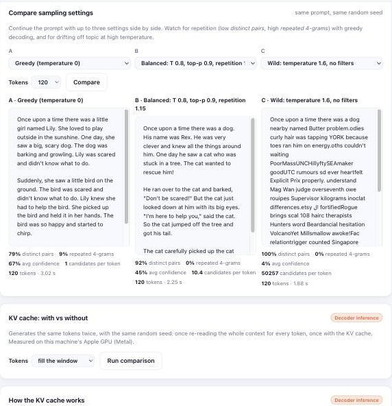

**Lesson.** Decoding is half of inference quality. The same weights can loop or write fluently depending on
four numbers.

---

## 9. Measuring progress: a model library and an evaluation suite

Each new training run used to replace the last model, and every result was measured a little differently.
Two changes fixed that:

- A **model library** (`models/`): every trained or imported model is kept under its own name, and any of
  them can be switched in for generation.
- An **evaluation suite** (`evaluate.py`): the same tests for every model. That's held-out loss on fixed
  windows of each dataset, six fixed prompts decoded greedy and Balanced (repetition, variety, confidence,
  speed), and size.

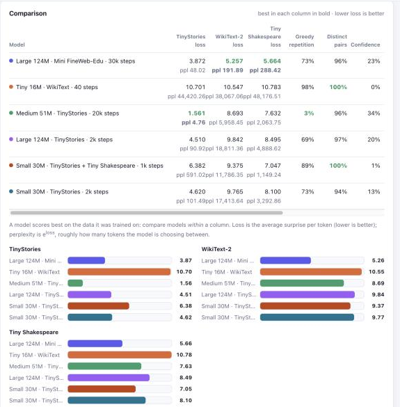

What it showed: each model is best on its own kind of text. The TinyStories model reaches perplexity 4.8 on
stories but is lost on Wikipedia. The FineWeb model, trained on varied text, is best on WikiText-2 and
Shakespeare, neither of which it saw. And every undertrained model loops (69–98% greedy repetition).

**Lesson.** Decide how you'll measure *before* you change things. Every improvement after this point is a
comparison against a fixed baseline.

---

## 10. Never losing a run: resume training

Long runs die: a closed laptop, a disconnected Colab session. Every evaluation now saves the **full training
state**, not just the weights: AdamW's running averages, the mixed-precision scaler, the step, the loss
history and the random-number state. A run can be **finished** after an interruption, or **extended**: the
cosine schedule is stretched to the new end, and the learning rate re-warms from where it stopped instead of
crawling at the minimum.

Building it found a bug: a run shorter than one evaluation interval never saved its checkpoint. Every run now
ends with a final evaluation.

**Lesson.** The weights alone aren't enough to continue training. The optimizer's state is half of what
was learned about the loss landscape.

---

## 11. Architecture, step one: rotary positions (RoPE)

From here on, the focus is the architecture, one change at a time, each tested against the baseline with the
same data, seed and settings.

**Learned positions (GPT-2).** Each of the 256 positions has a trained vector, added to the token embedding.
The model only knows positions it was trained on, and a position vector has to describe the absolute slot,
even though language mostly cares about *relative* distance.

**RoPE (Llama, Mistral, Qwen).** No position vectors. Inside attention, each query and key is **rotated** by an
angle proportional to its position, a different speed for each pair of dimensions. The dot product of a query
at position *m* and a key at position *n* then depends only on *m − n*.

Two consequences:

1. No position parameters, and attention that is naturally relative.
2. **The KV cache can slide.** Each cached key carries its position in its rotation, so when the window is
   full, the newest token simply overwrites the oldest slot (a ring buffer). Nothing is rebuilt.

   One subtlety: past the window, a sliding cache is *not* exactly the same as recomputing the last 256 tokens
   from scratch. In layer 2 and above, a cached key was computed when the tokens before it were still in
   view, so it still carries a trace of tokens that have since left the window. With one layer the two agree
   to 1e-6. With two layers and random weights, the logits differed by up to 0.37. It's an approximation, and
   in practice a mild one; Mistral's sliding-window cache works the same way. (Before the window fills, the
   cache is exact.)

In this project it's a switch: **Positions: Learned / RoPE** in the Model step, `--rope` on the command line,
or `pos_encoding = "rope"` in the notebook.

**The A/B test.** The Small model (30M), 1,000 steps on TinyStories, seed 42, learning rate 6e-4, the
same batches. The only difference is the position encoding.

| | Learned positions | RoPE |
|---|---|---|
| Parameters | 30,044,544 | 29,946,240 (no position table) |
| Validation loss at steps 250 / 500 / 750 / 1,000 | 3.462 / 2.956 / 2.706 / 2.631 | **3.164 / 2.753 / 2.536 / 2.475** |
| Held-out loss: TinyStories | 2.602 | **2.440** |
| Held-out loss: WikiText-2 | 9.569 | **9.461** |
| Held-out loss: Tiny Shakespeare | 8.149 | **8.040** |
| Greedy repetition (4-token runs) | 14.1% | **8.9%** |
| Balanced repetition | 0.3% | 0.7% |
| KV cache past the 256-token window | rebuilt 79 times, 1.14× faster than no cache | **never rebuilt, 1.47× faster** |
| Greedy text with the cache = without it (benchmark prompt) | yes | yes (not guaranteed past the window, see above) |

RoPE was ahead at every evaluation, and by about the same margin (0.16 nats at the end). It reached the
learned model's final loss (2.63) somewhere between steps 500 and 750, which is roughly **30% fewer steps**
for the same quality. The gain carries over to the two datasets neither model was trained on.

Past the window, the learned model has to rebuild its cache for every new token (its positions are absolute
slots, and the window has moved), so the cache barely helps. The RoPE cache simply slides.

A caveat: the RoPE run also trained faster (0.67 vs 0.45 steps/s), but the runs were one after the other on a
16 GB Mac that was swapping, so that difference is memory pressure, not RoPE. Compare the losses, not the times.

**Lesson.** A good inductive bias (attention that depends on relative distance) is worth more than parameters:
RoPE has *fewer* parameters and learns faster. And a design choice in the model (absolute vs relative positions)
decides what's possible at inference (a sliding cache).

---

## 12. Architecture, step two: RMSNorm

Every block normalizes its input twice (before attention and before the feed-forward layer), and once more at
the end. GPT-2's **LayerNorm** subtracts each vector's mean, divides by its standard deviation, then applies a
learned scale and shift. **RMSNorm** (Llama, Mistral, Qwen) skips the mean and the shift: divide by the root mean
square, √(mean of x²), then scale. The claim is that re-centering doesn't matter, only re-scaling does.

It's a switch: **Normalization: LayerNorm / RMSNorm** in the Model step, `--rmsnorm` on the command line, or
`norm = "rmsnorm"` in the notebook.

**The A/B test.** RoPE + RMSNorm against the RoPE + LayerNorm run from step 11: the same data, seed, learning
rate and 1,000 updates of 32 sequences.

| | RoPE + LayerNorm | RoPE + RMSNorm |
|---|---|---|
| Parameters | 29,946,240 | 29,941,248 (no shifts) |
| Validation loss at updates 250 / 500 / 750 / 1,000 | 3.164 / 2.753 / 2.536 / 2.475 | 3.165 / 2.755 / 2.545 / 2.483 |
| Held-out loss: TinyStories | 2.440 | 2.451 |
| Held-out loss: WikiText-2 | 9.461 | 9.454 |
| Held-out loss: Tiny Shakespeare | 8.040 | 8.037 |
| Greedy / Balanced repetition | 8.9% / 0.7% | 9.7% / 0.3% |
| A training step (batch 4, Mac GPU, timed alone) | 190 ms | 157 ms |

**A tie.** The curves sit on top of each other: 0.008 apart at the end on TinyStories, slightly ahead on the two
unseen datasets. One run per arm can't separate differences that small. RMSNorm gives the same quality with
fewer operations, so it stays as an option, and it's the norm the later steps (SwiGLU, no biases) are usually
paired with.

**A memory lesson along the way.** The first attempt crawled at 17 s per step: at batch 32, the training
process grew to 15 GB on this 16 GB Mac and paged 5 GB to disk every 20 seconds. The fix was **gradient
accumulation**: 4 micro-batches of 8, gradients summed, then one update. That gives the same gradient as a batch
of 32 in a quarter of the activation memory, and the run went from 17 s to 1.5 s per update. (The largest
activation here is the output layer's 32 × 256 × 50,257 logits: 1.6 GB in float32, before its gradient.)

**Lesson.** Not every famous change is a win at every scale. Measure it, and keep it when it's free.

---

## 13. Architecture, step three: a gated feed-forward layer (SwiGLU)

About two thirds of each block's parameters sit in the feed-forward layer. GPT-2's version widens each token's
vector to 4 × n_embd, applies GELU, and narrows it back: two matrices. **SwiGLU** (Llama, Mistral, Qwen) uses
three. Two project the vector up in parallel; one copy goes through SiLU and **multiplies** the other, feature by
feature, so the model learns a gate deciding how much of each feature passes. Then one matrix projects back.

To keep the comparison fair, the hidden width shrinks from 4 × to 8/3 × n_embd (1,536 → 1,024 for the Small
model), so three narrower matrices hold the same number of weights as two wide ones: 29,949,312 parameters vs
29,946,240 (the 3k difference is biases).

It's a switch: **Feed-forward: GELU / SwiGLU** in the Model step, `--swiglu` on the command line, or
`mlp = "swiglu"` in the notebook.

**The A/B test.** RoPE + SwiGLU against the RoPE + GELU run from step 11, same data, seed and 1,000 updates.

| | RoPE + GELU | RoPE + SwiGLU |
|---|---|---|
| Validation loss at updates 250 / 500 / 750 / 1,000 | 3.164 / 2.753 / 2.536 / 2.475 | **3.035 / 2.642 / 2.431 / 2.366** |
| Held-out loss: TinyStories | 2.440 | **2.338** |
| Held-out loss: WikiText-2 | **9.461** | 9.501 |
| Held-out loss: Tiny Shakespeare | 8.040 | **8.019** |
| Greedy / Balanced repetition | **8.9%** / 0.7% | 28.0% / **0.0%** |
| Training speed (updates/s, this run) | 0.67 | 0.73 |

**A clear win where it counts.** SwiGLU led by about 0.11 at every evaluation, the same size of gain as RoPE gave
over learned positions, and it reached the baseline's final loss around update 700: roughly 30% fewer updates.
On the two datasets neither model trained on, it's a wash (WikiText-2 slightly worse, Shakespeare slightly
better); at losses above 8, a TinyStories model barely predicts either.

One number went the wrong way: greedy decoding repeated itself more (28% of 4-token runs vs 9%). Greedy
repetition over 6 prompts is noisy, and the Balanced default had none, but it's worth watching in the next steps.

**Lesson.** The two changes that helped (RoPE, SwiGLU) both change *what the model can express*: relative
positions, multiplicative gating. The one that didn't (RMSNorm) only changes how it's kept numerically stable.

---

## 14. Architecture, step four: no biases

Every linear layer in GPT-2 computes `xW + b`, and every LayerNorm learns a shift. Llama, Mistral and Qwen drop
all of them: with normalization before every layer, a bias adds little that the weights can't do, and it's one
more thing that can drift during long training runs.

It's a switch: **Biases: Yes / No** in the Model step, `--no-bias` on the command line, or `bias = False` in
the notebook.

**The A/B test.** RoPE + SwiGLU without biases against the RoPE + SwiGLU run from step 13.

| | RoPE + SwiGLU | RoPE + SwiGLU, no biases |
|---|---|---|
| Parameters | 29,949,312 | 29,920,512 (29k fewer) |
| Validation loss at updates 250 / 500 / 750 / 1,000 | 3.035 / 2.642 / 2.431 / 2.366 | 3.044 / 2.645 / 2.430 / 2.365 |
| Held-out loss: TinyStories | 2.338 | **2.324** |
| Held-out loss: WikiText-2 | 9.501 | **9.483** |
| Held-out loss: Tiny Shakespeare | **8.019** | 8.093 |
| Greedy / Balanced repetition | 28.0% / 0.0% | **7.5%** / 0.0% |

**Another tie.** The validation curves are indistinguishable (0.0005 apart at the end), so the biases weren't
doing anything this model needed. Dropping them is free: fewer parameters, simpler layers, and one less
difference from the models people actually use.

The greedy repetition that jumped to 28% with SwiGLU is back to 7.5% here, with an almost identical loss. That
says the jump was noise from greedy decoding on 6 prompts, not something SwiGLU did, which is a useful reminder
not to read too much into one small metric.

**Lesson.** Simplifications that cost nothing are worth taking; they make later changes easier to reason about.

---

## 15. Architecture, step five: QK-norm, and moving the A/B tests to a GPU

Attention scores are dot products of queries and keys. Nothing stops those vectors from growing during
training, and when they do, the softmax becomes extremely peaked: one token gets all the attention, gradients
vanish elsewhere, and the loss can spike. **QK-norm** (OLMo 2, Gemma 3, Qwen3) RMS-normalizes each head's query
and key before the dot product, with a learned scale per dimension, so scores stay in a steady range. The usual
claim is not lower loss but **stability**, which lets you train with a higher learning rate.

It's a switch: **QK-norm** in the Model step, `--qk-norm` on the command line, `qk_norm` in the notebook. It
adds 2 × head_dim = 128 parameters per layer.

**Testing a stability claim needs more than one run**, so this A/B had four variants: QK-norm off and on, at
the usual learning rate (6e-4) and at three times it (1.8e-3). Every update's loss was recorded to count spikes.

At about 25 minutes per variant, that was too slow for the Mac, so the A/B tests moved to the cloud. `ab_test.py`
trains named variants the same way, evaluates each, and writes a table, a chart and a zip; the notebook's
**A/B test** section runs it on a Colab GPU, and `import_run.py` brings the zip home into the model library. On
an L4, each variant took about 2½ minutes. The Colab baseline reproduced the Mac's A4 result (2.369 vs 2.365),
and the Mac's QK-norm run matched Colab's (2.337 vs 2.336), so numbers from the two machines line up.

| On an L4 (RoPE + SwiGLU, no biases) | Baseline, 6e-4 | QK-norm, 6e-4 | Baseline, 1.8e-3 | QK-norm, 1.8e-3 |
|---|---|---|---|---|
| Best validation loss | 2.369 | 2.336 | 2.266 | **2.251** |
| Held-out: TinyStories | 2.329 | 2.300 | 2.230 | **2.219** |
| Held-out: WikiText-2 | **9.456** | 9.461 | 9.900 | 9.938 |
| Held-out: Tiny Shakespeare | 8.216 | **8.016** | 8.365 | 8.360 |
| Greedy / Balanced repetition | 36.7% / 0.2% | 21.3% / 0.2% | 21.0% / 0.0% | **6.6%** / 0.2% |
| Loss spikes | 0 | 0 | 0 | 0 |

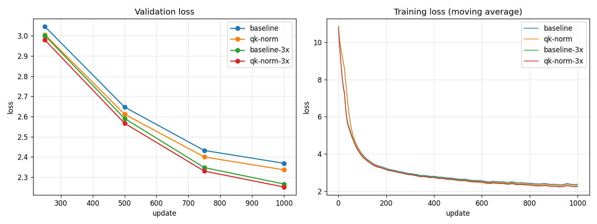

**QK-norm: a small, consistent win.** It was 0.033 lower at the usual learning rate and 0.015 lower at the
higher one, with less greedy repetition in both. But its headline benefit, stability, never got a chance to
show: no variant had a single loss spike, because 1.8e-3 isn't high enough to make this small model unstable.

**The bigger finding was the learning rate.** Tripling it improved the loss by 0.10, three times what QK-norm
did, with no instability at all. Every A/B test so far ran at 6e-4, which is too cautious for a 30M model trained
for only 1,000 updates. (The faster learner also specialized more: its losses on the two unseen datasets got
worse.) The next step is a learning-rate sweep, which will also show where training breaks with and without
QK-norm.

**Lesson.** Check your hyperparameters before your architecture. A setting carried over from another context
(6e-4 is nanoGPT's choice for much bigger models and longer runs) can hide gains larger than the change you
are testing.

---

## 16. A learning-rate sweep, and what QK-norm is really for

Step 15 showed that tripling the learning rate helped more than QK-norm. So before testing more architecture,
a sweep: the same model at five peak learning rates, with and without QK-norm (8 new variants on the L4, about 25
minutes; the 6e-4 points come from step 15, and the repeated 1.8e-3 pair matched it to the last digit).

| Best validation loss | 6e-4 | 1.8e-3 | 3e-3 | 6e-3 | 1.2e-2 |
|---|---|---|---|---|---|
| RoPE + SwiGLU, no biases | 2.369 | 2.266 | 2.666 | 2.997 | 3.325 |
| … + QK-norm | 2.336 | **2.251** | 2.376 | 2.550 | 2.553 |

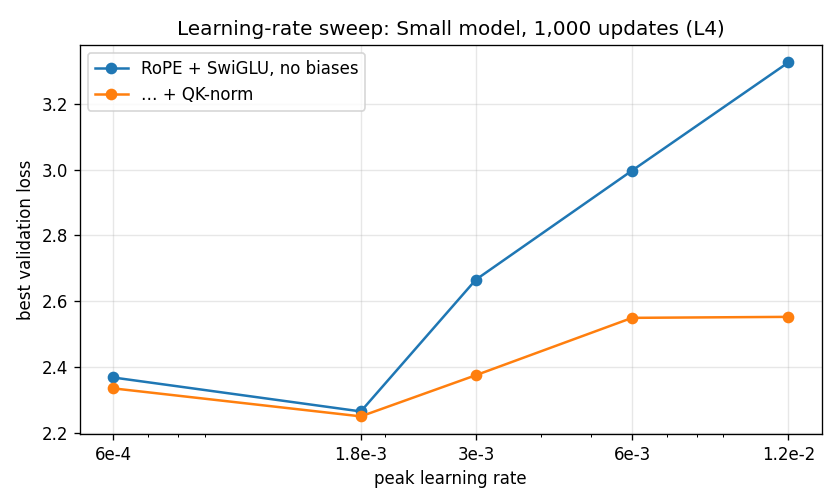

Three things stand out:

1. **The best learning rate is about 1.8e-3**, three times the 6e-4 every earlier A/B used, for both versions.
2. **Without QK-norm, training falls apart above it.** Not with spikes (there were none in any run), but by
   stalling: at 1.2e-2 the loss is 3.33, worse than after a quarter of the run at the best rate. Large updates
   push attention scores so far that the softmax saturates, and learning crawls.
3. **With QK-norm, the curve flattens.** At 1.2e-2, twenty times the original rate, it still reaches 2.55: 0.77
   better than without it. That's the stability QK-norm is famous for. It barely changes the best result, but it
   makes the learning rate much less critical, which matters when you can't afford a sweep (big models, long runs).

The costs: QK-norm made each update about 10% slower on the L4 (6.6 vs 7.3 updates/s; two small extra
normalizations per layer that PyTorch doesn't fuse), and at high learning rates both versions lose more on the
unseen datasets.

**The new baseline** for the next A/B tests: RoPE + SwiGLU, no biases, QK-norm, learning rate 1.8e-3, at
**2.251**. That's 0.38 better than the step 11 baseline (learned positions, 2.631) on the same budget of 1,000
updates.

**Lesson.** A sweep is cheap insurance. One afternoon of GPU time showed that every comparison had been running
at a third of the best learning rate, and gave QK-norm the test it needed.

---

## 17. Architecture, step six: grouped-query attention

The first change aimed at **inference** rather than quality. While generating, the KV cache keeps a key and a
value vector for every past token in every layer and every head (section 7). For big models with long contexts,
that cache, not the weights, is what fills GPU memory, and reading it is what limits generation speed.

**Grouped-query attention** (Llama 2 70B, Llama 3, Mistral, Qwen) lets several query heads share one key/value
head. The queries stay as rich as before; only the keys and values are pooled. With 6 query heads and 2 key/value
heads, each token stores 128 numbers per layer instead of 384, and the cache is 3× smaller. With one shared head,
it's called multi-query attention.

It's a switch: **Key/value heads** in the Model step (it offers only numbers that divide the head count),
`--kv-heads N` on the command line, `n_kv_head` in the notebook, `kv=N` in `ab_test.py`. The KV cache views and
memory calculator in the app account for it.

**The A/B test**, on the new baseline from step 16, on the L4. Fewer key/value heads also means slightly fewer
parameters, so this isn't an equal-size comparison; the question is how much quality each cut costs.

| | 6 KV heads (baseline) | 3 | 2 | 1 (multi-query) |
|---|---|---|---|---|
| KV cache per token | 18,432 bytes | 9,216 (2× smaller) | 6,144 (3×) | 3,072 (6×) |
| Parameters | 29.92M | 29.04M | 28.74M | 28.45M |
| Best validation loss | 2.251 | 2.252 | 2.264 | 2.284 |
| Held-out: TinyStories | 2.219 | **2.212** | 2.226 | 2.248 |
| Held-out: WikiText-2 | 9.938 | **9.863** | 9.973 | 10.077 |
| Greedy / Balanced repetition | **6.6%** / 0.2% | 19.4% / 0.7% | 13.0% / 0.0% | 37.6% / 0.2% |
| Generation, tokens/s (with cache) | 134 | 124 | 126 | 126 |

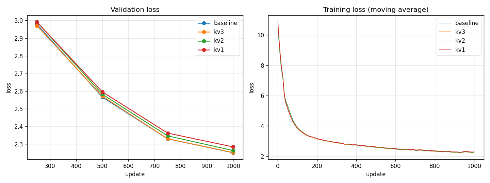

**Halving the cache was free**: 3 key/value heads matched the baseline (2.252 vs 2.251, and slightly better on
held-out data). Going to 2 cost 0.013 and to 1 cost 0.033. That's the pattern that made GQA standard: grouping
costs almost nothing up to a point, and only full sharing really hurts.

**But generation didn't get faster here.** At this size the whole cache is under 5 MB, the GPU isn't waiting on
memory, and the shared heads are copied out for each query head before attention (`repeat_interleave`), which
costs a little. The benefit is memory, and it scales: in the app's memory calculator, Llama 3.1 8B's cache for
a 128k-token context in 16-bit precision is 16 GB with 8 key/value heads, against 64 GB if each of its 32 query heads had its own.

The run also showed that training here is **exactly reproducible**: the baseline's weights came out bit-for-bit
identical to step 16's run with the same settings.

**Lesson.** Measure the thing a change is for. GQA's win is memory, not speed or loss, and at small scale the
memory win is invisible unless you measure it directly.

---

## 18. Architecture, step seven: deep and thin, or wide and shallow?

With a fixed number of parameters, you can stack many narrow layers or a few wide ones. Studies of small models
(MobileLLM, 2024) found that **depth wins**: more layers, each thinner, gave better models at the same size.

At this size, a twist: most of the parameters are in the vocabulary embedding (50,257 × width), so a narrower
model frees up a lot of parameters for extra layers. Four shapes, all within 0.7% of 29.9M parameters, all with
64-dimensional heads and the step 16 baseline's settings (`ab_test.py` gained `layers=`, `embd=` and `heads=`
options for this):

| | 3 × 448 (wide) | 6 × 384 (baseline) | 11 × 320 | 22 × 256 (deep) |
|---|---|---|---|---|
| Parameters in the blocks / in the embedding | 7.2M / 22.5M | 10.6M / 19.3M | 13.6M / 16.1M | 17.1M / 12.9M |
| Validation loss at updates 250 / 500 / 750 / 1,000 | 2.955 / 2.568 / 2.345 / 2.271 | 2.979 / 2.567 / 2.330 / **2.251** | 3.028 / 2.595 / 2.349 / 2.270 | 3.280 / 2.762 / 2.491 / 2.401 |
| Held-out: TinyStories | 2.235 | **2.219** | 2.233 | 2.360 |
| Training speed (updates/s) | **7.17** | 6.56 | 5.85 | 5.00 |
| Generation, tokens/s (with cache) | **215** | 132 | 79 | 42 |
| KV cache per token | **10,752 bytes** | 18,432 | 28,160 | 45,056 |

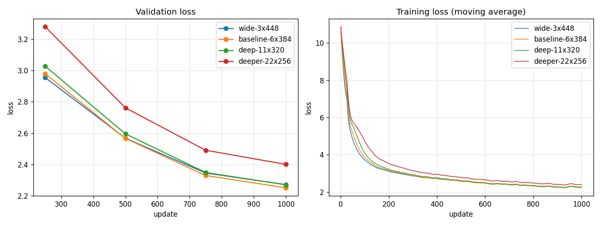

**At this budget, the middle wins.** 6 × 384 is best; 3 and 11 layers tie 0.02 behind; 22 layers is 0.15
behind. That doesn't contradict MobileLLM so much as show its conditions: deep, thin models start slower (the
22-layer model was 0.30 behind after 250 updates, 0.15 at the end, still closing) and need more training to pay
off, and the learning rate was tuned for 6 layers. 1,000 updates isn't enough for depth to win.

**Depth also has an inference cost** that loss tables hide. Each layer runs one after another, so generating a
token takes time proportional to the number of layers: the 3-layer model generates 5× faster than the 22-layer
one. And every layer keeps its own keys and values, so the KV cache per token grows with depth (4× from 3 to 22
layers). The wide model gives up 0.02 in loss for 1.6× faster generation and a cache 40% smaller than the
baseline's. For a model that has to answer quickly, that might be the better deal.

**Lesson.** "Better" depends on the budget and the goal. A result from a paper holds under its conditions (here,
long training); under yours (a short run, fast generation), the answer can flip.

---

## 19. Architecture, step eight: layer sharing

If depth helps but parameters are scarce, why not reuse them? **Layer sharing** (MobileLLM's block-wise
sharing) applies each block twice or more in a row with the same weights: 6 blocks become 12 layers deep with the
parameters of 6. Memory for weights stays the same; compute per token, and the KV cache, grow with the depth
(each pass sees different inputs, so it keeps its own keys and values).

It's a switch: **Repeat each block** in the Model step, `--block-repeat N`, `block_repeat` in the notebook,
`repeat=N` in `ab_test.py`.

| Same parameters, L4, 1,000 updates | 6 × 384 (baseline) | each block 2× (12 deep) | each block 3× (18 deep) | 3 × 448, 2× (6 deep) |
|---|---|---|---|---|
| Best validation loss | **2.251** | 2.346 | 2.518 | 2.345 (unshared 3 × 448: 2.271) |
| Held-out: TinyStories | **2.219** | 2.311 | 2.481 | 2.311 |
| Training speed (updates/s) | **6.64** | 4.99 | 3.98 | 5.89 |
| Generation, tokens/s | 134 | 75 | 51 | **135** |
| KV cache per token | 18,432 bytes | 36,864 | 55,296 | 21,504 |

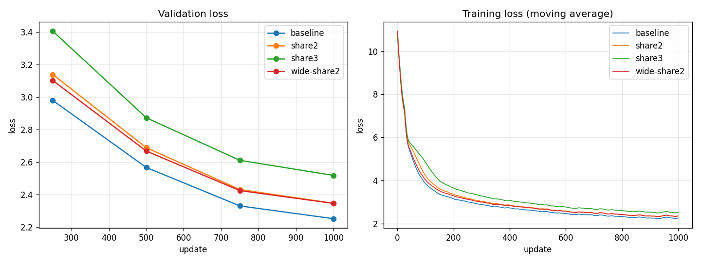

**A clear loss, every time.** Sharing made every model worse (by 0.07 to 0.27) and slower, on the same number of
updates, even though each update did 2–3× the compute. The more passes, the worse.

Why, when MobileLLM found it helps? Two likely reasons, both from the earlier steps. A shared block receives
gradients from every pass, so its weights move 2–3× as much per update: in effect, a higher learning rate, and
the sweep (step 16) showed that above 1.8e-3 this model gets worse. And, as step 18 showed, deeper models start
slower and 1,000 updates isn't long enough for depth to pay off. MobileLLM trained for far longer, with the
learning rate tuned for the shared model. A fair verdict would need a lower learning rate for the shared
variants and a longer run; at this budget, sharing doesn't pay.

**Lesson.** A negative result is still a result. It's recorded here, with the conditions, so it isn't tried
again blindly and so it can be revisited with a longer run.

---

## 20. Architecture, step nine: predicting several tokens at once

A language model is trained to predict one token: the next. **Multi-token prediction** (Meta, 2024; used in
DeepSeek-V3) adds extra heads that, from the same internal state, also predict the token 2, 3 or 4 positions
ahead. The idea is a richer training signal: to guess two tokens ahead, the model has to plan a little. Here each
extra head is one transformer block on top of the model, sharing the output layer; the training loss is the
average over all heads. The heads are used only in training: generating, and the validation loss, use the normal
next-token head, so the model you generate with is the same size as before.

It's a switch: **Tokens predicted (training)** in the Model step, `--mtp N`, `mtp_heads` in the notebook,
`mtp=N` in `ab_test.py`. The A/B also measured, for each head, how often its top guess is right on held-out text,
and how often the extra heads agree with the main head: roughly the fraction of drafts a speculative decoder would
accept (roadmap item I5).

| L4, 1,000 updates | Next token only (baseline) | + 1 head (2 tokens) | + 2 heads (3) | + 3 heads (4) |
|---|---|---|---|---|
| Best validation loss (next-token head) | **2.251** | 2.336 | 2.490 | 2.536 |
| Held-out: TinyStories | **2.219** | 2.302 | 2.454 | 2.494 |
| Top-1 accuracy: next token | **50.1%** | 49.1% | 47.6% | 47.0% |
| Top-1 accuracy: 2 / 3 / 4 tokens ahead | – | 34.3% | 33.8% / 24.3% | 33.7% / 24.9% / 19.6% |
| Extra heads agree with the main head | – | 50.9% | 51.3% / 34.6% | 51.7% / 35.6% / 27.2% |
| Training speed (updates/s) | **6.64** | 4.33 | 3.22 | 2.55 |

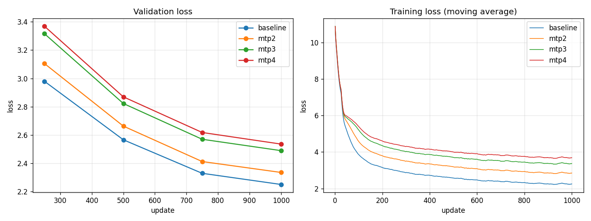

**Worse for the model itself, at this size.** Every extra head made the next-token loss worse, and training
slower (each head adds a block and another pass through the 50,257-word output layer). That matches Meta's
paper, which found the gains appear only in models with billions of parameters; small models lose. There's also
a dilution effect: with the loss averaged over heads, the next-token objective gets half (or a quarter) of the
weight, which behaves like a lower learning rate for it.

**But the extra heads are usable drafters.** The second head agrees with the main head about half the time.
In speculative decoding (I5), the head would guess the token after next, and one forward pass of the main model
would check it: accepted half the time, that's up to about 1.5 tokens per pass instead of 1, with exactly the
same output as before. Whether that's faster in practice depends on how cheap the draft is; that's the
experiment for I5.

**Lesson.** Some techniques are scale-dependent. Testing them small isn't wasted, though: it shows the costs
clearly, and here it produced a by-product (a cheap drafter) worth testing on its own.

---

## 21. Architecture, step ten: a mixture of experts

In a dense model every token goes through the same feed-forward layer. A **mixture of experts** (Switch
Transformer, Mixtral, DeepSeek) gives each block several feed-forward "experts" and a small router that sends
each token to its top 1 or 2. The model has many more parameters, but each token only uses a few experts' worth
of them, so compute per token barely grows. A load-balancing loss (Switch Transformer's) nudges the router to
spread tokens evenly, so no expert sits idle.

It's a switch: **Experts** and **Experts per token** in the Model step, `--experts N --experts-per-token K`,
`n_experts` / `moe_top_k` in the notebook, `experts=N topk=K` in `ab_test.py`. The parameter table shows both the
total and the parameters active per token.

| L4, 1,000 updates | Dense (baseline) | 4 experts, 1 per token | 8 experts, 1 per token | 4 experts, 2 per token |
|---|---|---|---|---|
| Parameters: total / active per token | 29.9M / 29.9M | 51.2M / 29.9M | 79.5M / 29.9M | 51.2M / 37.0M |
| Best validation loss | 2.251 | 2.391 | 2.464 | **2.200** |
| Held-out: TinyStories | 2.219 | 2.361 | 2.435 | **2.171** |
| Top-1 accuracy: next token | 50.1% | 47.6% | 47.0% | **51.1%** |
| Busiest expert's share of tokens (even = 25% / 12.5%) | – | 26.9% | 14.8% | 33.3% |
| Training speed (updates/s) | **6.65** | 5.62 | 4.78 | 5.12 |
| Generation, tokens/s | **132** | 76 | 67 | 66 |

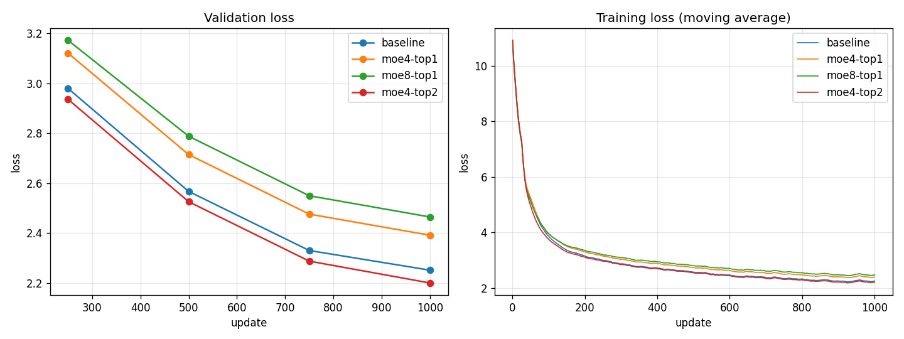

**Two experts per token: the best model so far** (2.200, 0.05 better than the dense baseline, and better on
TinyStories held-out text and next-token accuracy). **One expert per token: worse**, and worse with more
experts. The likely reason is data per expert: with one expert per token, each of 4 experts sees only about a
quarter of the tokens, so in 1,000 updates each is trained on a quarter of the data. More experts, less each.
With two per token, each expert sees twice as much, and every token gets a blend of two specialists.

Two caveats. The 2-per-token model also uses 24% more parameters per token than the baseline, so part of its
gain may simply be more compute; a dense model of 37M would be the fairer comparison. And it was slower: this
implementation loops over the experts in Python, which on a small model costs more than it saves (generation
halved, 132 → 66 tokens/s). Production MoE models use fused kernels that run all experts at once. The router
kept the load reasonably even (no expert above a third of the tokens).

**Lesson.** Mixture of experts trades memory for quality: more parameters, the same compute. Whether it pays
depends on the routing (here, top-2 beat top-1 decisively) and on training long enough for every expert to learn.

---

## 22. Putting it together: the original model vs all the wins

Every result above came from a short run (1,000 updates), one change at a time. Do the wins add up, and do they
survive a longer run? The closing experiment trained four models for **5,000 updates** each on the L4, with the
same data, seed and batches:

- **GPT-2 style**: learned positions, LayerNorm, GELU, biases, learning rate 6e-4. Where step 11 started.
- **GPT-2 style, learning rate 1.8e-3**: the same model with step 16's learning rate, to separate the two.
- **Best dense**: RoPE, SwiGLU, no biases, QK-norm, learning rate 1.8e-3.
- **Best with experts**: the same, with 4 experts and 2 per token (step 21).

| Small model, 5,000 updates, L4 | GPT-2 style | + learning rate 1.8e-3 | Best dense | Best with experts |
|---|---|---|---|---|
| Parameters: total / active per token | 30.0M / 30.0M | 30.0M / 30.0M | 29.9M / 29.9M | 51.2M / 37.0M |
| Validation loss at updates 1,250 / 2,500 / 3,750 / 5,000 | 2.448 / 2.138 / 1.987 / 1.903 | 2.403 / 2.117 / 1.950 / 1.851 | 2.248 / 2.020 / 1.870 / 1.782 | 2.213 / 1.977 / 1.824 / **1.732** |
| Held-out: TinyStories | 1.878 | 1.820 | 1.754 | **1.700** |
| Held-out: Tiny Shakespeare | 8.342 | 8.344 | 8.300 | **8.194** |
| Top-1 accuracy: next token | 55.9% | 56.2% | 57.5% | **58.1%** |
| Greedy repetition | 27.0% | 27.4% | 27.5% | **7.9%** |
| Training speed (updates/s) | **8.75** | 8.73 | 7.34 | 5.68 |
| Generation, tokens/s | 232 | **234** | 132 | 66 |

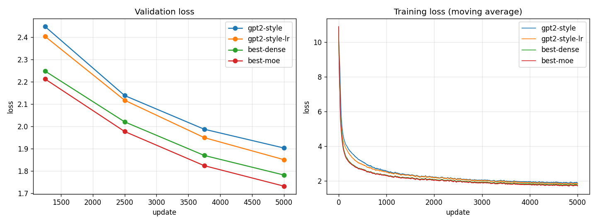

**The wins held, and added up.** Over a run five times longer, the gaps from the short A/B tests stayed: the
learning rate alone is worth 0.05, the architecture changes another 0.07, and the experts another 0.05, for
**1.903 → 1.732** in all. Put differently, the best dense model passed the GPT-2-style model's final loss before
update 3,750, and the model with experts around update 3,100: the same quality with roughly 25% to 38%
fewer updates. The best model also repeats itself far less when decoding greedily, and is better on Tiny
Shakespeare, which neither model trained on.

**The bill is speed.** In this implementation, the new architecture trains 16% slower and generates at about
half the speed (232 → 132 tokens/s; 66 with experts). None of that is inherent: the rotation angles are
recomputed for every token, QK-norm and SwiGLU add small separate operations that PyTorch doesn't fuse, and the
experts run one after another in a Python loop. Production models use fused kernels for exactly these parts.
Making generation fast again is the job of the inference track (caching the RoPE tables, compiled generation,
half precision, and speculative decoding with step 20's extra head).

Two stories from the prompt "Once upon a time there was a little girl who" (Balanced sampling, same seed):

> **GPT-2 style:** …loved to explore. She would go on adventures and play in the garden. One day she decided to
> climb a tree in her backyard. As she was climbing, she saw a little bird stuck inside. The little girl thought
> that maybe it could help the bird find its home. So she climbed up the tree and saw how many animals needed its
> own food…

> **Best with experts:** …loved to explore. She had a special box full of toys that she would play with every
> day. One day, the little girl decided it was time to go on an adventure. She grabbed her box and opened it up.
> Inside was a beautiful necklace that sparkled in the light of the box. The little girl thought about how
> magical the necklace looked in the box. But then suddenly something strange happened! The necklace started to
> move…

Both are fluent; the second keeps better track of its own objects (the box, the necklace) from sentence to
sentence, which is what a lower loss feels like in practice.

**Lesson.** Small, careful steps compound. No single change here was dramatic, but measured one at a time and
kept only when they helped, they added up to a model that learns noticeably faster from the same data, and a
clear list of what to fix next.

---

## 23. The same designs on harder data: Mini FineWeb-Edu

Everything above was measured on TinyStories, children's stories with a small vocabulary. Would the same choices
hold on harder text? The three models from step 22 were trained again, the same way (5,000 updates on a Colab L4),
on **Mini FineWeb-Edu**, educational web pages. This was the first run launched from the web app's **Lab**: it
packs every setting into a run spec, which the `lab_run.ipynb` notebook runs on a cloud GPU (Mini FineWeb-Edu
isn't tokenized on the Mac), and the results zip comes back into the model library with one click.

| Mini FineWeb-Edu, 5,000 updates, L4 | GPT-2 style | Our best, dense | Our best + experts |
|---|---|---|---|
| Validation loss at updates 1,250 / 2,500 / 3,750 / 5,000 | 5.331 / 4.878 / 4.621 / 4.495 | 4.930 / 4.560 / 4.343 / 4.206 | 4.909 / 4.522 / 4.286 / **4.143** |
| Held-out: Mini FineWeb-Edu | 4.580 | 4.301 | **4.245** |
| Held-out: WikiText-2 / Tiny Shakespeare | 6.528 / 6.296 | 6.276 / 6.138 | **6.240 / 6.121** |
| Top-1 accuracy: next token | 28.5% | 30.9% | **31.8%** |
| Greedy / Balanced repetition | 79.7% / 0.0% | 76.1% / 0.0% | 76.5% / 0.3% |
| Training (updates/s) / generation (tokens/s) | **8.57 / 226** | 7.21 / 128 | 5.56 / 66 |

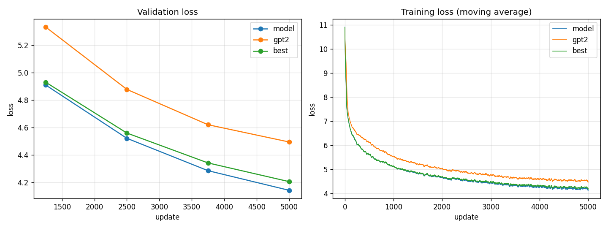

**The ranking holds, and the gaps double.** On TinyStories the best model was 0.17 ahead of GPT-2 style after
5,000 updates; on web text it's **0.35** ahead (4.495 → 4.143), with the dense best 0.29 ahead. Harder data has
more to learn, so a design that learns faster pays off more. The best dense model reached GPT-2 style's final
loss (4.495) at about update 2,900, between its checkpoints at 2,500 (4.560) and 3,750 (4.343): the same quality
in about 40% fewer updates.

The models trained on web text are also far better on the two unseen datasets than the TinyStories models were
(WikiText-2: 6.2–6.5 against 9.5–9.9), because their training text is closer to them. Greedy decoding still loops
on web text at this size (76–80% repeated 4-token runs); the Balanced default avoids it.

For scale: the 124M Large model from step 6 reached 3.603 on the same data, with four times the parameters and
six times the updates. These 30M models are 0.5 behind after 5,000 updates.

**Lesson.** Check results on the data you care about. The choices made on TinyStories transferred to web text,
and mattered more there: a short, cheap benchmark was a good guide, but the size of a gain depends on the task.

## 24. A yardstick: OpenAI's GPT-2

Our Large model has GPT-2 small's size (124M), but is it as good? Losses on different data can't be compared,
so we measured GPT-2 itself. It uses the same tokenizer and the GPT-2-style architecture this code supports, so
`reference_gpt2.py` loads **OpenAI's own weights** into our GPT class (124,439,808 parameters, exactly the
official count; two details: OpenAI stored its linear layers transposed, and its GELU is the tanh approximation),
saves it to the model library, and runs the evaluation suite on it. Mini FineWeb-Edu's held-out split was
prepared on the Mac too; its numbers matched Colab's to the third decimal, so the windows are identical.

| Held-out loss, same 256-token windows | Mini FineWeb-Edu | WikiText-2 | Tiny Shakespeare |
|---|---|---|---|
| **OpenAI GPT-2 small** (124M; WebText, ~40 GB of web pages) | **3.401** | **4.180** | **4.807** |
| Our Large 124M, GPT-2 style, 30,000 steps on Mini FineWeb-Edu (246M tokens) | 3.735 | 5.582 | 5.823 |
| Our Small, best + experts, 5,000 updates | 4.245 | 6.240 | 6.121 |
| Our Small, GPT-2 style, 5,000 updates | 4.580 | 6.528 | 6.296 |

GPT-2 is still clearly ahead, even on FineWeb-Edu, which it never saw: 0.33 better than our same-size model, and
1.4 better on WikiText-2. The difference is data. OpenAI's GPT-2 read many billions of tokens; ours read a quarter
of a billion. Open reproductions match GPT-2 with about 10 billion tokens of FineWeb.

That sets the targets. A Large model with our best design should close part of the 0.33 gap at the same 30,000
steps (on the Small model the design was worth 0.35 on FineWeb); closing all of it, and the much larger gap on
Wikipedia-style text, needs billions of tokens: FineWeb-Edu *full* plus Cosmopedia, over several sessions.

**Lesson.** Measure against a known model, not only against your own baseline. GPT-2 turned "our best" into
"0.33 short of a 2019 model of the same size", which says exactly where the remaining gains are: in the data.

## 25. Winning back generation speed

The new design trained better but generated slower: 232 → 132 tokens/s for the dense model and 66 with experts, on
the Mac. Small models spend most of each token's time not on maths but on overhead: launching dozens of tiny GPU
operations, and waiting for the GPU whenever Python needs a number back. So the fixes are about doing less of that.

**The model (I0).**
- RoPE's cos and sin tables are computed once and reused, instead of once per token.
- RMSNorm uses PyTorch's fused kernel.
- The mixture of experts ran a Python loop over the experts, each picking out its tokens. When generating, all
  experts now run as two batched matrix products and the router's weights pick the result (for one token, four small
  experts cost less than finding which two to run). Training keeps the sparse routing: the loss and gradients are
  identical to the old maths.

**The generation loop.** Profiling showed waits nobody wrote on purpose.
- `x[:, [-1], :]` (a *list* index) copies the index to the GPU, which waits for the queue. A slice, `x[:, -1:, :]`,
  gives the same result without it.
- The token history was a GPU tensor grown with `torch.cat` every token, about 0.7 ms each; it's now a Python list.
- The token, its probability, how many tokens sampling kept and the top-5 alternatives come back from the GPU in one
  read instead of four.

| Tokens/s, M5, KV cache, greedy (best of two runs) | Before | After | |
|---|---|---|---|
| Best + experts | 43 | **150** | 3.5× |
| Best, dense | 127 | **232** | 1.8× |
| GPT-2 style | 123–165 | **292–309** | ~2× |

The output is identical: the same tokens, probabilities and alternatives over 300 tokens (past the 256-token
window), greedy and sampled, with and without penalties and the cache.

**Half precision (I2)** didn't help: float16 ran at the same speed (the time isn't in the maths at this size), and
bfloat16 changed the greedy output after 11–38 tokens. **A compiled one-token step (I8)**, with fixed-size buffers
and a mask so `torch.compile` builds it once, works on the Mac: +25% for the dense model and +35% with experts, but
nothing for GPT-2 style, which then attends over the whole 256-token window from the first token. Not adopted yet.

**Speculative decoding (I5).** A small model guesses the next few tokens, one at a time; the large model checks
all of them in a single pass, keeps every guess it agrees with and adds its own next token, so each pass of the large
model yields 1 to k + 1 tokens. The output is exactly the large model's: the same greedy tokens, or, when sampling,
the same distribution (a guess is kept with probability min(1, p/q), and a rejected one is redrawn from what's left of
the large model's distribution). It needed a KV cache that takes several new tokens at once (each sees the cache and
the new tokens before it) and can forget the rejected ones.

| Target (drafter), greedy, 180 tokens | Target alone | Best with drafting | Guesses kept | Tokens per target pass |
|---|---|---|---|---|
| Medium 51M, TinyStories (Tiny 4 × 256, 2,000 updates) | 231–233 tokens/s | 0.99–1.07× (k = 2) | 59–69% | 2.2–2.4 |
| Medium 51M, TinyStories (Small 6 × 384) | 231–233 | 0.84–0.91× | 67–78% | 2.3–2.5 |
| Our Large 124M, FineWeb (Small 6 × 384) | 115 | 0.97× (k = 3) | 90% | 3.7 |
| OpenAI GPT-2 124M (Small 6 × 384) | 98 | 1.33× (k = 2) | 79% | 2.6 |

It works, the large model accepts most guesses, and it's still barely faster. The reason is the same as above: on the
Mac a pass of these models costs mostly fixed overhead, not maths. A pass of the 124M model costs 8.2 ms for one token
and 9.2 ms for four, which is what makes checking cheap, but a 6-layer drafter costs 3.5 ms per guess and a 4-layer one
1.6 ms, so drafting eats most of the saving. It pays when the large model is many times slower per token than the
drafter: bigger models, or slower hardware. Kept as a tool (`speculative_generate`), not the default.

**Lesson.** Profile before optimizing. The biggest cost wasn't the maths or a missing compiler, but a few lines that
made Python wait for the GPU, and one list index.

## 26. Better decoding algorithms

Greedy decoding loops: our small FineWeb model repeats 76% of its 4-token runs, the TinyStories one 27.5%. The
Balanced preset fixes that with randomness and a repetition penalty, but the penalty pushes down every word
already used, including "the" and the story's characters. Four alternatives:

- **DRY** ("don't repeat yourself"): penalize only a token that would *continue a sequence already in the text*,
  by 0.8 × 1.75^(n − 2) for a repeat n tokens long (n ≥ 2). Single words can come back freely.
- **Typical sampling** (Meier et al. 2022): keep the tokens whose surprise is closest to the model's average
  surprise at that point, dropping the blandest choices as well as the unlikely ones.
- **Contrastive search** (Su et al. 2022): of the 4 most likely tokens, take the best of
  0.4 × probability − 0.6 × (how similar its hidden state is to anything already written). Deterministic.
- **Beam search**: keep the 4 most probable continuations; optionally never repeat a 3-token sequence.

Each method continued the evaluation suite's 6 prompts for 100 tokens (sampled ones with 2 seeds). Fluency is
how likely a bigger model (the judge) finds the text: Medium 51M for TinyStories, our Large 124M for FineWeb.
Lower is more fluent, but looping text is easy to predict too, so it only compares methods that don't loop.

| Method | TinyStories: repeated 4-grams | judge perplexity | FineWeb: repeated 4-grams | judge perplexity |
|---|---|---|---|---|
| Greedy | 27.5% | 2.70 | 76.1% | 2.63 |
| Greedy + DRY | **1.2%** | **2.67** | 12.4% | 5.76 |
| Balanced (T 0.8, top-p 0.9, repetition penalty 1.15) | 0.3% | 5.67 | 1.2% | 23.4 |
| T 0.8, top-p 0.9 + DRY | 1.4% | **4.16** | 0.9% | **18.8** |
| Typical 0.9 (T 1.0) | 1.9% | 7.79 | 0.1% | 89.9 |
| Contrastive search (k 4, α 0.6) | 1.2% | 3.66 | 0.7% | **7.99** |
| Beam 4 | 18.7% | 2.05 | 65.2% | 2.59 |
| Beam 4, no repeated 3-grams | 0.0% | 2.34 | 0.0% | 5.05 |

- **DRY does what a repetition penalty can't.** Greedy + DRY keeps greedy's fluency on stories and stops its
  loops; with sampling it matches Balanced's low repetition and the judge finds it more fluent, because common
  words aren't penalized. On web text 0.8 is too weak for greedy: loops there are longer and vary a little.
- **Contrastive search** gave the most coherent web text of the methods that don't loop.
- **Beam search** finds more probable text and loops more than greedy, as is well known. Banning repeated
  3-grams stops the exact repeats, but the text circles the same idea ("the first woman… the second woman…").
- **Typical sampling** turned into word salad: a 30M model's "typical" tokens are often nonsense.

DRY and typical-p are sliders in the Generate step, with a **Greedy + DRY** preset, and **Balanced** now uses
DRY 0.8 instead of the repetition penalty (the evaluation suite keeps the old setting, so every model is measured
the same way). Contrastive search, beam search and several samples at once are in the Generate step's **Other ways
to generate** card. Six prompts is a small sample, and these are 30M models.

**Lesson.** Penalize what you actually don't want. A repetition penalty punishes words; the problem was
repeated *sequences*. DRY targets exactly that and costs greedy decoding nothing on the stories it was fluent on.

## 27. 8-bit and 4-bit weights

A 124M model in 32-bit floats takes 495 MB. `quantize.py` stores each weight matrix as small integers and a few
scales, symmetric around zero: at 8 bits one scale per row (w ≈ q × scale, q in −127…127), at 4 bits one per group
of 64 weights (q in −7…7). A layer turns its integers back into floats when it runs, so the maths is unchanged and
only the storage shrinks.

| Held-out loss · weights | 32-bit | 8-bit | 4-bit (embedding 8-bit) |
|---|---|---|---|
| Our Large 124M, GPT-2 style (FineWeb) | 3.7345 · 495 MB | 3.7353 · **125 MB** | 3.7490 · **88 MB** |
| Small, best dense (TinyStories) | 1.7544 · 120 MB | 1.7545 · 30 MB | 1.7636 · 26 MB |
| Small, best + experts (TinyStories) | 1.6996 · 205 MB | 1.7000 · 52 MB | 1.7029 · 37 MB |
| OpenAI GPT-2 small | 3.4014 · 498 MB | 3.4607 · 128 MB | 3.5616 · 90 MB |

- **8 bits is almost free** for our models (+0.001 or less): a quarter of the memory. Greedy text sometimes takes
  a different turn after 30 tokens, but it's as good.
- **4 bits** costs our models 0.003–0.015, for a fifth to a seventh of the memory.
- **OpenAI's GPT-2 is harder to quantize.** At 4 bits it first broke completely (3.40 → 6.98), and one matrix
  did it: the shared embedding / output layer (3.40 → 7.03 on its own; every other layer 0.01–0.05). Its rows hold
  a few large values (up to 1.8 against a typical 0.09), so with 15 levels the many small weights all round to
  the same few values. Keeping that matrix at 8 bits, as llama.cpp does, brings it to 3.56. Even at 8 bits GPT-2
  loses 0.06, against 0.001 for our GPT-2-style model of the same size: its weights have larger outliers.
- **It's slower here**: 1.3–3.5× (124M: 111 → 32 tokens/s), because PyTorch on the Mac has no fast integer matrix
  multiply, so every layer rebuilds its float weights on every token. Quantization pays where memory is the limit
  or the hardware multiplies integers directly.
- **The 8-bit KV cache** wasn't worth building at this size: for 256 tokens the 124M model's cache is 19 MB,
  against 495 MB of weights.

**Lesson.** Quantization error depends on the weights, not just the bit count: the same 4 bits that cost our
model 0.015 broke GPT-2 until one outlier-heavy matrix was kept at 8 bits. Measure per layer.

## 28. Batched generation and prefix caching

The same fact that made speculative decoding disappointing makes batching powerful: a pass of these models costs
mostly fixed overhead. `generate_batch` reads a prompt once, copies its KV cache to n rows and runs all n samples'
next tokens through the model in one batched pass per step.

| Tokens/s in total (T 0.8, top-p 0.9, 150 tokens) | 1 stream (the app) | 4 samples | 16 | 64 |
|---|---|---|---|---|
| Small, best dense (TinyStories) | 92 | 340 | 1,083 | **2,864** (31×) |
| Large 124M (FineWeb) | 60 | 216 | 852 | **1,682** (28×) |

Each sample runs at about half the single-stream speed, but 64 of them together give 28–31× the throughput. With
greedy decoding every row is identical to `generate_stream`'s output. It's the way to make many samples: best-of-n,
comparing settings, building a dataset.

Two side findings:
- **Prefix caching isn't worth it at this size.** It saves re-reading a prompt that was seen before, and reading
  a 250-token prompt takes 17 ms (Small) to 25 ms (124M). With a 256-token window there's at most ~16 ms to save.
- **Sampling costs a little speed, not half.** Measured side by side, under the same load, Balanced runs 10–25%
  slower than greedy (Small 91 vs 103 tokens/s, Large 60 vs 79). Two fixes didn't help reliably: an exact,
  faster way to draw the token (the "exponential race", 5× faster than `torch.multinomial` on its own) and copying
  the penalty's token history to the GPU before the model's pass. Both were left out. (A first comparison made
  sampling look twice as slow: it set this afternoon's numbers, with the GPU shared by other apps, against
  this morning's quiet ones.)

**Lesson.** The same property can sink one idea and float another. Fixed overhead per pass made a drafter
nearly as expensive as the model it was helping, and made 64 samples cost little more than a few.

## 29. Seeing the model work: the Explorer

The walkthrough in *Inside the transformer* uses made-up 4-number vectors so every value can be checked by
hand. That explains the maths but hides what a real model does. The **Explorer** shows the real thing: one prompt
through the model you've chosen, every number its own. Its layout takes the idea of
[Transformer Explainer](https://poloclub.github.io/transformer-explainer/) (Georgia Tech's Polo Club, built
around GPT-2), redrawn for this project's designs (RoPE, QK-norm, SwiGLU, experts) and with more to inspect.

- `explain.py` replays the forward pass block by block and records each stage: embeddings, every head's
  attention before and after the mask and softmax, one layer's queries, keys and values, the feed-forward
  activations or the router's choices, and each token's vector size. Its final logits match the model's own
  (within 0.0004), so what's drawn is what the model computes.
- **Flow** draws it as ribbons: tokens fan into every head's Q, K and V; the chosen head's keys drop into the
  attention dots, queries run into their rows, values flow to Out; each token dips into the feed-forward
  layer's wider hidden layer and comes back beside the residual; the last token fans out into the
  probabilities. **Diagram** shows the numbers.
- **▶ Play the data flow** follows one token through the whole model, block by block, lighting only what acts
  on it and explaining each step with its real numbers; the diagram moves to each block as the token reaches it.
  For "cat" in "The little cat sat on the mat" (our Small model, head 1): in block 1, scores 1.1, 2.3, 1.1 against
  "The", "little", "cat", after softmax 20%, 62%, 19%, 3.5% of the 1,024 hidden values strongly active, and the
  vector grows from 15.5 to 40.7. By block 3 its attention has moved to "The" (61%; head 6 puts 96% there). At
  the end, its own prediction: "was" (33%), while the real next word, "sat", is only the model's 42nd choice
  (0.28%, a loss of 5.88 for that token). After "sat", it does guess "on" first (35%).
- The **logit lens** applies the final norm and output layer after every block. For OpenAI's GPT-2 and
  "…the capital of Germany is", the guess is "not" for seven blocks, "Paris" after block 8 (the earlier answer in
  the prompt) and "Berlin" (80%) from block 9: you can see where in the network the answer appears.
- Clicking a token's name follows it through every block: what it attends to, its vector size and its
  prediction. "cat" attends to itself in block 1, then to "The"; its vector grows from 41 to 144.

Two things had to be fixed to make it readable. Each vector is coloured by its own typical size, because
GPT-2's vectors have one or two huge dimensions that otherwise wash everything else out. And the long single
row of stages was split into two bands (attention, then feed-forward), at 40-pixel rows, with a full-screen
mode.

**Lesson.** Show the real numbers. Made-up examples teach the mechanics; the real model's numbers show things
the mechanics don't predict: a head that only looks at the previous word, an answer that appears halfway up the
network, outlier dimensions in GPT-2.

## 30. The best design at GPT-2 size

Every architecture win so far was measured on a 30M model over 1,000–5,000 updates. Would it hold at GPT-2's size
over a full run? The Large model (12 layers × 768, 123.6M parameters) was trained again with the best dense
design (RoPE, SwiGLU, no biases, QK-norm), on the same data (Mini FineWeb-Edu *small*), for the same 30,000 steps of
32 × 256 tokens, on a Colab L4, and compared with our first Large model (GPT-2 style, learning rate 6e-4) and
OpenAI's GPT-2.

A short check picked the learning rate first: 1,000 updates each at 6e-4, 1.2e-3 and 1.8e-3 gave 5.125, 5.103 and
5.105. 1.2e-3 and 1.8e-3 tie; 1.2e-3 is the safer choice for a long run at this size.

| Validation loss at step | 1,000 | 2,000 | 5,000 | 10,000 | 15,000 | 20,000 | 25,000 | final (30,000) |
|---|---|---|---|---|---|---|---|---|
| GPT-2 style, lr 6e-4 | 5.428 | 4.870 | 4.287 | 4.006 | 3.847 | 3.734 | 3.628 | 3.603 |
| Best design, lr 1.2e-3 | **5.173** | **4.636** | **4.227** | 4.023 | 3.859 | **3.713** | **3.621** | **3.563** |

| Held-out loss, same 256-token windows | Mini FineWeb-Edu | TinyStories | WikiText-2 | Tiny Shakespeare |
|---|---|---|---|---|
| Our Large, GPT-2 style | 3.735 | 3.872 | **5.582** | 5.823 |
| **Our Large, best design** | **3.691** | **3.856** | 5.605 | **5.753** |
| OpenAI GPT-2 small | 3.401 | 2.553 | 4.180 | 4.807 |

- **It's better, but by much less than on the small model.** 0.04 on held-out web text, against 0.29–0.35 for the
  Small model at 5,000 updates. The new design led early (0.25 at step 1,000), fell level in the middle (its
  higher learning rate slowed it while the rate was high), and pulled ahead again as the rate decayed.
- **The design mostly buys speed of learning.** At a short budget that's worth a lot; with 30,000 updates there's
  less left to win. The gain was also measured with a different learning rate, so it isn't the design alone.
- **GPT-2 is still 0.29 ahead** on web text (it was 0.33), and far ahead on Wikipedia and stories. That gap is the
  data: GPT-2 read billions of tokens, these models a quarter of a billion.
- **Text:** fluent and on topic, but it still loops on ideas ("a solid, solid, and solid form"): a 124M model
  that has read 246M tokens.
- **Standard benchmarks** (zero-shot, scored like EleutherAI's harness; GPT-2 reproduces its published scores
  exactly): ARC-Easy 42.1% (GPT-2 43.8%), HellaSwag 27.9% (31.1%), PIQA 58.4% (62.9%), Winogrande 50.6% (51.6%,
  both at chance), LAMBADA 9.6% (32.6%). Close on school science, which is what the data teaches; far behind on
  LAMBADA's novels, because educational web pages contain almost no fiction. The benchmarks show *what kind* of
  data is missing, not just how much.

It took 3 h 38 min (18,759 tokens/s, 12.9 GB peak memory), 35% slower per step than the GPT-2-style model:
SwiGLU's three matrices and QK-norm cost time on the GPU even at the same parameter count.

**Lesson.** Check a small-scale win at the scale you care about. The design still won at 124M, but the size of a
gain measured on a short run at 30M didn't carry over; what remains is the data.

## 31. Faster training

The benchmarks said the next gains are in data, and data costs GPU hours: the 124M run read 246M tokens in 3 h 38 min
(18,759 tokens/s on an L4). Before a bigger run, the training itself had to get faster. `speedtest.py` (run from
`speed_test.ipynb` on Colab) times real training steps of the 124M best design on real batches, one change at a time:

| Colab L4, 124M best design | 256 tokens of context | 512 tokens | Peak memory |
|---|---|---|---|
| The recipe so far (no compile, plain AdamW) | 20,869 tokens/s | 20,182 | 11.2 GB |
| + fused AdamW and TF32 | 22,181 (1.06×) | 21,555 (1.07×) | 11.2 GB |
| **+ `torch.compile`** | **35,344 (1.69×)** | **34,381 (1.70×)** | **7.5 GB** |
| + a bigger batch (64 / 32 sequences) | 34,203 | 33,920 | 13.2 GB |

- **`torch.compile` is the win.** It fuses the many small GPU operations of each block (the norms, RoPE, SwiGLU's
  gate) into fewer kernels: 1.7× faster, and a third less memory, because fused operations don't store their
  intermediate results.
- **Bigger batches don't help here.** Once compiled, the L4 is busy at 32 sequences; its compute is the limit, so the
  2–3× hoped for was too optimistic for this GPU. An A100 has about 2.5× the compute and should go further, but Colab
  had none free.
- **512 tokens of context cost almost nothing** (3% slower per token), which helps the next run.
- **The maths is unchanged:** on the Mac, where these options don't apply, the training losses are identical to the
  last digit, and a compiled model's loss is identical with gradients within 4e-8.

`torch.compile` is now on by default for GPU training in the notebook (`compile_model`). The data run planned next,
500M tokens on an L4, takes about 4 hours instead of 7.

**Lesson.** Measure each speed-up on its own, on the hardware you'll use. One change gave 1.7×; the others gave
6% and nothing, and an estimate made from other people's GPUs was too optimistic for this one.

## 32. More kinds of data

The benchmarks on the first base model (section 30) pointed at the data: close to GPT-2 on school science, behind on
everyday common sense, far behind on LAMBADA's novels, because educational web pages are almost all explanation and no
stories. So the next run kept the design and the number of updates, and changed what the model reads:

| Dataset | Training tokens | Share | Chosen for |
|---|---|---|---|
| Mini FineWeb-Edu (small) | 650M | 55% | general educational text, as before |
| Cosmopedia stories (first 300K) | 162M | 14% | narrative prose (LAMBADA) |
| Cosmopedia wikihow | 166M | 14% | everyday how-to (PIQA, HellaSwag) |
| Cosmopedia openstax | 99M | 8% | textbooks (ARC) |
| Cosmopedia stanford (first 100K) | ~95M | ~8% | university lessons (ARC) |
| Cosmopedia khanacademy | ~20M | 2% | lessons |

Cosmopedia is synthetic: textbooks, stories and how-to articles written by an LLM from seed topics, the idea behind
TinyStories applied to general knowledge. Two code changes made the run possible: the training notebook can now mix
datasets (batches drawn in proportion to size), and a large dataset can be streamed for just its first N rows (300K of
5 million stories, without the 12 GB download). The context grew to 512 tokens, which with `torch.compile` costs only
3% in speed. 30,500 updates of 32 × 512 tokens: 500M tokens, about the same amount of FineWeb-Edu as before plus 255M
of Cosmopedia, in 4 h 20 min on a Colab L4.

| | First base (FineWeb-Edu, 256 ctx) | **New base (+ Cosmopedia, 512 ctx)** | OpenAI GPT-2 small |
|---|---|---|---|
| Held-out Mini FineWeb-Edu | 3.691 | **3.549** | 3.401 |
| Held-out TinyStories | 3.856 | **2.790** | 2.553 |
| Held-out WikiText-2 | 5.605 | **5.370** | 4.180 |
| Greedy repetition | 75% | **25%** | 66% |
| HellaSwag | 27.9% | **29.7%** | 31.1% |
| LAMBADA | 9.6% | **15.7%** | 32.6% |
| ARC-Easy | 42.1% | **44.0%** | 43.8% |
| PIQA | 58.4% | **62.6%** | 62.9% |
| Winogrande | 50.6% | 50.0% | 51.6% |

- **Every gap the data was chosen for narrowed.** ARC-Easy now matches GPT-2 and PIQA is within 0.3; HellaSwag closed
  more than half its gap; LAMBADA rose by 6 points, still far behind (synthetic stories aren't novels).
- **It got better at web text too:** held-out FineWeb-Edu improved by 0.14, halving the gap to GPT-2, though the model
  read about the same amount of FineWeb-Edu as before. Varied text helps on the original data, not just on new tasks.
- **Narrative text improved most** (TinyStories 3.856 → 2.790, near GPT-2), and greedy loops fell from 75% to 25%.
- The held-out test uses 256-token windows, so none of this comes from the longer context yet.

It became the new base model. A run of the same length on a different mix gained more than the whole architecture
track did at this size (0.14 against 0.04 on held-out web text).

**Lesson.** Let the evaluation tell you what to train on. The benchmarks showed which kinds of text were missing; adding
exactly those closed the gaps they pointed at, and helped everywhere else too.

## 33. A second kind of model: masked diffusion

Every model so far writes left to right, one token per pass. A **masked diffusion model** (the author's own design,
`diffusion_models/v1_original.py`, made modular in `diffusion_models/`) writes by denoising: the continuation starts as
all `[MASK]`, and at each step a bidirectional transformer predicts every masked position at once and a few are
revealed. Training is the reverse: hide a random share t/T of a real text's tokens and learn to recover them. Its
**likelihood bound** (the masked loss weighted by T/t) is an upper bound on the loss per token, so it can sit next to an
autoregressive model's loss, flattering the autoregressive side.

| 51M parameters, 164M tokens, 49–50 min on a Colab L4 | Likelihood bound | Autoregressive model, same size and tokens |
|---|---|---|
| TinyStories | **2.525** | 1.583 (*Medium 51M · TinyStories · 20k steps*) |
| Mini FineWeb-Edu (small) | **5.269**, still falling | (the 124M base model: 3.549 held out, 500M tokens) |

- **A long plateau first.** For about 2,500 updates (20M tokens) the model only learned how common each word is, then
  started to use the context and the loss fell fast, as BERT-style models do. On FineWeb-Edu it took 3,000 updates.
  Both 2,000-update checks had stopped just short of it, and a higher learning rate made it worse.
- **The sampler made the difference, twice.** v1's sampler re-drew every position at every step, so the last step
  re-sampled all 128 tokens independently: fluent middle steps, jumbled final text. Keeping each token once revealed
  gave coherent stories. On FineWeb-Edu that sampler then collapsed into one word ("fish, fish, fish"): it fills the
  position it's surest about, which is usually a copy of a neighbouring word, and every copy makes the next surer.
  `diffusion_models/quality.py` measured it (on held-out prompts: repetition, and the base model's loss on the text): a
  repetition penalty of 1.3 took repeated 4-token runs from 43% to 4% on FineWeb-Edu (real text 0%) at about real
  text's judge loss. Semi-autoregressive blocks, left-to-right order, re-masking and random order were all worse.
- **Speed:** 64 tokens in 64 passes, but every pass reads the whole window: about 0.3 s on the L4, 6 s on the M5,
  where the autoregressive model with its KV cache writes the same in under a second.
- The app's **Diffusion** page replays the denoising: masked positions filling in, and a grid of when each position was
  revealed (scattered clusters, where left-to-right writing draws a staircase).

The TinyStories model writes stories about as coherent as the autoregressive one at the same size; the FineWeb-Edu one
stays on topic but loosely connected. A three-times-longer FineWeb-Edu run (492M tokens) is training.

**Lesson.** With a diffusion model, the sampler is half the model: the same weights produced jumbled text, a loop of one
word, or readable stories depending only on which positions are revealed when.

## 34. Lessons

1. **Most of the early gains were training hygiene, not architecture.** Document separators, enough weight
   updates and a sensible learning rate took validation loss from 4.5 to 2.2 at a smaller size.
2. **Underfitting looks like train loss ≈ val loss.** Fix it with more updates, less regularization and a
   higher learning rate, not a bigger model.
3. **Check your settings mean what you think**: a "minimum" learning rate above the maximum, "supported"
   bfloat16 that's emulated.
4. **Measure on your hardware.** The KV cache saved 37% on a Mac and slowed generation on an L4.
5. **Decoding matters as much as weights** for how good a small model seems.
6. **Fix your evaluation before you optimize**, and change one thing at a time.
7. **Small models learn style before facts.** Fluent and confidently wrong is a stage, not a bug.
8. **Architecture choices with a clear reason (RoPE) can pay off immediately; others (RMSNorm) are about
   efficiency, not quality.** Know which kind you're testing.
9. **When training suddenly slows, check memory before code.** Gradient accumulation trades a little speed
   for a lot of memory, without changing the maths.
10. **Compare at equal parameters.** SwiGLU's win only means something because its hidden layer was narrowed to
    keep the count the same.
11. **Small metrics are noisy.** A number measured on a handful of samples (greedy repetition over 6 prompts)
    can swing from 9% to 28% and back; trust the loss over thousands of tokens.
12. **Re-check the hyperparameters as the model changes.** The learning rate mattered more than QK-norm.
13. **Move experiments to where they're cheap.** The same A/B took 25 minutes per variant on the Mac and 2½ on
    a cloud GPU, with the same results, so more ideas get tested and with longer runs.
14. **Some changes don't move the best score but widen the safe range.** QK-norm hardly changed the best loss,
    but made a 7× higher learning rate cost 0.3 instead of 1.06.
15. **Measure what a change is for.** GQA didn't change loss or speed here; its win is a smaller KV cache.
16. **Shape matters for speed, not just quality.** At equal size, a 3-layer model generated 5× faster than a
    22-layer one, for 0.13 better loss than the deep one and 0.02 worse than the best.
17. **Interactions matter.** Layer sharing behaves like a higher learning rate for the shared weights; a change
    that's tested at someone else's settings can fail at yours for reasons that have nothing to do with the idea.
18. **Some ideas only pay at scale.** Multi-token prediction hurt a 30M model, as its authors found for small
    models, but left behind heads that could speed up generation.
19. **Count compute, not just parameters.** A mixture of experts can have 2.6× the parameters for the same
    compute per token; compare models on both, and on speed in your own implementation.
20. **Check that short-run wins survive a long run.** Here they did, and added up: 1.903 → 1.732 at 5,000
    updates. That's what made the short A/B tests worth trusting.
21. **Check on the data you care about.** The TinyStories choices held on web text, and gained twice as much.
22. **Measure against a known model.** OpenAI's GPT-2 showed our 124M model is 0.33 short on web text, and why.
23. **Profile before optimizing.** For small models, the time goes to overhead: every read back from the GPU waits
    for it, and a list index can hide one. Removing them doubled generation speed with identical output.
24. **Penalize what you actually don't want.** Loops are repeated sequences, not repeated words: DRY stopped
    greedy's loops on stories without making the text less fluent, where a repetition penalty punishes every word.
25. **Quantization error depends on the weights, not just the bits.** 4 bits cost our 124M model 0.015 and broke
    GPT-2 until its outlier-heavy embedding was kept at 8 bits.
26. **The same property can sink one idea and float another.** Fixed overhead per pass made speculative
    decoding barely pay, and made 64 samples at once 28–31× the throughput of one.
27. **Show the real numbers.** Made-up examples teach the mechanics; a real model's numbers show what they
    don't predict: heads with habits, an answer that appears halfway up the network, outlier dimensions.
28. **Check a small-scale win at the scale you care about.** The best design still won at 124M, but by 0.04, not
    the 0.3 it gained at 30M over a short run: it mostly buys speed of learning. The rest of the gap is data.
29. **Measure each speed-up on its own, on your hardware.** `torch.compile` gave 1.7×; fused AdamW 6%; bigger batches
    nothing, because the compiled L4 was already compute-bound.
30. **Let the evaluation tell you what to train on.** The benchmarks showed which kinds of text were missing;
    adding them closed those gaps and improved the original data too (0.14, against 0.04 from the architecture at 124M).
31. **A diffusion model's sampler is half the model.** The same weights gave jumbled text, a one-word loop or coherent
    stories depending only on which positions were revealed when; measure the text, not just the loss.
32. **Look for the plateau before giving up.** The diffusion model learned nothing but word frequencies for 2,500
    updates, then took off; a 2,000-update check would have called it broken.

## 35. What's next

The [roadmap in the analysis](analysis.md#improving-the-model-step-by-step) lists the next steps.
- **Quantization with GPTQ** (llm-compressor's `oneshot`) on the new base model, compared with the simple
  round-to-nearest 8- and 4-bit weights of section 27.
- **Post-training:** instruction tuning (a Chat mode), preference optimization (DPO) against repetition, and
  reinforcement learning with checkable rewards (GRPO).
- **More data:** a long, resumable run on FineWeb-Edu *full* plus Cosmopedia, ideally on an A100.
- **Diffusion:** the longer FineWeb-Edu run, generation from the Generate page, and the side-by-side page with the
  autoregressive model.
- **Later:** re-testing depth and layer sharing with longer runs.

Every step will be added here with what it measured.

## Reproduce it

```bash
git clone https://github.com/a-ramakrishnan/tinystories-ARM-model.git
cd tinystories-ARM-model
pip install -r requirements.txt
python3 app/server.py          # the step-by-step web app
python3 full-model.py --help   # or the command line
```

For the cloud runs, open the notebook in Colab with the badge in the [README](../README.md).
