# How to use it

Everything you need to run the project: on your Mac (the web app or the command line), or on a cloud GPU with
the notebooks. For what each part does inside, see [Understanding the components](components.md); for what was
measured, see [Analysis](analysis.md).

## Three ways to use it

| | What it is | Best for |
|---|---|---|
| **Web app** · `python3 app/server.py` | A local, step-by-step studio in your browser with explanations and live charts | Learning how it works, experimenting |
| **Command line** · `python3 full-model.py` | Runs the whole pipeline in one go | Long training runs |
| **Notebook on Colab or Kaggle** · [Open in Colab](https://colab.research.google.com/github/a-ramakrishnan/tinystories-ARM-model/blob/main/train_step_by_step.ipynb) | The same steps on a free cloud GPU; brings the model home as a zip | Bigger or longer training runs, or no Mac |

## Made for Apple Silicon

- **Trains on the Mac GPU.** The device is picked automatically, and on M-series Macs that's the GPU through
  PyTorch's Metal backend (MPS). The app and the script both show it at startup:
  `Training on device: mps (float32)`.
- **No extra setup.** The standard `pip install torch` already includes Metal support on macOS.
- **Full precision on MPS.** Training uses float32 on the Mac. Mixed precision is only switched on for CUDA,
  where it's well supported.
- **Unified memory.** Even the Large preset (124M parameters, about 2 GB to train) fits comfortably on a
  16 GB Mac. The app checks the memory before building a model that wouldn't fit.
- **Measured speed.** On an M5 with 16 GB, the default model trains at about **2 steps per second**
  (32 × 128 tokens per step, measured with the original 128-token window). The *Quick* preset (2,000 steps) takes roughly 20 minutes and brings the
  validation loss from 10.8 down to about 4.6. The full run (20,000 steps) takes several hours. Generation
  with the KV cache runs at about 130–150 tokens per second for the default model.

It also runs on an Nvidia GPU (CUDA, with mixed precision) or the CPU, but the Mac is what it's built and
tested on.

Check that PyTorch can see your Mac's GPU:

```bash
python3 -c "import torch; print('MPS available:', torch.backends.mps.is_available())"
```

## Quick start (Mac)

Requires an Apple Silicon Mac (M1 or later) and Python 3.9+.

```bash
git clone https://github.com/a-ramakrishnan/tinystories-ARM-model.git
cd tinystories-ARM-model
pip install -r requirements.txt
```

### Web app (recommended)

```bash
python3 app/server.py
```

It opens http://127.0.0.1:8000 in your browser. The sidebar walks through seven steps:

1. **Dataset**: add one or more datasets by name or link, or from the gallery of public datasets. **Check**
   validates a dataset before anything is downloaded. With several, choose whether batches mix them by size
   or equally.
2. **Tokenize**: see how BPE works through examples (common words, rare words, numbers, capitals, emoji),
   try your own text, then tokenize your training data.
3. **Batches**: a worked example shows how one window becomes many next-token exercises; then sample a real
   batch (and see which datasets it came from).
4. **Model**: pick a size preset (Tiny 16M, Small 30M, Medium 51M, Large 124M) or set layers, heads and
   embedding size yourself, with a live parameter estimate. Building shows the architecture diagram, the
   input and output token counts, and how every parameter adds up.
5. **Inside the transformer**: compare encoder-only, decoder-only and encoder–decoder models, then walk a
   prompt through a whole transformer block and out to the next token in 13 stages, and explore your
   model's real attention heatmaps by layer and head. The **Explorer** (switch at the top of the step) draws
   your model's real numbers for the whole model at once, in two looks:
   - **Flow** (the default): ribbons carry every token from the embedding into each head's Q, K and V, through
     the chosen head's attention, down into the feed-forward layer and back, past the other blocks, and out to
     the next-token probabilities. **▶ Play the data flow** follows one token through the whole model: block 1
     step by step, then each later block's attention and feed-forward, with the diagram moving to each block
     as the token reaches it, and finally the prediction. It lights only the parts that act on the token,
     moves particles along its ribbons and explains each step with the real numbers; pause with space, step
     with ← →, jump to a block with the block arrows, or pick the token to follow.
   - **Diagram**: the numbers themselves, in two bands (attention, then feed-forward): embedding, query, key
     and value strips, the attention matrix as scores, mask or softmax (click a cell for its calculation), the
     feed-forward activations or the experts' router.

   Both have head and block controls, sampling sliders for the next-token probabilities, an explanation for
   every part, **Full screen** (Esc to leave), a **logit lens** table (what the model would predict after each
   block), and, when you click a token's name, a table that follows it through every block.
6. **Train**: see what one training step does, how loss relates to probability, and the learning-rate
   schedule; then train and watch loss, speed, optimizer updates, parameters updated and tokens processed.
   Every run is kept in a history table.
7. **Generate**: text streams in token by token, colored by the model's confidence, with tokens used, time
   to first token, decode speed, KV cache size, GPU memory and a per-token timing chart. Switch the KV cache
   on or off, or run a side-by-side comparison.

Options: `--port 8080` to use another port, `--no-browser` to skip opening a browser tab. A step can be
opened directly with a link such as http://127.0.0.1:8000/#attention.

### Command line

```bash
python3 full-model.py
```

Training takes hours, so keep the Mac awake and save a log:

```bash
caffeinate -i python3 full-model.py 2>&1 | tee train.log
```

The loss plot window **pauses the script** until you close it; generation runs after that.

If a run is interrupted, or you want to train an existing run for longer, continue it from its saved state:

```bash
python3 full-model.py --resume                     # finish an interrupted run
python3 full-model.py --resume --max-iters 30000   # extend a finished run to 30,000 steps in total
```

`--max-iters` also sets the number of steps for a new run. See [Resuming and extending a run](#resuming-and-extending-a-run).

## Screenshots

| Choose one or more datasets | Tokenization, explained with examples |
|---|---|
| 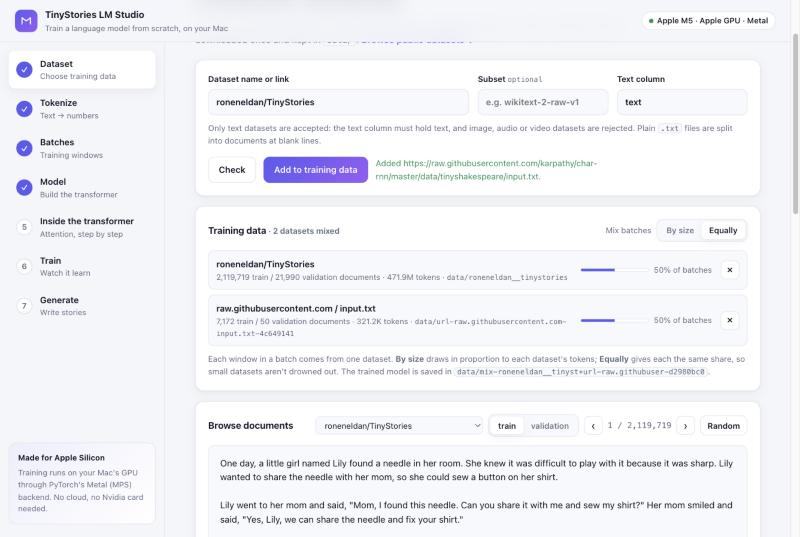 | 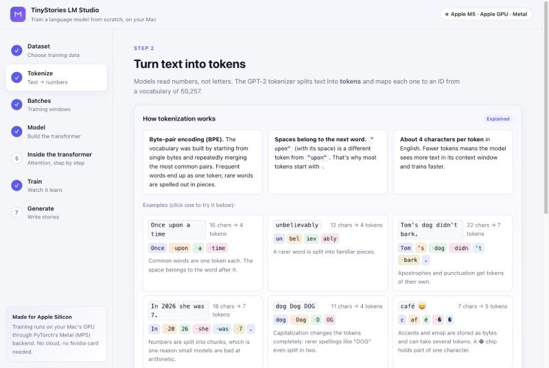 |
| **Batches: a worked example** | **Pick a model size and see its parameter count** |
| 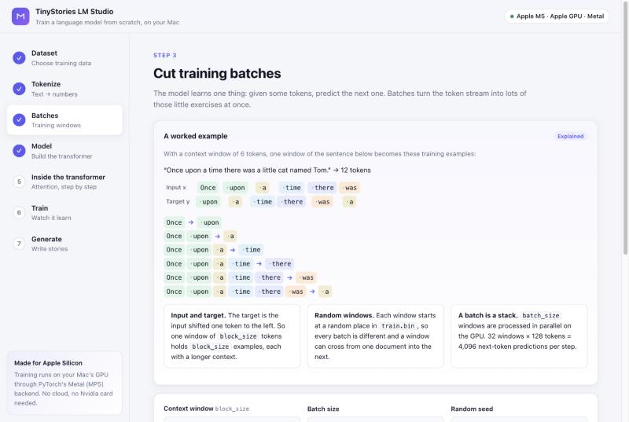 | 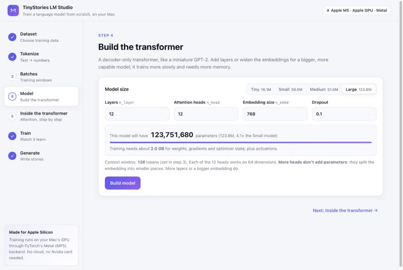 |
| **The architecture, drawn from your settings** | **How every parameter adds up** |
| 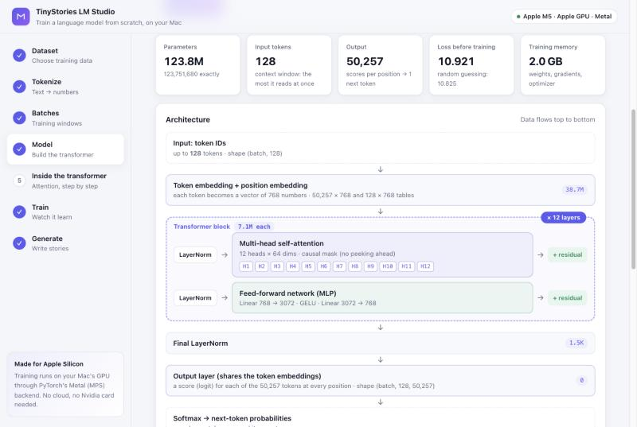 | 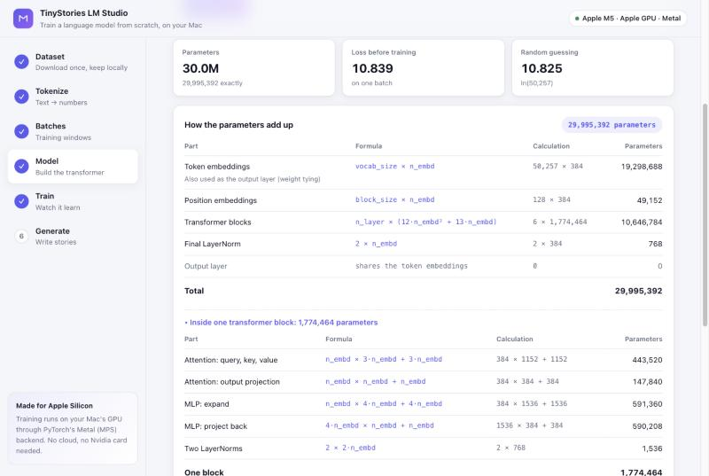 |
| **Encoder, decoder, or both?** | **Attention weights after softmax, with the real model's heatmap** |
| 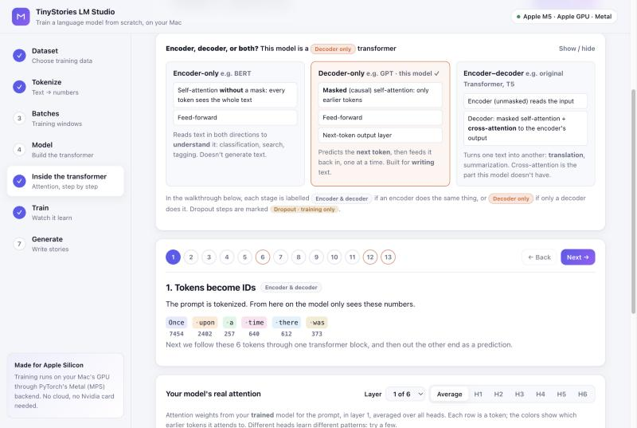 | 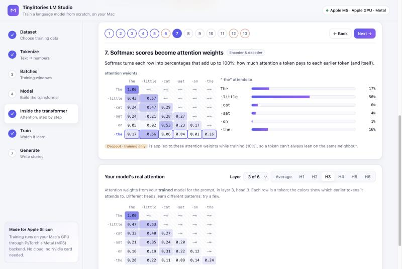 |
| **How a context vector is computed** | **Output projection, dropout and the residual connection** |
| 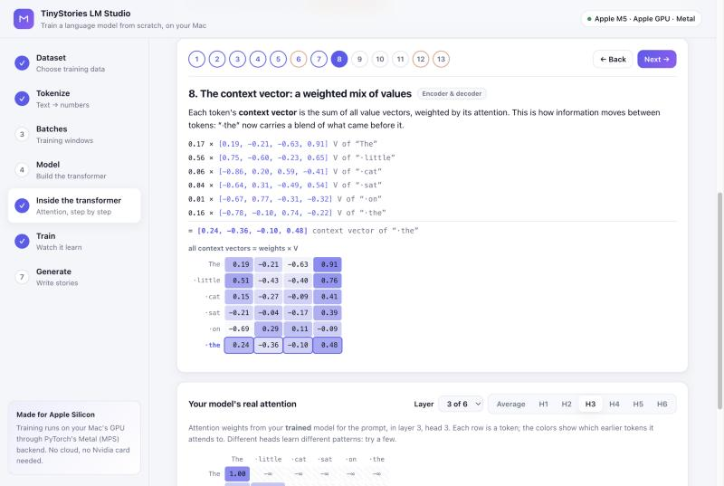 | 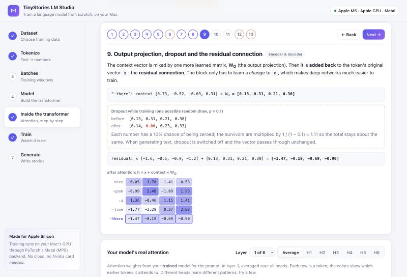 |
| **The context vector goes through LayerNorm and the feed-forward network** | **Final LayerNorm, logits and softmax pick the next token** |
| 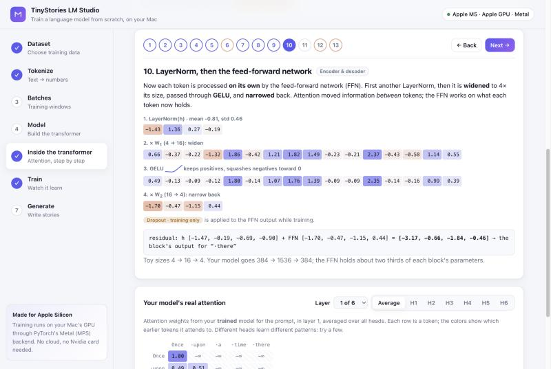 | 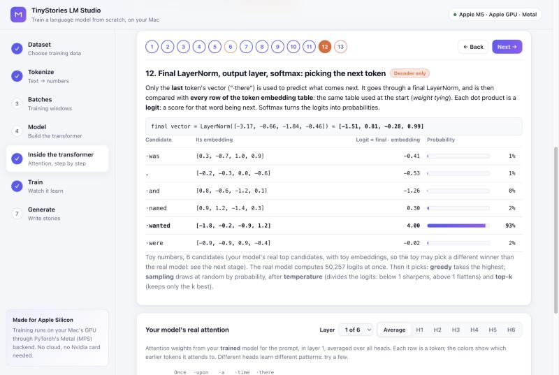 |
| **Your real model's next-token probabilities** | **Generation with inference metrics** |
| 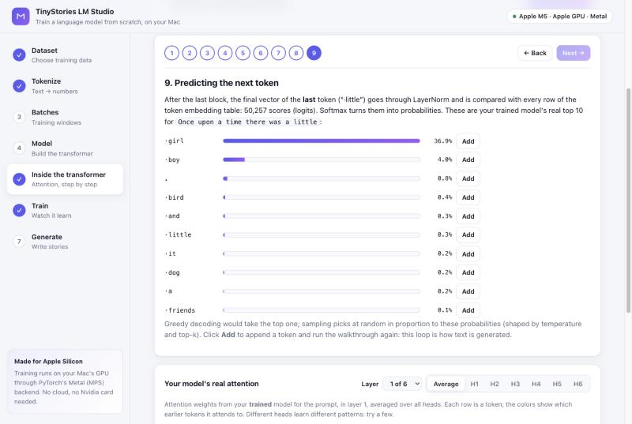 | 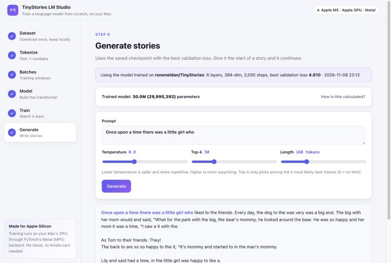 |
| **KV cache: with vs without** | |
| 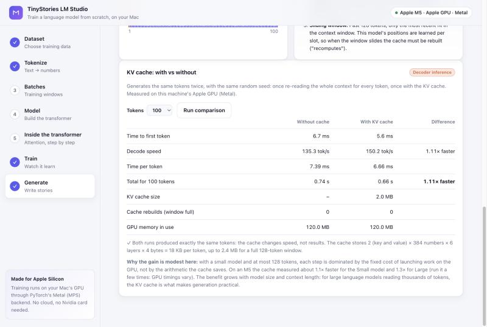 | |
| **What one training step does** | **Training on a mix: updates, parameters updated, tokens** |
| 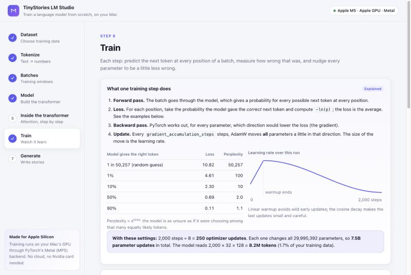 | 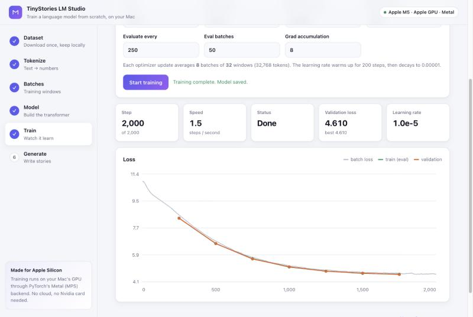 |

## Choosing datasets

TinyStories is the default, but any text dataset works, and you can **train on several at once**. A dataset
can be given as:

| Form | Example |
|---|---|
| Hugging Face name | `Salesforce/wikitext` (plus subset `wikitext-2-raw-v1`) |
| Hugging Face link | `https://huggingface.co/datasets/roneneldan/TinyStories` |
| Link to a text file | `https://raw.githubusercontent.com/karpathy/char-rnn/master/data/tinyshakespeare/input.txt` |

File links can point to `.txt`, `.jsonl`, `.json`, `.csv` or `.parquet` files. GitHub page links are
converted to the raw file automatically. Plain `.txt` files are split into documents at blank lines.

From the command line:

```bash
python3 full-model.py --dataset Salesforce/wikitext --dataset-config wikitext-2-raw-v1
python3 full-model.py --dataset https://raw.githubusercontent.com/karpathy/char-rnn/master/data/tinyshakespeare/input.txt
python3 full-model.py --list-datasets
```

| Option | Meaning | Default |
|---|---|---|
| `--dataset` | Hugging Face name or link, or a link to a text file. Repeat it to train on several | `roneneldan/TinyStories` |
| `--dataset-config` | Subset name, for datasets that have them | none |
| `--text-column` | Column holding the text | `text` |
| `--mix` | With several datasets: `size` (in proportion to their tokens) or `equal` | `size` |
| `--list-datasets` | Print the public datasets below with ready-to-run commands | |

In the web app, enter the same values in step 1. In the notebook, they're the form fields in Step 1.

### Training on several datasets

Each window in a batch is drawn from one dataset. **By size** picks datasets in proportion to their
tokens; **equally** gives each the same share, so a small dataset isn't drowned out (mixed by size, Tiny
Shakespeare would get only 0.07% of the batches next to TinyStories). In the command line, write a
dataset's subset and column as `name@subset#column`:

```bash
python3 full-model.py --mix equal \
  --dataset roneneldan/TinyStories \
  --dataset Salesforce/wikitext@wikitext-2-raw-v1 \
  --dataset https://raw.githubusercontent.com/karpathy/char-rnn/master/data/tinyshakespeare/input.txt
```

### Text-only validation

Datasets are checked before anything is downloaded, using the dataset's metadata:

- Datasets with **image, audio or video** columns are rejected.
- The chosen column must exist and hold **text** (not numbers or labels). If it doesn't, the message lists
  the text columns that do exist.
- Datasets with several **subsets** list them so you can pick one (in the web app, as clickable buttons).
- **Links** must be reachable and point to a data file, not a web page.
- After downloading, the first rows are checked to make sure they hold **readable text**.

### Public datasets that work out of the box

Each of these was checked with the validation above. The web app shows them as a gallery with **Add** and
**View** buttons.

| Dataset | What it is | Size | Use with |
|---|---|---|---|
| [Mini FineWeb-Edu](https://huggingface.co/datasets/BaoMinhTran/mini-fineweb-edu) | Educational web pages (the default, `small` subset; also `debug`, `tiny`, `base`, `full`) | 595K pages · 1.3 GB | `--dataset BaoMinhTran/mini-fineweb-edu@small` |
| [TinyStories](https://huggingface.co/datasets/roneneldan/TinyStories) | Simple short stories | 2.1M stories · 1.0 GB | `--dataset roneneldan/TinyStories` |
| [Tiny Shakespeare](https://github.com/karpathy/char-rnn/tree/master/data/tinyshakespeare) | A 1 MB selection of Shakespeare's plays | 1 text file · 1.1 MB | `--dataset https://raw.githubusercontent.com/karpathy/char-rnn/master/data/tinyshakespeare/input.txt` |
| [WikiText-2](https://huggingface.co/datasets/Salesforce/wikitext) | Good and featured Wikipedia articles | 37K lines · 7.7 MB | `--dataset Salesforce/wikitext@wikitext-2-raw-v1` |
| [WikiText-103](https://huggingface.co/datasets/Salesforce/wikitext) | Over 100M tokens of Wikipedia | 1.8M lines · 315 MB | `--dataset Salesforce/wikitext@wikitext-103-raw-v1` |
| [Simple English Wikipedia](https://huggingface.co/datasets/wikimedia/wikipedia) | Every Simple English Wikipedia article | 242K articles · 157 MB | `--dataset wikimedia/wikipedia@20231101.simple` |
| [WritingPrompts](https://huggingface.co/datasets/euclaise/writingprompts) | Stories written for Reddit writing prompts | 273K stories · 605 MB | `--dataset euclaise/writingprompts#story` |
| [TinyStories Instruct](https://huggingface.co/datasets/roneneldan/TinyStoriesInstruct) | TinyStories with instructions | 21.8M lines · 2.7 GB | `--dataset roneneldan/TinyStoriesInstruct` |
| [CNN / DailyMail](https://huggingface.co/datasets/abisee/cnn_dailymail) | News articles | 287K articles · 837 MB | `--dataset abisee/cnn_dailymail@3.0.0#article` |
| [AG News](https://huggingface.co/datasets/fancyzhx/ag_news) | News headlines and descriptions | 120K articles · 20 MB | `--dataset fancyzhx/ag_news` |
| [IMDB Reviews](https://huggingface.co/datasets/stanfordnlp/imdb) | Movie reviews | 25K reviews · 83 MB | `--dataset stanfordnlp/imdb` |
| [Rotten Tomatoes](https://huggingface.co/datasets/cornell-movie-review-data/rotten_tomatoes) | One-sentence review snippets | 8.5K sentences · 0.5 MB | `--dataset cornell-movie-review-data/rotten_tomatoes` |

Sizes are download sizes reported by Hugging Face. Find more on the
[Hugging Face datasets hub](https://huggingface.co/datasets?modality=modality:text&sort=trending).

### Where datasets are stored

Each dataset is downloaded once and kept in its own folder, with its own tokens and trained model, so
switching back and forth doesn't redo any work. A `validation`, `valid`, `val` or `test` split is used for
validation; if there isn't one, a small slice of `train` is held out.

```
data/
├── roneneldan__tinystories/
│   ├── dataset/               local copy of the downloaded dataset (~1.8 GB for TinyStories)
│   ├── train.bin              token IDs for training (~900 MB for TinyStories)
│   ├── validation.bin         token IDs for validation
│   ├── best_model_params.pt   best weights from training on this dataset
│   ├── model_config.json      model settings and training summary for those weights
│   └── runs.jsonl             history of every training run
└── mix-<datasets>-<hash>/     a model trained on several datasets (their tokens stay in their own folders)
```

`data/` is git-ignored, so none of this is committed.

## The Lab and the Journey

Two pages under **Explore** in the app's sidebar:

- **Lab**: start from a known design (GPT-2 style, Llama style, our best dense model, our best with experts,
  or a fast and lean one) or set every switch yourself, each with what it measured in this project. A live
  summary shows parameters (total and used per token), KV cache size and training memory. Pick one or more
  tokenized datasets, the number of updates and the learning rate, and train: the run uses the same recipe as
  `ab_test.py` (32 × 256-token updates, seed 42, four evaluations), then the model is evaluated and saved to the
  library with its full training record (`models/<id>/training.json`: settings, loss curves, speed).
  **Compare models** lists every model trained so far, grouped by the experiment that made it, and lines up any
  of them in one table: architecture, size and cost, quality and speed, with differences highlighted, the best
  value in each row in bold, and the validation and training curves overlaid.
  **Recommend settings for me** fills in the measured best choices for a goal (best quality, quality per compute,
  fastest generation, smallest KV cache), each marked with its reason; every decision and training setting
  (RoPE's base θ, the experts' balancing weight, warmup, final learning rate, weight decay, clipping, dropout)
  stays editable. **Train this model** asks where to train: on this Mac, or on **Google Colab** or **Kaggle**, for
  datasets not tokenized here (Mini FineWeb-Edu, for example) or for speed. A cloud run copies a *run spec*
  (every setting, plus optional comparison models) and opens `lab_run.ipynb`; paste it, run all, and import the
  zip under **Results from Colab or Kaggle**. The same spec runs anywhere with `python3 ab_test.py --spec <spec>`.
  OpenAI's **GPT-2 small** is in the library as a reference (`python3 reference_gpt2.py --fineweb` downloads it,
  prepares Mini FineWeb-Edu's held-out split and evaluates it); **Against GPT-2** in the comparison lines it up
  with every model trained on FineWeb.
- **Journey**: the best model at the top, the decisions that built it on one budget (2.631 → 2.200 after 1,000
  updates), the numbers behind the model, and a timeline of every decision (wins, ties, losses and fixes), each
  with its result, the arithmetic behind it and its cost. Filter by area, or show only what's in the best model.

## Saved models and evaluation

Training a new model on the same data used to replace the old one. Now every model you train (in the app or
with `full-model.py`) or import from Colab is also saved in a **model library**, `models/<id>/`, under its
own name, and is never overwritten. The app's **Models** step (step 8) lists them:

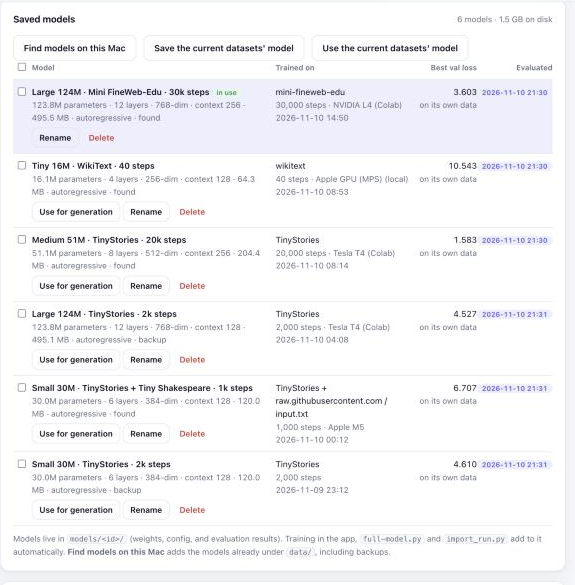

- **Use for generation** switches Generate and *Inside the transformer* to that model, whatever datasets
  are selected. A model trained on Colab can be used without downloading its dataset. The choice is remembered
  across restarts (`models/active.json`).
- **Find models on this Mac** adds the models already under `data/`, including the backups `import_run.py`
  made. **Save the current datasets' model** saves the one you're working with; training also saves the
  current model before replacing it.
- **Rename** and **Delete** (which removes only the library copy; `data/` isn't touched).

On the command line:

```bash
python3 registry.py scan        # add every model under data/ to the library
python3 registry.py list        # show the library
```

### The evaluation suite

Every model gets the **same tests**, so the numbers can be compared directly (`evaluate.py`):

1. **Held-out loss** on every tokenized dataset on this Mac: 64 fixed windows of 256 tokens from each
   validation split, the same positions for every model. Loss is the average surprise per token; perplexity
   (e<sup>loss</sup>) is roughly how many tokens the model is choosing between.
2. **Generation**: 6 fixed prompts (stories and educational text), 100 tokens each with a fixed seed,
   decoded greedy and with the Balanced preset. Measures how much greedy decoding repeats itself, the variety
   of the Balanced text, the model's confidence, speed with the KV cache and time to first token.
3. **Size**: parameters, weights in memory and KV cache per token.

Results are stored with each model (`models/<id>/eval.json`). Tick models in the Models step and press
**Evaluate selected models** (15–40 seconds each on an M5), or:

```bash
python3 evaluate.py              # evaluate every saved model that hasn't been evaluated yet
python3 evaluate.py --table      # print the comparison table
```

All six models on this Mac, evaluated on an Apple M5:

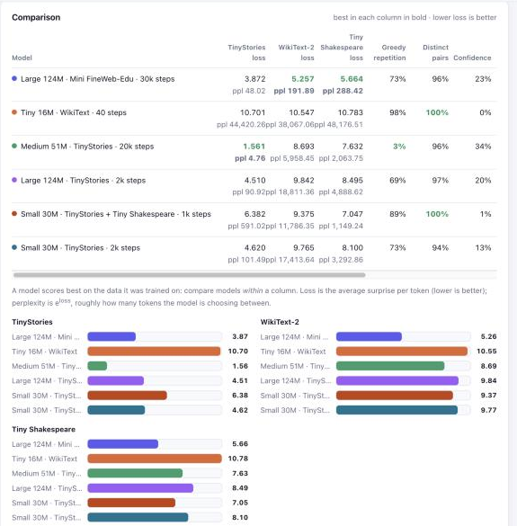

| Model | TinyStories | WikiText-2 | Tiny Shakespeare | Greedy repetition | Speed |
|---|---|---|---|---|---|
| Large 124M · Mini FineWeb-Edu · 30k steps | 3.872 | **5.257** | **5.664** | 73% | 49 tok/s |
| Medium 51M · TinyStories · 20k steps | **1.561** | 8.693 | 7.632 | **3%** | 99 tok/s |
| Large 124M · TinyStories · 2k steps (old settings) | 4.510 | 9.842 | 8.495 | 69% | 60 tok/s |
| Small 30M · TinyStories · 2k steps (old settings) | 4.620 | 9.765 | 8.100 | 73% | 97 tok/s |
| Small 30M · TinyStories + Tiny Shakespeare · 1k steps | 6.382 | 9.375 | 7.047 | 89% | 98 tok/s |
| Tiny 16M · WikiText · 40 steps (a quick test) | 10.701 | 10.547 | 10.783 | 98% | 118 tok/s |

What it shows: each model is best on the kind of text it was trained on. The TinyStories model is
excellent on stories (perplexity 4.8) and lost on Wikipedia, while the FineWeb model, trained on varied
educational text, is the best on WikiText-2 and Shakespeare, neither of which it ever saw. The well-trained
TinyStories model barely repeats itself even with greedy decoding (3%); the FineWeb model still loops
greedily (73%), which is why the Balanced preset matters for it. The undertrained models, including the
original 2,000-step runs, score far worse everywhere. (Mini FineWeb-Edu joins the held-out tests once it's
downloaded and tokenized on this Mac.)

The **Samples** card shows every model's continuation of the same prompt side by side:

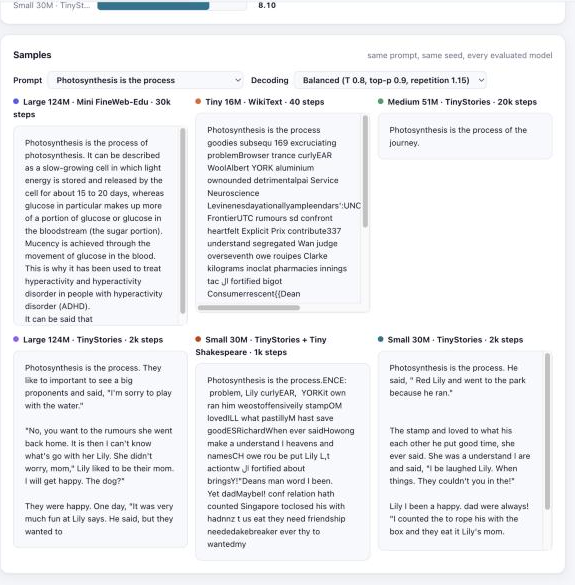

## Generating text from a trained model

The web app's Generate step does this for you. From Python:

```python
from data import dataset_paths
from inference import generate_text, load_model, load_model_config
from tokenization import get_tokenizer
from train_config import setup_device

paths = dataset_paths("roneneldan/TinyStories")          # same name (and subset) you trained on
config, info = load_model_config(paths.model_config)
dev = setup_device()
model = load_model(config, paths.checkpoint, dev.device)

print(generate_text(model, get_tokenizer(), "Once upon a time there was a dragon who",
                    dev.device, max_new_tokens=200, temperature=0.8, top_k=50))
```

- `temperature`: lower is more predictable, higher is more varied.
- `top_k`: only sample from the `k` most likely next tokens (`None` for no limit).

For a model trained on several datasets, use `mix_paths([...dataset folders...])` from `data.py` instead of
`dataset_paths`.

## Resuming and extending a run

Every evaluation saves the **full training state** next to the model, in `training_state.pt`: the latest
weights, AdamW's running averages for every parameter, the mixed-precision scaler, the step, the loss history
and the random-number state, with a small summary in `training_state.json`. A run can then carry on later:

- **Finish an interrupted run.** Continuing with the same number of steps picks up at the step where the state
  was saved, with the same weights, optimizer state and learning-rate schedule (after stopping in the app,
  closing the terminal, or a disconnected Colab session).
- **Extend a finished run.** Asking for more steps stretches the cosine learning-rate schedule to the new end.
  A finished run has decayed to the minimum learning rate, so instead of crawling on at the minimum, the
  learning rate ramps back up to the stretched curve over a short re-warmup (200 steps, or a fifth of the
  extension if that's shorter) and then decays again. Extending a 30,000-step run to 40,000, it ramps from
  6e-5 to 1.4e-4 and returns to 6e-5 at step 40,000.

Every run now also ends with a final evaluation, so the last stretch of training counts towards the best
checkpoint, and a run shorter than one evaluation interval still saves its model.

Where to continue a run:

| Where | How |
|---|---|
| Web app | **Continue training** in the Train step: shows the saved run (step, best loss, learning rate) and trains until the step you choose |
| Command line | `python3 full-model.py --resume [--max-iters N]` |
| Colab / Kaggle | Tick `resume` in Step 5. Files in `/content` disappear when a Colab session disconnects, so for long runs tick `keep_checkpoints_in_drive` to save the checkpoints and training state in Google Drive |
| Colab → Mac | Tick `include_training_state` in Step 10; `import_run.py` installs it, and the run continues on the Mac |

The training state is about three times the size of the weights (the weights plus AdamW's two running
averages), e.g. about 1.5 GB for the 124M Large model.

## Configuration

### Model size: `full-model.py`

```python
config = GPTConfig(
    vocab_size=50257,   # GPT-2 tokenizer
    block_size=256,     # context window (tokens)
    n_layer=6,          # transformer blocks
    n_head=6,           # attention heads per block
    n_embd=384,         # embedding size
    dropout=0.0,
    bias=True
)
```

### Training: `train_config.py`

| Setting | Default | Meaning |
|---|---|---|
| `max_iters` | 20000 | Training steps |
| `learning_rate` | 6e-4 | Peak learning rate |
| `min_lr` | 6e-5 | Learning rate at the end of the cosine decay |
| `warmup_steps` | 1000 | Steps of linear warmup |
| `batch_size` | 32 | Sequences per batch |
| `gradient_accumulation_steps` | 1 | Batches averaged per optimizer update (1 = update every step) |
| `eval_interval` | 1000 | Evaluate every N steps |
| `eval_iters` | 100 | Batches per evaluation |
| `weight_decay` | 0.1 | AdamW weight decay |
| `grad_clip` | 1.0 | Gradient norm clipping |

The web app's *Quick* preset uses 2,000 steps, 200 warmup, and evaluation every 250 steps over 50 batches,
with the same learning rate and no gradient accumulation. *Full* uses the defaults above. See
[Getting better stories](analysis.md#getting-better-stories) for why these settings replaced the original ones.

## Train on a cloud GPU: Google Colab or Kaggle

Everything runs on your Mac except, if you like, the training itself. The notebook
[`train_step_by_step.ipynb`](../train_step_by_step.ipynb) runs on **Google Colab** or **Kaggle**, trains on their
Nvidia GPU, and packages the result into one zip that you bring back with `import_run.py`.

On a GPU the notebook also shows:

- the GPU's name, memory and utilization (`nvidia-smi`);
- a **model size** dropdown up to **Large** (124M parameters, GPT-2 small size), which fits easily on a T4;
- training throughput (tokens per second) and **peak GPU memory** after training;
- **Step 9**: a KV cache benchmark at several lengths (tokens per second with and without the cache, cache
  size, rebuilds once the window is full, GPU memory);
- **Step 10**: everything packaged into `tinystories-run-<dataset>-<date>.zip`.

CUDA GPUs train with mixed precision: bfloat16 on GPUs with native support (compute capability 8.0+, such
as A100 and L4), float16 with a gradient scaler otherwise (such as the T4).

### Google Colab

1. Open the notebook in Colab: [Open in Colab](https://colab.research.google.com/github/a-ramakrishnan/tinystories-ARM-model/blob/main/train_step_by_step.ipynb) (also the badge at the top of the [README](../README.md)).
2. *Runtime → Change runtime type → T4 GPU* (free), or L4 / A100 with Colab Pro or compute units.
3. Run the cells from top to bottom. Step 0 clones this repository and installs the dependencies.
4. Set the run with the form fields: the dataset (Step 1), `model_size` (Step 4, e.g. `large`) and `mode`
   (Step 5: `quick` or `full`).
5. Step 10 downloads the results zip to your computer (allow the download if the browser asks). It's also
   in the Files panel.

Things to know on Colab:

- **"This notebook was not authored by Google".** Colab shows this warning for any notebook opened from
  GitHub. The notebook doesn't mount Google Drive or ask for your Google data; choose *Run anyway*.
- **Running everything except the download.** To run the whole notebook but decide later whether to download
  the zip, select the Step 10 cell and use *Runtime → Run before*. Run Step 10 when you're ready.
- **Changing code mid-session.** Step 0 runs `git pull` when the repository is already cloned. After pulling
  new code, use *Runtime → Restart session* (files in `/content` are kept) so Python loads it.
- **Precision.** GPUs with native bfloat16 (compute capability 8.0+: A100, L4) train in bfloat16. Older GPUs
  such as the T4 train in float16 with a gradient scaler: the T4 reports bfloat16 as supported, but only
  through slow emulation (1.4 s per step for the Large model, versus about 3.9 steps per second in float16).
- **Sessions.** Free Colab sessions can disconnect when idle or when usage limits are reached, and files in
  `/content` are lost when they do. On Colab Pro, GPU time uses compute units.

The numbers from a real run on a free Colab T4 are in [Analysis: Measured on a Colab T4](analysis.md#measured-on-a-colab-t4).

### Kaggle

1. On [kaggle.com](https://www.kaggle.com), *Create → New Notebook*, then *File → Import Notebook* and paste
   the link to [`train_step_by_step.ipynb`](https://github.com/a-ramakrishnan/tinystories-ARM-model/blob/main/train_step_by_step.ipynb)
   on GitHub.
2. In the side panel, *Settings → Accelerator → GPU* (T4 or P100; one GPU is used) and switch **Internet
   on**, which Kaggle only allows for phone-verified accounts.
3. Run the cells from top to bottom. The Colab form fields appear as plain variables you can edit. The code
   and data go to `/tmp`, so only the results zip is saved as the notebook's output.
4. Download the zip from the **Output** panel (`/kaggle/working`). *Save Version → Save & Run All* runs the
   whole notebook in the background, so you can close the tab.

Kaggle sessions run for up to about 12 hours, with a weekly GPU quota (around 30 hours at the time of
writing; your account page shows the current limit).

### Bring the model home

From the project folder on your Mac:

```bash
python3 import_run.py ~/Downloads/tinystories-run-roneneldan__tinystories-20261110-1430.zip
```

It puts the weights and config in `data/<dataset>/` (backing up the model already there to
`data/<dataset>/backups/`), adds the run to the training history, and keeps the loss chart, GPU metrics and
sample story in `data/<dataset>/imported/`. Start `python3 app/server.py` and the Generate and *Inside the
transformer* steps use the GPU-trained model. If that dataset isn't on your Mac yet, add it in the Dataset
step first.
